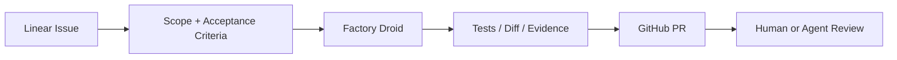

# Factory

## TL;DR

Factory is not another code autocomplete. Its core unit is the **Droid**, an execution-capable software agent that can work from desktop, terminal, SDK or cloud surfaces and can be embedded into automated SDLC workflows.

For Ginkgo, the strongest role is **software execution plane for bounded engineering tasks**, while architecture, governance and product decisions remain owned by Ginkgo processes and reviewers.

**Decision:** `HIGH-PRIORITY EXPERIMENT`.

## Why it matters

The useful distinction is:

```text
LLM chat -> suggests code
coding agent -> changes code
Factory/Droid -> can become a governed software-work executor
```

Official documentation exposes the same agent harness through CLI and SDK, including sessions, tool execution, model selection, permissions and multi-step execution. Factory also supports managed connectors such as GitHub, Linear, Notion, Slack, Sentry and Google Workspace, with MCP for custom/self-hosted tools.

## Core capabilities

- interactive and headless coding-agent execution;
- local and cloud/background agent sessions;
- TypeScript and Python SDKs;
- persistent sessions and resumable work;
- model selection and session discovery;
- MCP tools and managed third-party connectors;
- code review, QA, docs and incident-response workflows;
- skills/missions/custom Droids;
- IDE integration and Git-centered review flow.

## Ginkgo use cases

### 1. Linear -> Factory -> GitHub



Factory should execute a scoped contract, not invent roadmap scope.

### 2. Ginkgo Ops delivery

Potential tasks:

- implement one approved slice;
- repair a failing test;
- migrate a component to an existing design-system primitive;
- generate focused regression tests;
- investigate a Jam/Sentry bug with evidence;
- update docs after implementation.

### 3. Agent benchmarking

Compare Factory against Codex, Claude Code, Cursor agents and Antigravity on:

- task completion rate;
- test pass rate;
- review burden;
- unauthorized scope expansion;
- token/cost efficiency;
- time to accepted PR;
- ability to follow repository invariants.

## Architecture fit

Factory should remain **outside Ginkgo Runtime's business-execution contract** unless a future capability explicitly requires software engineering as a product capability.

Recommended boundary:

```text
Product/Architecture decision
        ↓
Executable engineering task
        ↓
Software-agent adapter
        ↓
Factory | Codex | Claude Code | other
        ↓
Git diff + tests + evidence
```

The canonical artifact is the repository change and evidence, not the Factory session.

## Integration surface

| Surface | Status | Ginkgo relevance |
|---|---|---|
| CLI | Verified | local execution and CI/headless workflows |
| TypeScript SDK | Verified | programmatic agent orchestration |
| Python SDK | Verified | automation and evaluation harnesses |
| MCP | Verified | custom/self-hosted tool access |
| Managed connectors | Verified | GitHub, Linear, Notion, Slack, Sentry, Google Workspace |
| REST/platform API | Present in platform docs | verify exact production contract before adapter work |

## Build vs Buy vs Reference

**Recommendation:** buy/experiment, do not rebuild.

Ginkgo should own:

- task contract;
- repository invariants;
- approvals;
- evidence requirements;
- provider-neutral evaluation.

Factory may own:

- coding-agent harness;
- session/tool execution;
- model orchestration inside its product;
- agent UX.

## Risks

### Security
A coding agent may receive shell, repo and connector access. Treat permissions as production-grade privileged automation.

Controls required:

- least privilege;
- no production secrets in developer context;
- branch protection;
- mandatory tests;
- scoped credentials;
- approval gates for destructive actions;
- auditable diffs and evidence.

### Vendor lock-in
Do not encode Ginkgo engineering workflow around Factory-specific session identifiers. Persist normalized task, result and evidence objects.

### Cost
Official Pro pricing verified at USD 20/month on 2026-09-03. Third-party annual offers far below official pricing should be treated as commercial-risk experiments, not production entitlement.

## Alternatives

- Codex: strong OpenAI-native coding-agent path;
- Claude Code: strong repository reasoning and agentic development;
- Cursor: IDE-centered agent workflow;
- Antigravity/Gemini tooling: architecture and implementation workflows in Google's ecosystem.

## Ginkgo destination

```text
Role: external software-agent provider
Owner: ginkgo-agents / engineering toolchain
Consumers: Ginkgo Ops, Runtime, Library and other repos during development
Promotion gate: benchmark + security review + provider-neutral adapter decision
```

## Verification notes

Verified from official Factory site/docs on 2026-09-03: Pro/Plus/Max plans, desktop/CLI/SDK surfaces, local/cloud background agents, TypeScript/Python SDKs, MCP and managed connectors.

## Decision

```text
CURATED -> BENCHMARK NOW -> PROMOTE ONLY IF IT REDUCES ACCEPTED-PR COST/REVIEW BURDEN
```
