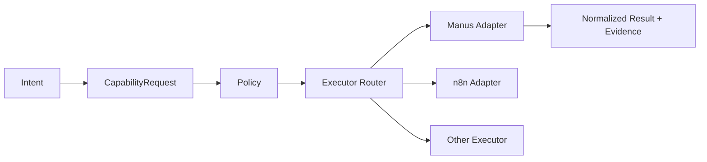

# Manus

## TL;DR

Manus is a hosted autonomous-agent platform capable of multi-step tasks, tool use, research, files and artifact generation. API v2 exposes tasks, projects, files, webhooks, skills and agents programmatically. Manus Agents can also surface through Telegram and WhatsApp Business.

For Ginkgo, Manus matters in two roles:

1. **benchmark competitor/reference** for AI Employees and Runtime UX;
2. **optional external executor/provider** for tasks where its full hosted agent stack is economically superior to building the path internally.

**Decision:** `BENCHMARK AGGRESSIVELY; INTEGRATE ONLY BEHIND PROVIDER BOUNDARY`.

## Why it matters

Manus demonstrates a commercial pattern close to Ginkgo's direction:

```text
user goal -> persistent agent -> tools -> multi-step execution -> files/results -> messaging surface
```

The lesson is not “replace Ginkgo Runtime with Manus.” The lesson is to benchmark which parts users value enough to pay for and where a hosted external agent can be delegated work safely.

## Core capabilities

- create/manage autonomous tasks through REST API;
- multi-turn task continuation;
- custom agents with persistent main task/thread;
- projects with shared instructions;
- file uploads and attachments;
- webhooks for lifecycle events;
- built-in/custom skills;
- web/browser research and task execution;
- structured/artifact outputs;
- Telegram agent surface;
- WhatsApp Business agent surface.

## Ginkgo use cases

### 1. AI Employee benchmark

Compare Manus against Callima/Ginkgo Runtime on:

- delegation UX;
- tool transparency;
- progress/status representation;
- artifact delivery;
- follow-up/context continuation;
- messaging-channel behavior;
- human confirmation points;
- failure recovery.

### 2. External executor behind Runtime

Possible future contract:



Runtime owns the capability contract. Manus is never source of truth for business entities.

### 3. Research-heavy jobs

Potential delegated workloads:

- broad market research;
- document synthesis;
- file/report generation;
- bounded web workflows;
- non-critical operational tasks with human review.

### 4. Messaging benchmark

Official Manus docs show the same agent engine exposed in Telegram/WhatsApp Business. This is useful reference material for Ginkgo's channel-agnostic AI Employee design.

## Architecture fit

Hard boundary:

```text
Ginkgo Runtime != Manus
Ginkgo AI Employee != Manus Agent identity
```

If used, persist:

- Ginkgo request ID;
- external Manus task/agent ID as provider binding;
- normalized status;
- normalized result;
- evidence/artifact references;
- cost/usage metadata.

The business identity survives provider replacement.

## Integration surface

| Surface | Status | Notes |
|---|---|---|
| REST API v2 | Verified | latest documented API; v1 deprecated |
| Tasks/projects/files | Verified | programmatic lifecycle |
| Webhooks | Verified | real-time task notifications |
| Custom agents | Verified | agent identity + persistent main task |
| Telegram | Verified | messaging agent surface |
| WhatsApp Business | Verified | messaging agent surface |
| Skills | Verified | extensibility surface |

## Important constraint

Official help documentation currently states that only **one messaging Agent connection can be active per Manus workspace at a time** across Telegram/WhatsApp Business. Do not assume a workspace can simultaneously operate both messaging bindings.

## Security / privacy

High-risk because the platform may receive prompts, files, browser context and business data.

Required controls before integration:

- scoped provider credentials;
- task-level data classification;
- explicit allowlist of capabilities sent to Manus;
- human approvals for irreversible actions;
- no direct canonical DB writes without Ginkgo policy layer;
- artifact ingestion scanning/validation;
- cost limits and timeout handling;
- retention/terms review.

## Build vs Buy vs Reference

**Recommendation:** all three, with boundaries.

- **Reference:** benchmark product/agent UX.
- **Buy:** use for selected high-leverage hosted tasks if economics win.
- **Build:** retain Ginkgo's own capability bus, policy, evidence, tenancy and product identity.

## Alternatives

- OpenAI/Agents SDK/Codex ecosystems;
- Claude agentic workflows;
- custom n8n + models + Ginkgo Runtime;
- Gemini/Google agent tooling.

## Ginkgo destination

```text
Role: benchmark + optional external agent executor
Owner: ginkgo-agents
Consumers: Runtime evaluation, Ginkgo Ops AI Employees, research workflows
Promotion gate: normalized adapter + security/cost benchmark
```

## Verification notes

Verified from official Manus API v2 and help documentation on 2026-09-03. API v1 is deprecated. Telegram and WhatsApp Business agent surfaces are documented, with one active messaging connection per workspace currently documented.

## Decision

```text
CURATED -> BENCHMARK -> OPTIONAL PROVIDER ADAPTER; NEVER SUBSTITUTE GINKGO CONTROL PLANE
```
