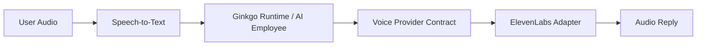

# ElevenLabs

## TL;DR

ElevenLabs is a mature hosted voice layer covering TTS, STT, voice cloning and speech-to-speech through APIs suitable for real-time and generated-media workflows.

For Ginkgo, it is a strong provider for **Callima voice, AI Employee audio, media generation and telephony-oriented speech**, but should sit behind a provider-neutral voice contract.

**Decision:** `CRITICAL PROVIDER CANDIDATE; ADOPT BEHIND AUDIO/VOICE ABSTRACTION`.

## Why it matters

Voice touches multiple Ginkgo products:

```text
WhatsApp voice note -> STT -> AI Employee -> TTS -> reply
Video script -> TTS -> avatar/video pipeline
Call/telephony -> low-latency TTS/STT
Creator identity -> approved voice binding
```

A shared voice provider abstraction avoids every product integrating ElevenLabs independently.

## Core capabilities

- multilingual text-to-speech;
- low-latency streaming speech;
- speech-to-text;
- instant voice cloning;
- professional voice cloning;
- speech-to-speech/voice conversion;
- API and SDK access;
- MCP-compatible TTS workflows;
- telephony-friendly output formats including μ-law/A-law.

## Ginkgo use cases

### 1. Callima / AI Employee voice



### 2. Pyre / video factory

Script -> voice render -> video/avatar/lipsync pipeline.

### 3. Creator/brand voices

Canonical identity must remain Ginkgo-owned:

```text
voice_identity
  ├─ consent/provenance
  ├─ allowed uses
  ├─ brand/person binding
  └─ provider_bindings
      └─ elevenlabs_voice_id
```

Provider voice IDs must never become the business identity.

### 4. Telephony

Official docs expose output formats optimized for telephony. This makes ElevenLabs relevant to future voice-call AI Employee channels.

## Architecture fit

Recommended contract:

```text
VoiceRequest
  mode: tts | stt | speech-to-speech
  language
  voice_binding
  latency_profile
  output_format
     ↓
Voice Router
     ↓
ElevenLabs | local/Kokoro | other provider
```

Route by quality, latency, consent, cost and availability.

## Integration surface

| Surface | Status | Notes |
|---|---|---|
| REST API | Verified | TTS/STT/voice operations |
| SDKs | Verified | official developer quickstarts |
| MCP | Verified for TTS workflows | hosted MCP referenced in capability docs |
| Streaming | Verified | real-time speech use cases |
| Voice cloning | Verified | Instant and Professional cloning paths |
| Speech-to-speech | Verified | preserves timing/emotion while converting voice |

## Pricing note

Official API pricing on 2026-09-03 lists Creator at USD 22/month, alongside Starter/Pro/Scale/Business tiers. Usage economics depend on model and volume; do not model annual third-party entitlements as equivalent to official account ownership.

## Security / consent

Voice identity is biometric-like/high-sensitivity media and requires stricter governance than generic TTS.

Required controls:

- explicit authorization for cloning real people;
- provenance and permitted-use metadata;
- provider credentials in secret manager;
- tenant isolation of voice IDs/bindings;
- prevent cross-client voice reuse;
- retention review for source recordings;
- audit generation requests for branded/identity-bound voices;
- fallback to generic approved voices where consent is absent.

## Build vs Buy vs Reference

**Recommendation:** hybrid.

Use ElevenLabs where quality/latency wins, while maintaining local/alternative providers such as Kokoro or other TTS/STT engines for cost, privacy and resilience.

## Alternatives

- Kokoro/local TTS: control and lower marginal cost;
- OpenAI/audio models: unified API ecosystem;
- cloud speech providers;
- specialized telephony voice engines.

## Ginkgo destination

```text
Role: voice/audio provider
Owner: shared voice contract; creative ownership currently maps to ginkgo-pyre
Consumers: Callima, Runtime, Ginkgo Ops, Pyre, avatar/live pipelines
Promotion gate: provider-neutral contract + consent model + cost/latency benchmark
```

## Verification notes

Verified from official ElevenLabs docs and pricing on 2026-09-03: TTS, STT, voice cloning, speech-to-speech, API/SDK surfaces, MCP mention and telephony-friendly output formats.

## Decision

```text
CURATED -> BENCHMARK -> PROMOTE BEHIND PROVIDER-NEUTRAL VOICE CONTRACT
```
