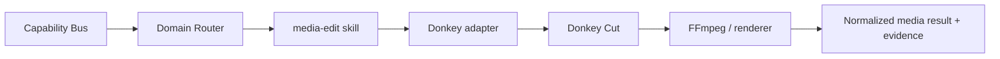

# Donkey Cut

## TL;DR

Donkey Cut is the strongest candidate currently identified for the **agentic editing / timeline** layer of the Ginkgo media stack. Its key idea is more valuable than the UI itself: editor actions are represented as tools that an AI assistant can invoke against the same project state the human sees.

## Why it matters

Donkey Cut combines a traditional multi-track editor with AI-assisted editing, captions, audio, effects, generation and export. Its architecture supports browser-local projects, cloud projects, and a Mac-local engine with bundled FFmpeg and on-device speech processing.

The upstream tool catalog exposes editor, preview, timeline, inspector, effects, transitions, subtitles, audio, image/video generation, library and other editing surfaces to AI providers through a tool/MCP-oriented layer.

That makes Donkey useful as a reference implementation for a Ginkgo invariant:

> Human editing and agent editing should mutate the same canonical project model through governed tools.

## Canonical Ginkgo role



Rules:

- Donkey Cut is never called directly by Pyre, Sylvia, n8n or another caller;
- callers request semantic capabilities such as `media.timeline.edit` or `media.render.export`;
- the Domain Router selects an eligible editing implementation internally;
- Donkey's own model/provider integrations are not automatically inherited as Ginkgo production routes;
- credentials and user sessions are never exposed through the public capability contract.

## Relationship with HeliosGen

HeliosGen is a generation workflow surface. Donkey Cut is an editing/composition surface.

```text
HeliosGen / other generator -> image/video/audio assets -> Donkey Cut -> edited timeline -> export
```

The sequential composition belongs to a higher-level Skill Atlas workflow. HeliosGen must not hard-code Donkey and Donkey must not hard-code HeliosGen.

## Relationship with ComfyUI

ComfyUI can generate specialized/local GPU assets. Donkey can consume those normalized assets for timeline work. This enables local creative workflows without turning ComfyUI into an editor.

## Candidate capability surface

```text
media.project.create
media.media.import
media.timeline.read
media.timeline.edit
media.clip.add
media.clip.trim
media.clip.split
media.clip.reframe
media.caption.transcribe
media.caption.style
media.audio.mix
media.effect.apply
media.transition.apply
media.color.grade
media.render.preview
media.render.export
```

These names are Ginkgo semantic capabilities, not a claim that upstream Donkey currently exposes an identical public API for every item.

## Promotion gate

Current Ginkgo status: **curated / experimental**.

Before runtime promotion:

1. run the browser editor locally;
2. validate import -> timeline edit -> export with a fixed fixture;
3. test at least one agent-issued edit tool against deterministic project state;
4. document adapter mapping from Ginkgo capability to Donkey action/tool;
5. verify project storage boundaries and auth behavior;
6. verify headless/server rendering path for Linux deployment or explicitly constrain the adapter to supported execution environments;
7. record evidence, latency and failure normalization.

No production execution is authorized by this record.
