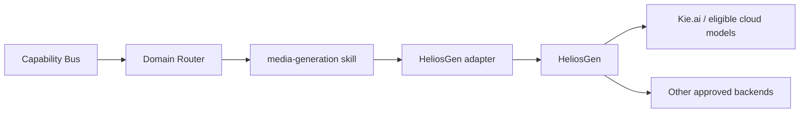

# HeliosGen

## TL;DR

HeliosGen is a visual, node-based AI media workflow builder. In Ginkgo it should be treated as a **generation workflow provider / UI**, not as the canonical router and not as a replacement for ComfyUI.

## Why it matters

HeliosGen provides a much simpler surface for chaining prompts, reference images, image models and video models than a low-level GPU workflow system. Its current architecture is Next.js/React/TypeScript with XYFlow, Zustand, Supabase and Cloudflare R2, while generation is primarily routed through Kie.ai.

Its main Ginkgo value is therefore UX + multi-provider generation composition.

## Supported upstream shape verified on 2026-08-29

The upstream README lists image generation via GPT Image 2, Nano Banana variants, Seedream, Z-Image and Grok Imagine, plus video generation via Veo, Kling, Seedance, Grok and other providers. It supports reusable node workflows, parallel/sequential execution, reference images, history, per-user API keys and self-hosting.

The project also documents an optional Codex CLI path for GPT Image 2 in self-hosted/single-user scenarios.

## Canonical Ginkgo role



Rules:

- callers never select HeliosGen;
- HeliosGen is an internal adapter/provider candidate;
- provider eligibility remains an internal Domain Router / Policy decision;
- no implicit HeliosGen -> ComfyUI fallback;
- fallback, if ever enabled, must be explicit `same_semantics_only` and use independently eligible routes;
- credentials stay in the runtime secret layer, never in workflow definitions committed to Git.

## Relationship with ComfyUI

Use HeliosGen when:

- a user-facing visual workflow is valuable;
- models are consumed through hosted APIs;
- the workflow should be easy for non-technical users to understand;
- generation must span multiple external model families.

Use ComfyUI when:

- local GPU execution is required;
- custom nodes/model graphs are required;
- precise low-level diffusion/video control matters;
- a reproducible pinned local workflow is more important than UX simplicity.

They are complementary provider surfaces, not parent/child runtimes.

## Relationship with Donkey Cut

HeliosGen creates or transforms **assets**. Donkey Cut edits **timeline compositions**. A higher-level media skill may use both sequentially, but neither may call the other directly as architectural authority.

```text
media assets -> generation provider -> normalized assets -> edit provider -> final render
```

## Promotion gate

Current Ginkgo status: **curated / experimental**.

Before runtime promotion:

1. run locally with a Ginkgo-owned test key/account;
2. verify callback/auth and secret handling;
3. validate one image and one video job end-to-end;
4. capture normalized request/result/error contracts;
5. measure cost, latency and failure behavior;
6. security-review public workflow sharing and user API key storage;
7. bind only the proven capabilities behind the Capability Bus.

No production route is implied by this record.
