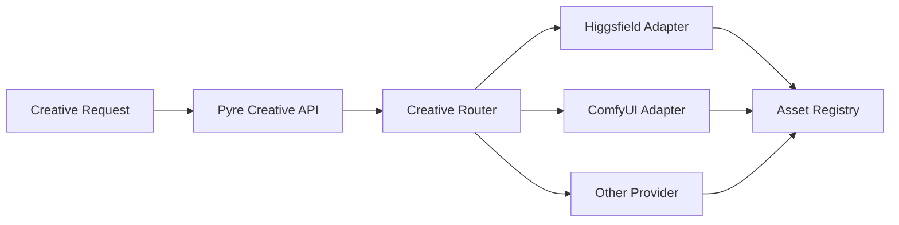
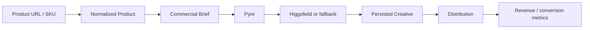

# Higgsfield

## TL;DR

Higgsfield is useful to Ginkgo primarily as a **hosted media provider behind Pyre**, not as a platform that downstream products should call directly.

Its strongest fit is rapid commercial media generation: vertical social video, UGC/product creatives, motion/camera-directed content and persistent creator identity bindings.

**Decision:** `EXPERIMENT / PROMOTION CANDIDATE` through `Ginkgo-Seeds/ginkgo-pyre`.

## Why it matters

The value is not merely image/video generation. For Ginkgo the useful pattern is:

```text
one creative capability
  ↓
provider-neutral Pyre contract
  ↓
Higgsfield / ComfyUI / another provider
```

This allows products to request outcomes such as `product-ad`, `ugc-video` or `social-video` without coupling their business logic to a particular media vendor.

## Core capabilities

- hosted generative image/video workflows;
- product/ad-oriented generation workflows;
- UGC-style commercial media;
- motion/camera control surfaces;
- persistent identity/character workflows;
- MCP-based agent integration surface;
- access to multiple underlying generative model families through one platform surface.

Provider/model availability is volatile and should be treated as configuration, not hard-coded architectural truth.

## Ginkgo use cases

### Pyre — Creative Engine provider

Canonical integration target.



Pyre owns the contract, asset metadata and provider routing.

### Commerce OS — product to creative



Commerce OS should never contain Higgsfield-specific business logic.

### Wave — creative performance feedback

Wave can correlate provider/model/generation cost with CTR, CPA and ROAS while still treating the asset as a Pyre `creativeAssetId`.

### Scale Group — creator identities

Persistent provider identities should be represented as bindings of a Ginkgo-owned creator record:

```text
creator_identity
  ├── canonical Ginkgo references
  ├── brand/visual rules
  ├── provenance/consent metadata
  └── provider_bindings
       └── higgsfield: <provider-id>
```

The business identity survives provider replacement.

## Integration surface

| Surface | Status | Notes |
|---|---|---|
| MCP | Yes | Primary verified agent-oriented integration surface in current research |
| REST API | Unknown/verify before implementation | Do not design core contracts around an assumed public REST surface |
| Self-host | No | Hosted provider |
| Docker | No | Not a Ginkgo-controlled runtime |

## Build vs Buy vs Reference

**Recommended:** `hybrid`.

Use Higgsfield for rapid hosted generation where its quality/workflows win, while keeping:

- Pyre as internal contract;
- Ginkgo-controlled asset storage;
- ComfyUI as deep/customizable alternative;
- at least one additional provider path for resilience.

## Operational profile

Advantages:

- low infrastructure burden;
- useful commercial-generation primitives;
- agent-callable surface;
- fast access to multiple media capabilities.

Trade-offs:

- output leaves Ginkgo infrastructure;
- credit/provider pricing can change;
- provider/model availability can change;
- hosted identity records can create lock-in if made canonical;
- asynchronous generation requires job lifecycle handling.

## Security / privacy / licensing

Before production use:

- review current platform terms and data policy;
- classify uploaded/reference media;
- avoid sending sensitive client material without appropriate contractual basis;
- never store provider credentials in n8n workflow JSON or prompts;
- persist generated canonical assets into Ginkgo-controlled storage;
- retain provider/job/cost metadata for auditability.

## Alternatives

| Alternative | Better when | Worse when |
|---|---|---|
| ComfyUI | custom workflows, LoRAs, local/self-host control, reproducibility | higher operational burden |
| fal.ai / similar media APIs | API-first composition and model-level control | may require more provider-specific orchestration |
| direct model APIs | exact model control | multiplies integrations and vendor-specific contracts |

## Ginkgo destination

```text
Canonical owner: ginkgo-pyre
Promotion target: Ginkgo-Seeds/ginkgo-pyre
Consumers: Commerce OS, Wave, Scale Group, social/content workflows
```

Existing architecture work should treat Higgsfield as one `CreativeProvider` implementation.

## Sources and provenance

### Canonical sources

- https://higgsfield.ai
- https://higgsfield.ai/mcp
- https://higgsfield.ai/marketing-studio-intro

### Discovery source

Initial discovery/refinement came from the Felipe Tambara AI-tools resource collection reviewed on 2026-08-17.

## Verification notes

Verified on 2026-08-17 at architectural level: hosted platform, MCP relevance, commercial media/marketing use and persistent-identity concepts.

Before implementation, re-check:

- current MCP tool schema;
- authentication;
- pricing/credits;
- exact model inventory;
- async completion mechanics;
- terms/data retention.

## Decision

```text
EXPERIMENT -> PROMOTE THROUGH PYRE IF BENCHMARK PASSES
```
