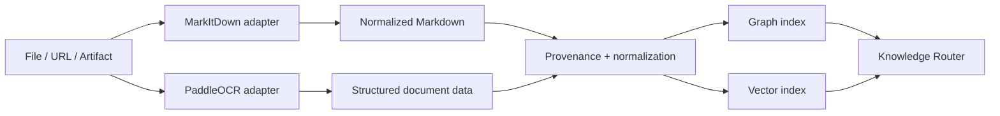
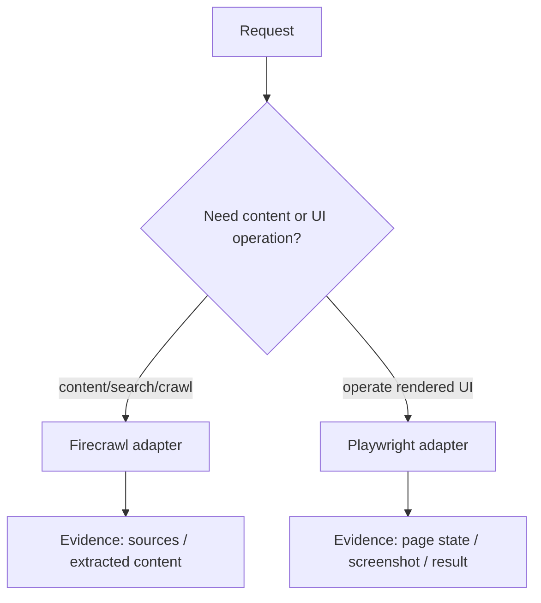

# Agentic Foundation Repository Atlas

Curated: 2026-08-20

Purpose: classify external repositories as Ginkgo architectural inputs without confusing popularity, source code availability or feature richness with runtime eligibility.

## Taxonomy

Every entry is classified as one or more of:

- **PATTERN SOURCE** — methodology or implementation ideas to re-express in Ginkgo contracts.
- **PROVIDER CANDIDATE** — external/local implementation that may sit behind a Ginkgo adapter.
- **TOOL CANDIDATE** — execution primitive, not a public capability.
- **EXECUTOR CANDIDATE** — runtime that may execute tasks behind Executor Router.
- **BENCHMARK** — compare against Ginkgo; do not adopt by default.
- **DISCOVERY SOURCE** — catalog used to find candidate integrations.
- **KNOWLEDGE SOURCE** — reference material only.
- **OPERATOR SURFACE** — UI/AgentOps reference, not Capability Bus replacement.

A source is never automatically promoted to `VALIDATED`, `INTEGRATED` or `PRODUCTION`.

## Priority atlas

| Priority | Repository | Classification | Ginkgo use | Adoption posture |
|---|---|---|---|---|
| P0 | `affaan-m/ECC` | PATTERN SOURCE | engineering harness, skills, research-first development, security/memory patterns | extract patterns; no direct provider binding |
| P0 | `Graphify-Labs/graphify` | PROVIDER CANDIDATE | explainable knowledge graph build/query/path over code/docs/media | prototype behind `graphify-adapter` |
| P0 | `punkpeye/awesome-mcp-servers` | DISCOVERY SOURCE | discover MCP integrations | catalog input only; never auto-install |
| P0 | `firecrawl/firecrawl` | PROVIDER CANDIDATE | web search/extract/crawl/map/batch collection | prototype behind `firecrawl-adapter` |
| P0 | `microsoft/playwright` | TOOL CANDIDATE | browser navigation and bounded UI operation | preferred browser-operation primitive |
| P0 | `earendil-works/pi` | EXECUTOR CANDIDATE | agent harness/runtime evaluation | sandbox evaluation only before eligibility |
| P0 | `thedotmack/claude-mem` | PATTERN SOURCE | observation capture, compression, progressive memory retrieval | extract architecture; remain provider-agnostic |
| P0 | `PaddlePaddle/PaddleOCR` | PROVIDER CANDIDATE | OCR, layout, tables, formulas, structured document parsing | prototype as local document provider |
| P0 | `microsoft/markitdown` | PROVIDER CANDIDATE | normalize heterogeneous files into LLM-ready Markdown | prototype as local converter |
| P0 | `garrytan/gstack` | PATTERN SOURCE | engineering lifecycle and specialist skill patterns | mine methodology into Ginkgo engineering suite |
| P1 | `open-webui/open-webui` | OPERATOR SURFACE / BENCHMARK | self-hosted AI console, RBAC, RAG, tools, automation | benchmark console; do not replace core contracts |
| P1 | `farion1231/cc-switch` | PATTERN SOURCE | workstation AgentOps/config switching | derive workstation management feature ideas |
| P1 | `koala73/worldmonitor` | PROVIDER CANDIDATE | attributed geopolitical/finance/infrastructure intelligence | adapter evaluation; license/provenance review required |
| P1 | `lobehub/lobehub` | OPERATOR SURFACE / BENCHMARK | multi-agent operations UX | mine operator UX, scheduling/reporting patterns |
| P1 | `public-apis/public-apis` | DISCOVERY SOURCE | discover public APIs | metadata feed only |
| P1 | `puppeteer/puppeteer` | TOOL CANDIDATE | browser automation alternative | reference/alternate adapter, not silent fallback |
| P1 | `microsoft/semantic-kernel` | KNOWLEDGE SOURCE | historical agent orchestration patterns | no new dependency; evaluate Microsoft Agent Framework successor instead |
| P1 | `infiniflow/ragflow` | BENCHMARK | context engine, RAG, ingestion, citations, agents | benchmark against Knowledge Plane |
| P1 | `langflow-ai/langflow` | BENCHMARK | visual agents/workflows, API/MCP publication | lab/reference; overlaps n8n execution role |
| P1 | `langgenius/dify` | BENCHMARK | LLM app platform, RAG, agents, observability | benchmark platform; avoid architecture-inside-architecture coupling |
| P2 | `gin-gonic/gin` | KNOWLEDGE SOURCE | Go HTTP implementation reference | library only unless a Go service explicitly needs it |
| P2 | `fighting41love/funNLP` | KNOWLEDGE SOURCE | NLP resources/data/tools | research/reference only |
| P2 | `0xAX/linux-insides` | KNOWLEDGE SOURCE | Linux internals | engineering library |
| P2 | `langchain-ai/langchain` | BENCHMARK / KNOWLEDGE SOURCE | agent/RAG patterns | reference; not Ginkgo core abstraction |
| P2 | `datawhalechina/hello-agents` | KNOWLEDGE SOURCE | agent education | learning/reference |
| P2 | `dair-ai/Prompt-Engineering-Guide` | KNOWLEDGE SOURCE | prompt design patterns | library/reference |
| P2 | `vinta/awesome-python` | DISCOVERY SOURCE | Python ecosystem discovery | catalog only |
| P2 | `trimstray/the-book-of-secret-knowledge` | KNOWLEDGE SOURCE | ops/security commands and references | human/agent reference; commands require validation |
| P2 | `x1xhlol/system-prompts-and-models-of-ai-tools` | RESEARCH SOURCE | study external prompt/system behaviors | research only; provenance/legal/security caution |

## Canonical compositions

### 1. Knowledge ingestion



Recommended public capabilities:

- `knowledge.document.convert`
- `document.ocr`
- `document.structure.extract`
- `knowledge.graph.build`
- `knowledge.graph.query`
- `knowledge.graph.path`

Graph retrieval and vector retrieval are complementary. Similarity search answers “what is semantically close?”; graph traversal answers “how are these entities connected?”

### 2. Web operations



Do not silently substitute browser automation for web extraction or vice versa. Same-semantics fallback only.

### 3. Engineering agents

ECC and gstack contribute methodology, not provider identity.

Target Ginkgo capability family:

```text
engineering.plan
engineering.architecture.review
engineering.code.review
engineering.security.audit
engineering.qa
engineering.investigate
engineering.release.validate
engineering.retro
engineering.freeze
engineering.devex.review
```

Public capability names remain stable even if execution moves between Codex, Claude Code, OpenCode, Hermes, OpenClaw or a future executor.

### 4. Memory continuity

Pattern distilled from persistent agent-memory projects:

```text
event
-> observation
-> compression
-> candidate memory
-> policy/promotion
-> durable memory
-> scoped retrieval
-> bounded context injection
-> forget/invalidation
```

Required concepts: tenant scope, identity scope, project scope, provenance, sensitivity, retention, promotion state and first-class deletion.

### 5. Global intelligence

World Monitor should be consumed as an attributed external intelligence source through an adapter, not copied into the core.

Candidate public capabilities:

- `intelligence.events.search`
- `intelligence.country.risk.read`
- `intelligence.geopolitics.read`
- `intelligence.market.risk.read`
- `intelligence.infrastructure.read`
- `intelligence.energy.read`

All results require provenance and freshness metadata.

## Operator-console benchmark

The operator/UI products serve a different architectural role from the Capability Plane.

| Surface | What to learn | What not to copy blindly |
|---|---|---|
| Open WebUI | RBAC, multi-model UI, tools, RAG, shared channels, self-hosted operator ergonomics | do not make UI plugin model the canonical Ginkgo contract |
| LobeHub | “agents as unit of work”, scheduling/reporting, team-agent UX | do not equate agent identity with capability identity |
| Dify | integrated product workflow, model management, RAG, observability | avoid replacing Ginkgo planes with one monolithic platform |
| Langflow | rapid visual authoring, publish flows as API/MCP | avoid duplicating n8n as a second mandatory executor plane |

## Executor evaluation: Pi

Pi is interesting because it separates agent runtime, coding agent, multi-provider API and telemetry. However, executor adoption requires hard boundaries around filesystem, process, network and credentials.

Evaluation gates:

1. sandbox/container isolation;
2. credential boundary;
3. bounded filesystem mounts;
4. network allowlist/denylist behavior;
5. telemetry/evidence hooks;
6. cancellation and timeout;
7. deterministic task envelope;
8. no bypass of TaskOps/Executor Router.

Until those gates are proven, classify Pi as `EXECUTOR_CANDIDATE`, not production executor.

## Discovery ingestion policy

Awesome lists and public API catalogs can feed Library discovery, but must never directly affect production routing.

```text
external catalog
-> candidate metadata
-> deduplication
-> provenance
-> license/security review
-> architectural classification
-> FEATURE
-> prototype/validation
-> possible Atlas registration
```

Explicitly forbidden:

- auto-install from catalog;
- auto-request secrets;
- auto-enable an MCP server;
- auto-promote provider eligibility;
- auto-route production traffic.

## Research-source cautions

Prompt dumps, command collections and broad awesome lists may contain stale, unsafe, mislicensed or context-dependent material. Treat them as untrusted research input. A Library record should preserve source URL and observation date and should separate **quoted/extracted facts** from **Ginkgo inference**.

## Promotion checklist

Before any P0/P1 candidate becomes an integrated provider/tool/executor:

- [ ] explicit capability semantics
- [ ] adapter boundary
- [ ] typed input schema
- [ ] normalized output schema
- [ ] normalized errors
- [ ] permission manifest
- [ ] secrets policy
- [ ] network policy
- [ ] license review
- [ ] deterministic contract tests
- [ ] negative/security tests
- [ ] governed E2E evidence
- [ ] GitHub evidence reference
- [ ] reviewer approval

## Source list

1. https://github.com/affaan-m/ECC
2. https://github.com/open-webui/open-webui
3. https://github.com/farion1231/cc-switch
4. https://github.com/Graphify-Labs/graphify
5. https://github.com/punkpeye/awesome-mcp-servers
6. https://github.com/koala73/worldmonitor
7. https://github.com/lobehub/lobehub
8. https://github.com/public-apis/public-apis
9. https://github.com/firecrawl/firecrawl
10. https://github.com/puppeteer/puppeteer
11. https://github.com/microsoft/playwright
12. https://github.com/earendil-works/pi
13. https://github.com/gin-gonic/gin
14. https://github.com/fighting41love/funNLP
15. https://github.com/0xAX/linux-insides
16. https://github.com/microsoft/semantic-kernel
17. https://github.com/langchain-ai/langchain
18. https://github.com/thedotmack/claude-mem
19. https://github.com/infiniflow/ragflow
20. https://github.com/PaddlePaddle/PaddleOCR
21. https://github.com/datawhalechina/hello-agents
22. https://github.com/dair-ai/Prompt-Engineering-Guide
23. https://github.com/vinta/awesome-python
24. https://github.com/trimstray/the-book-of-secret-knowledge
25. https://github.com/microsoft/markitdown
26. https://github.com/langflow-ai/langflow
27. https://github.com/langgenius/dify
28. https://github.com/x1xhlol/system-prompts-and-models-of-ai-tools
29. https://github.com/garrytan/gstack
