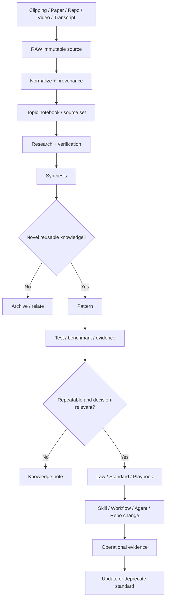

# Knowledge Promotion Pipeline

> How raw discoveries become reusable operational intelligence without corrupting source evidence.

## Core rule

```text
RAW != KNOWLEDGE != STANDARD
```

A clipping is evidence that something was observed. It is **not** automatically a recommendation, rule or architecture decision.

## Pipeline



## Layers

### 1. Source
Preserve the original meaning, provenance, date, author/source and capture context.

Never silently rewrite a source into a stronger claim.

### 2. Notebook / source set
Group related evidence for source-grounded exploration. NotebookLM is a preferred external implementation when appropriate, but the canonical knowledge artifact must remain portable: Markdown, citations/provenance and structured metadata live in the Library.

Suggested notebooks:
- GINKGO — COMPANY BRAIN
- N8NLAB
- AI-STACK
- LEAF
- CREATIVE-AI
- AGENT ENGINEERING
- SECURITY
- CLIENT — <name> (only when privacy policy allows)

### 3. Research
Use current external research when the subject is volatile or incomplete. Record facts, uncertainty, contradictions and dated verification.

### 4. Synthesis
Produce a concise answer to:
- what changed?
- what matters?
- what competes with it?
- where could Ginkgo use it?
- what should we not infer?

### 5. Pattern
A pattern is reusable guidance, not yet mandatory.

Example:
`Provider-neutral creative router prevents n8n/product code from being coupled to Higgsfield, ComfyUI or fal.ai.`

### 6. Law / standard
A law is a strongly governed architectural or operational rule supported by evidence.

Example:
`Products do not call creative providers directly; generation passes through the Creative Router.`

A law MUST contain:
- scope;
- rationale;
- evidence;
- exceptions;
- owner;
- date/version;
- deprecation trigger.

### 7. Operationalization
Promote validated knowledge into:
- a skill;
- an agent contract;
- an n8n workflow;
- a repository standard;
- a capability registry entry;
- an architecture decision;
- a code change.

## Agentic workflow

```text
new clipping
  -> classify
  -> deduplicate
  -> preserve RAW
  -> attach to source set/notebook
  -> determine whether current verification is needed
  -> synthesize
  -> relate to existing patterns
  -> propose promotion
  -> human/reviewer gate for laws and production standards
  -> operationalize
```

## Suggested agent roles

### Curator
Classifies, deduplicates, sanitizes and records provenance.

### Researcher
Verifies current claims and finds primary sources.

### Librarian
Maintains notebooks/source sets and relationship maps.

### Synthesizer
Extracts patterns, trade-offs and use cases.

### Reviewer
Challenges overclaiming and checks evidence.

### Promoter
Creates a PR/issue/skill/workflow only after the maturity gate passes.

## Promotion statuses

```text
raw -> triaged -> curated -> verified -> pattern -> validated -> promoted
```

Possible terminal states:
- `watch`
- `rejected`
- `deprecated`
- `archived`

## Safety rules

- Never place secrets, private client data or credentials in a public/external notebook.
- Keep raw sources immutable; corrections happen in derived notes.
- Numeric plan limits, prices and model availability are dated facts, not permanent laws.
- A single vendor marketing claim cannot by itself become a Ginkgo standard.
- A generated synthesis must preserve provenance back to source material.
- Promotion into production requires an independent review step.

## Example: creative AI

```text
15 clippings about ComfyUI / Higgsfield / Flow / fal.ai
  -> CREATIVE-AI notebook
  -> provider comparison
  -> pattern: provider-neutral routing
  -> benchmark in Pyre
  -> law: callers depend on Creative Router contract
  -> Pyre architecture + ai-stack runtime + provider registry
```

## Example: learning

```text
course/certification sources
  -> topic notebook
  -> source-grounded summaries
  -> flashcards / quizzes / mind map
  -> gap report
  -> next-study plan
  -> progress evidence
```

The learning artifacts are disposable derivatives; the source list, verified notes and progress decisions are the durable knowledge.
