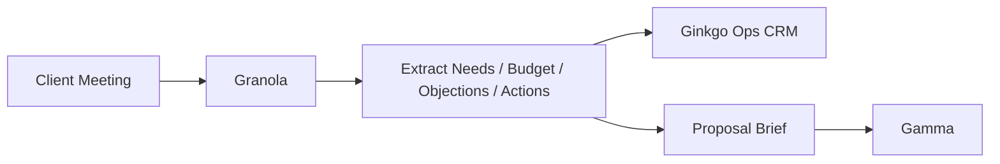

# Granola

## TL;DR

Granola converts meetings into structured, queryable operational context. Its strongest Ginkgo use is not merely note-taking: it can become the bridge from **conversation -> decision -> CRM/task/PRD/proposal**.

Official integrations currently expose meeting notes to ChatGPT, Claude, Cursor, Figma, Gemini, Lovable, Manus and others through MCP-style connectors, and route notes into CRM/project tools.

**Decision:** `HIGH-PRIORITY EXPERIMENT FOR SALES + PRODUCT DISCOVERY`.

## Why it matters

Meetings are usually dark data. The company pays for the conversation, then loses most of the decisions inside a transcript or human memory.

Ginkgo can treat meeting context as an event source:

```text
Meeting
  ↓
Granola note/transcript
  ↓
structured extraction
  ├─> CRM updates
  ├─> action items
  ├─> PRD requirements
  ├─> proposal inputs
  └─> follow-up email
```

## Core capabilities

- meeting capture across common meeting apps and in-person contexts;
- notes enriched from conversation context;
- AI retrieval over previous meetings;
- action-item and decision extraction through connected AI tools;
- MCP connector for AI assistants/tools;
- integrations with CRM, project-management, communication and automation systems;
- historical meeting context on paid tiers.

## Ginkgo use cases

### 1. Lead discovery -> Ginkgo Ops



### 2. Product discovery

A meeting with a client or internal stakeholder can feed:

- problem statements;
- requested workflows;
- exact terminology;
- acceptance criteria candidates;
- unresolved decisions.

The output must be reviewed before becoming a product requirement.

### 3. Follow-up automation

Granola currently lists Gmail, CRM and automation integrations. Ginkgo can normalize meeting output and trigger an n8n workflow for approved follow-up actions.

### 4. Company memory

Authorized agents can retrieve what was actually decided across multiple meetings instead of relying on summaries copied into separate systems.

## Architecture fit

Granola should be a **context source**, not the canonical CRM or task system.

Recommended boundary:

```text
Granola Meeting ID
   ↓
Ginkgo Connect adapter
   ↓
Normalized Meeting Context
   ↓
Ginkgo Ops / Knowledge / n8n
```

Persist Ginkgo-owned normalized facts and references. Do not make core records depend on a proprietary note URL remaining available forever.

## Integration surface

| Surface | Status | Notes |
|---|---|---|
| MCP/AI connector | Verified | ChatGPT, Claude and multiple compatible AI tools |
| CRM integrations | Verified | official integration catalog includes HubSpot, Salesforce via Zapier, Attio and others |
| Project integration | Verified | Linear and other workflow tools listed |
| Calendar | Verified | meeting context/detection |
| Public general REST API | Unknown | do not assume |

## Security / privacy

Meeting data may contain client confidential information, personal data, pricing and strategy.

Required before broad adoption:

- define which meetings may be captured;
- establish participant-consent policy where legally/contractually required;
- review retention and workspace permissions;
- separate personal notes from shared company knowledge;
- restrict agent access by role/workspace;
- avoid automatically promoting extracted statements into canonical CRM facts without review.

## Build vs Buy vs Reference

**Recommendation:** buy for capture, build the normalization/operational layer.

Ginkgo's moat should be what happens **after** the meeting, not rebuilding transcription UX.

## Alternatives

- native Google Meet/Zoom transcripts;
- Fireflies/Otter/Fathom and similar meeting assistants;
- direct audio transcription + custom pipeline;
- manual notes.

## Ginkgo destination

```text
Role: external meeting-context source
Owner: ginkgo-connect
Consumers: Ginkgo Ops, Sales, product discovery, proposals
Promotion gate: privacy review + normalized meeting contract + CRM pilot
```

## Verification notes

Verified from official Granola site/integration pages on 2026-09-03: cross-meeting capture, integrations, MCP access patterns and business-tier historical/search capabilities.

## Decision

```text
CURATED -> PILOT SALES/DISCOVERY -> PROMOTE AS GINKGO CONNECT SOURCE IF DATA GOVERNANCE PASSES
```
