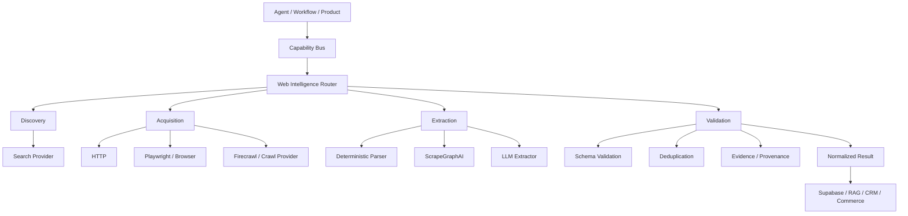
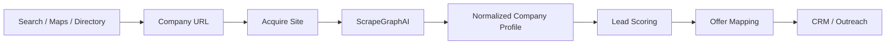
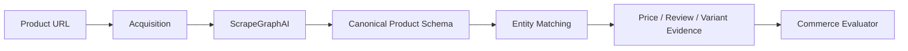

# ScrapeGraphAI

## TL;DR

ScrapeGraphAI é uma biblioteca Python de scraping orientado por LLM que usa lógica de grafos para montar pipelines de extração a partir de uma instrução natural e de uma fonte web ou documento local.

Para a Ginkgo, o valor principal não é substituir Playwright, Firecrawl ou crawlers determinísticos. O melhor encaixe é tratá-lo como um **provider de extração semântica estruturada** dentro de uma camada maior de `Web Intelligence`.

Recomendação atual: **adotar como candidato P0/P1 para laboratório e provider do `ai-stack`, sem promovê-lo ainda a dependência obrigatória de produção.**

## Snapshot verificado — 2026-08-24

No momento da curadoria, o repositório oficial apresentava:

- repositório: `ScrapeGraphAI/Scrapegraph-ai`;
- linguagem principal: Python;
- licença: MIT;
- aproximadamente 29,862 stars;
- aproximadamente 2,959 forks;
- 11 issues abertas;
- atividade recente, com push observado em 2026-08-23;
- documentação oficial e serviço cloud ativo;
- biblioteca OSS separada do serviço gerenciado.

Esses números são snapshot temporal e não devem ser tratados como constantes arquiteturais.

## O que ele resolve

Scrapers clássicos dependem fortemente de conhecimento prévio da estrutura da página:

```text
URL
  -> browser/http
  -> CSS/XPath
  -> parser específico
  -> normalização
  -> JSON
```

ScrapeGraphAI adiciona uma camada semântica:

```text
URL / HTML / JSON / Markdown / XML
  -> aquisição do conteúdo
  -> pipeline em grafo
  -> LLM
  -> instrução de extração
  -> resultado estruturado
```

A consequência prática é permitir perguntas do tipo:

```text
"Extraia empresa, segmento, serviços, fundadores e links sociais."
```

sem criar manualmente um parser exclusivo para cada layout.

## Pipelines principais

O README oficial documenta os seguintes pipelines:

| Pipeline | Papel |
|---|---|
| `SmartScraperGraph` | Extrai dados de uma página a partir de prompt + fonte. |
| `SearchGraph` | Pesquisa múltiplas fontes/resultados e extrai informação. |
| `SpeechGraph` | Extrai dados e produz saída em áudio. |
| `ScriptCreatorGraph` | Analisa uma página e gera um script Python de extração. |
| `SmartScraperMultiGraph` | Executa extração em múltiplas páginas/fontes. |
| `ScriptCreatorMultiGraph` | Gera lógica de scraping para múltiplas páginas/fontes. |

As variantes multi podem paralelizar chamadas de LLM.

## LLMs e execução local

A biblioteca pode trabalhar com provedores externos e modelos locais. O README oficial cita, entre outros:

- OpenAI;
- Groq;
- Azure;
- Gemini;
- MiniMax;
- Ollama para modelos locais.

O modo local é relevante para a Ginkgo porque possibilita:

```text
ScrapeGraphAI
   -> Ollama / runtime local
   -> modelo local
   -> extração sem enviar o documento inteiro a um LLM SaaS
```

Isso pode reduzir custo variável e exposição de dados, embora desempenho, precisão e manutenção devam ser medidos.

## Browser / Playwright

A instalação OSS orienta executar Playwright para aquisição de páginas:

```bash
pip install scrapegraphai
playwright install
```

Portanto, ScrapeGraphAI não elimina a camada de browser. Ele se posiciona acima dela.

Esse ponto é arquiteturalmente importante para evitar a antipattern:

```text
ScrapeGraphAI == browser automation
```

O modelo correto é:

```text
Browser / HTTP acquisition
        -> semantic extraction
        -> structured result
```

## OSS vs serviço gerenciado

O projeto diferencia explicitamente:

### Open source

Responsabilidade Ginkgo:

- infraestrutura;
- LLM/provider;
- Playwright;
- proxies;
- anti-bot;
- escalabilidade;
- observabilidade;
- retry/rate limiting;
- custos de inferência.

Benefícios:

- MIT;
- self-host;
- modelos locais;
- controle sobre dados;
- tuning de custo;
- ausência de lock-in forte no serviço cloud.

### Managed API

O serviço hospedado adiciona, segundo a documentação do projeto:

- scraping/extract/search;
- crawl;
- monitor;
- rendering JavaScript gerenciado;
- modos de browser/stealth;
- proxies e anti-bot gerenciados;
- escala operacional;
- SDKs Python e JavaScript/TypeScript.

Uso recomendado na Ginkgo: **fallback opcional**, não dependência arquitetural central.

## Integrações relevantes

O README oficial lista integração com:

- API oficial;
- SDK Python;
- SDK Node.js;
- LangChain;
- LlamaIndex;
- CrewAI;
- Agno;
- CamelAI;
- Pipedream;
- Bubble;
- Zapier;
- n8n;
- Dify;
- Toolhouse;
- MCP.

Para a Ginkgo, as superfícies prioritárias são:

```text
Python library
MCP
n8n
API/SDK managed fallback
```

## Encaixe Ginkgo

### Capability proposta

```text
web.intelligence.extract
```

Subcapacidades:

```text
web.extract
web.extract.structured
web.search.extract
web.multi.extract
web.company.research
web.product.research
web.lead.enrich
web.competitor.research
web.document.extract
```

### Provider model

ScrapeGraphAI deve ficar atrás de adapter/provider e nunca ser chamado diretamente por produtos finais.

```text
Caller / Agent
      |
      v
Capability Bus
      |
      v
web.intelligence.extract
      |
      +------------------+
      |                  |
      v                  v
ScrapeGraphAI         Firecrawl
      |                  |
      +--------+---------+
               |
               v
          Playwright
               |
               v
        browser / HTTP
```

## Arquitetura de Web Intelligence recomendada



## Estratégia de roteamento

Não usar LLM scraping para tudo.

Prioridade recomendada:

```text
1. API / JSON estruturado
2. parser determinístico
3. Firecrawl / crawler normalizado
4. ScrapeGraphAI
5. browser agent autônomo
```

Exemplo de política:

```yaml
capability: web.extract.structured
routing:
  preferred:
    - native_api
    - deterministic_parser
  semantic_fallback:
    - scrapegraph_ai
  acquisition_fallback:
    - firecrawl
    - playwright
  last_resort:
    - browser_agent
```

A ordem real depende do domínio. A ideia central é impedir que o LLM vire uma marreta universal cara e probabilística.

## Lead Finder / Sales Intelligence

ScrapeGraphAI é especialmente útil depois que um domínio/site já foi descoberto.



Schema alvo sugerido:

```json
{
  "company": "",
  "industry": "",
  "services": [],
  "emails": [],
  "phones": [],
  "social_links": [],
  "technologies": [],
  "ecommerce": false,
  "booking_system": null,
  "whatsapp": null,
  "automation_signals": [],
  "pain_signals": [],
  "evidence": []
}
```

O `automation_opportunity_score` deve ser calculado por camada posterior e não inventado pelo scraper.

## Commerce Intelligence

Possível fluxo para Shopee/Amazon/Mercado Livre e pesquisa de produto:



Campos úteis:

- marca;
- título normalizado;
- modelo;
- variante;
- dimensões;
- especificações;
- preço observado;
- rating/reviews quando expostos;
- seller;
- disponibilidade;
- links de evidência.

O pipeline deve preservar provenance para evitar matching falso entre produtos parecidos.

## RAG e Knowledge Ingestion

Outra aplicação direta:

```text
Web
 -> crawl
 -> ScrapeGraphAI
 -> structured JSON + markdown
 -> chunking
 -> metadata/provenance
 -> embeddings
 -> vector store
```

Isso é especialmente útil quando a informação desejada já possui schema conhecido e a extração livre em Markdown gera muito ruído.

## Relação com Firecrawl

Eles não devem ser tratados como substitutos 1:1.

### Firecrawl

Melhor encaixe conceitual:

- crawl amplo;
- aquisição;
- páginas para Markdown;
- descoberta de links;
- operação web generalista.

### ScrapeGraphAI

Melhor encaixe conceitual:

- extração orientada por objetivo;
- structured extraction;
- entendimento semântico do conteúdo;
- fallback quando seletores quebram;
- geração de scraper/script em certos fluxos.

Modelo mental:

```text
Firecrawl = mineradora
ScrapeGraphAI = geólogo
```

A mineradora traz material. O geólogo tenta identificar o que interessa dentro dele.

## Relação com Playwright

Playwright continua sendo a ferramenta de aquisição/automação de browser.

Use Playwright quando precisamos:

- executar JavaScript;
- autenticar;
- clicar;
- paginar;
- preencher formulários;
- esperar estados da UI;
- capturar respostas de rede;
- controlar browser de forma determinística.

Use ScrapeGraphAI para interpretar semanticamente o material adquirido.

## Relação com browser agents

Browser agent autônomo deve ser último recurso em tarefas de extração repetitiva, porque adiciona:

- custo;
- latência;
- maior não-determinismo;
- mais pontos de falha;
- superfície de segurança maior.

O agente pode decidir o plano; a execução deve preferir primitives determinísticas sempre que possível.

## Build vs Buy vs Reference

### Build

Não vale reconstruir o conceito inteiro do zero neste momento.

### Buy

A API gerenciada pode ser útil para:

- picos de demanda;
- anti-bot difícil;
- protótipos rápidos;
- fallback operacional.

### Reference / Adopt OSS

Recomendação principal:

- utilizar OSS em laboratório;
- encapsular em adapter Ginkgo;
- validar custo/precisão;
- promover somente após benchmark.

## Riscos

### 1. Não determinismo

Extração via LLM pode mudar entre modelos, versões e prompts.

Mitigação:

- schema forte;
- temperature control quando disponível;
- validação posterior;
- golden datasets;
- retries limitados;
- evidence fields.

### 2. Prompt injection via conteúdo web

Páginas podem conter instruções maliciosas direcionadas ao modelo.

Mitigação:

```text
web content != trusted instructions
```

Implementar:

- isolamento do conteúdo;
- prompt boundary explícito;
- output schema fechado;
- allowlist de capabilities;
- sem tool execution dentro do extractor;
- sanitização de HTML;
- provenance obrigatório.

### 3. SSRF / URL abuse

Qualquer serviço que receba URLs precisa bloquear:

- localhost;
- metadata endpoints;
- RFC1918 quando não autorizado;
- esquemas não HTTP(S);
- redirects para redes privadas.

### 4. Secrets em browser

Nunca enviar cookies, tokens ou credenciais ao LLM.

Separar:

```text
authenticated acquisition
        !=
semantic extraction
```

### 5. Custos de tokens

Scraping sem filtro pode gerar contexto gigante.

Mitigação:

- extrair DOM relevante antes do LLM;
- remover scripts/styles/nav duplicado;
- limitar páginas;
- chunking inteligente;
- cache por content hash;
- preferir modelos menores quando suficiente.

### 6. Anti-bot / ToS

OSS não resolve automaticamente políticas de acesso, robots.txt, contratos de site ou bloqueios técnicos.

Cada domínio deve possuir política de aquisição compatível com finalidade, contrato e legislação aplicável.

### 7. Telemetria

O README oficial informa coleta de métricas anônimas de uso e disponibiliza opt-out por:

```text
SCRAPEGRAPHAI_TELEMETRY_ENABLED=false
```

Para execução Ginkgo self-hosted, a recomendação inicial é desligar telemetria por padrão até revisão de privacidade.

## Benchmark obrigatório antes de promoção

Criar um corpus de referência com pelo menos:

```text
10 sites simples
10 sites JS-heavy
10 e-commerces
10 empresas locais
10 páginas longas/documentais
```

Medir:

| Métrica | Objetivo |
|---|---|
| schema validity | JSON/schema correto |
| field precision | campos corretos |
| field recall | campos encontrados |
| hallucination rate | informação sem evidência |
| latency | p50/p95 |
| token cost | custo por página |
| browser cost | CPU/RAM/tempo |
| retry rate | estabilidade |
| extraction drift | variação entre execuções |

Comparar pelo menos:

- ScrapeGraphAI;
- Firecrawl extraction;
- Crawl4AI + schema extraction;
- Playwright + parser determinístico;
- LLM extraction interno.

## Adapter proposto

Interface canônica:

```python
class WebExtractionProvider:
    async def extract(
        self,
        source: str,
        instruction: str,
        schema: dict,
        *,
        acquisition_mode: str = "auto",
        evidence: bool = True,
    ) -> dict:
        ...
```

Provider:

```text
providers/web_extraction/scrapegraph_ai
```

Nunca expor classes upstream diretamente ao restante da Ginkgo.

## Contrato de resultado

```json
{
  "status": "success",
  "provider": "scrapegraph_ai",
  "source": {
    "url": "https://example.com",
    "retrieved_at": "2026-08-24T00:00:00Z"
  },
  "data": {},
  "evidence": [],
  "metrics": {
    "latency_ms": 0,
    "input_tokens": null,
    "output_tokens": null
  },
  "warnings": []
}
```

## Observabilidade

Registrar por chamada:

- provider;
- capability;
- URL sanitizada/hash quando necessário;
- content hash;
- modelo;
- tokens;
- custo estimado;
- tempo;
- retries;
- schema validity;
- erros;
- cache hit/miss.

Não registrar secrets, cookies, authorization headers ou conteúdo pessoal desnecessário.

## Política de cache

```text
URL + content_hash + extraction_schema + prompt_version + model_version
```

Isso reduz custo e torna resultados auditáveis.

## Posição no lifecycle Ginkgo

```text
DISCOVERED
  -> CURATED            [agora]
  -> LAB BENCHMARK
  -> VALIDATED
  -> PROVIDER ADAPTER
  -> INTEGRATED
  -> PRODUCTION
```

Status atual: `curated`.

## Critérios para promover ao ai-stack

Promover somente se:

- benchmark demonstrar ganho relevante sobre parser/Firecrawl;
- hallucination rate estiver controlada;
- output validation estiver implementada;
- SSRF guard existir;
- prompt injection boundary existir;
- telemetria estiver governada;
- custos estiverem observáveis;
- adapter estiver caller-agnostic;
- nenhuma aplicação depender diretamente da biblioteca upstream.

## Backlog recomendado

### P0 — laboratório

- [ ] Criar adapter `scrapegraph_ai` no `ai-stack`.
- [ ] Criar schema canônico `web.extract.request/result`.
- [ ] Implementar SSRF guard.
- [ ] Desabilitar telemetria no ambiente de teste.
- [ ] Criar golden dataset.
- [ ] Benchmark contra Firecrawl, Crawl4AI e Playwright parser.
- [ ] Registrar custo, latência e hallucination rate.

### P1 — integração

- [ ] Integrar ao Capability Bus.
- [ ] Criar router `web.intelligence.extract`.
- [ ] Adicionar provider local com Ollama.
- [ ] Adicionar provider cloud opcional.
- [ ] Implementar cache por content hash.
- [ ] Implementar evidence/provenance contract.

### P2 — produtos

- [ ] Lead enrichment.
- [ ] Company research.
- [ ] Commerce product normalization.
- [ ] Competitor research.
- [ ] Knowledge ingestion.
- [ ] Monitoring/recrawl workflows.

## Veredito

**ADOPT FOR LAB / HIGH PRIORITY.**

Não substituir a stack inteira por ScrapeGraphAI. O desenho correto é incorporá-lo como uma cabeça semântica intercambiável dentro de um subsistema de Web Intelligence.

A arquitetura alvo fica:

```text
Search / Discovery
       -> Acquisition
       -> Deterministic Parsing
       -> Semantic Extraction
       -> Validation
       -> Provenance
       -> Knowledge / CRM / Commerce
```

ScrapeGraphAI ocupa principalmente **Semantic Extraction**.

## Sources and provenance

- Official repository: https://github.com/ScrapeGraphAI/Scrapegraph-ai
- Official website: https://scrapegraphai.com
- Official docs: https://docs.scrapegraphai.com/introduction
- Official SDKs referenced by upstream:
  - https://github.com/ScrapeGraphAI/scrapegraph-py
  - https://github.com/ScrapeGraphAI/scrapegraph-js

## Verification notes

Verificado em 2026-08-24 diretamente contra o repositório e README oficiais.

Não foram promovidas como verdade canônica funcionalidades de projetos laterais da organização que não tenham sido verificadas durante esta curadoria. Elas devem entrar em investigação separada se forem consideradas para adoção.
