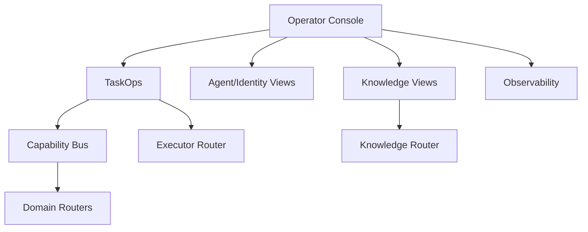

# Operator Surface Benchmark

Status: **P1 research benchmark**

Scope: Open WebUI, LobeHub, Dify and Langflow.

The objective is not to select a replacement for the Ginkgo architecture. The objective is to identify operator-console patterns worth importing while preserving the Control, Capability, Execution and Knowledge planes.

## Executive comparison

| Project | Strongest role | Useful Ginkgo patterns | Primary overlap/risk |
|---|---|---|---|
| Open WebUI | self-hosted AI operator console | RBAC, shared channels, model/tool access, RAG, automation, observability, multi-user UX | can become an accidental application/runtime monolith |
| LobeHub | multi-agent operator workspace | agents-as-unit-of-work UX, scheduling, reporting, agent collaboration | agent identity can leak into backend capability contracts |
| Dify | integrated LLM application platform | workflow/RAG/model management/LLMOps/API productization | replaces too many Ginkgo planes if adopted as foundation |
| Langflow | visual agent/workflow authoring | fast prototyping, Python extensibility, API/MCP publication | duplicates n8n orchestration and creates second workflow control plane |

## Ginkgo target operator surface

A future Ginkgo operator console should sit **above** the core architecture:



The console may visualize or request work. It must not become the hidden routing authority.

## Benchmark dimensions

### Identity and RBAC

Evaluate:

- tenant isolation;
- user/group roles;
- agent identities;
- per-tool/capability permissions;
- service identities;
- audit visibility;
- delegation.

Ginkgo requirement: permissions resolve through Identity/Policy, not UI-local settings alone.

### Agent operations

Evaluate:

- create/configure agent;
- assign tools/knowledge;
- schedule recurring work;
- observe active tasks;
- interrupt/cancel;
- hand off to a human;
- inspect evidence;
- compare agent performance.

Ginkgo requirement: operator UX should map to TaskOps and capability requests, not bypass them.

### Knowledge experience

Evaluate:

- file ingestion;
- source provenance;
- collections/spaces;
- retrieval inspection;
- citation UX;
- memory visualization;
- reindexing and deletion.

Ginkgo requirement: Knowledge Router remains canonical. UI indexes are views/caches, not source of truth.

### Tool and provider experience

Evaluate:

- discover integrations;
- configure credentials;
- assign permissions;
- inspect health;
- usage/cost dashboards;
- versioning;
- enable/disable provider eligibility.

Ginkgo requirement: caller never selects provider in `CapabilityRequest`; admin/operator configuration changes policy/registry, not public capability semantics.

### Workflow experience

Evaluate:

- visual DAG authoring;
- retry/error handling;
- human approval nodes;
- schedules/webhooks;
- testing and replay;
- export/version control.

Ginkgo position: n8n remains the primary visual executor/orchestrator unless a future architectural decision changes that. Langflow/Dify are useful benchmarks and labs, not co-equal mandatory control planes.

### Observability

Minimum future console views:

```text
Task
├─ caller / identity
├─ capability
├─ resolved skill/version
├─ adapter/provider (internal/admin view)
├─ executor
├─ status / latency / cost
├─ approvals / gates
├─ evidence
├─ retries
└─ provenance
```

## Build-vs-adopt decision

Do not select a console based on feature count alone. Use a weighted evaluation:

| Dimension | Weight |
|---|---:|
| architectural fit | 25% |
| identity/RBAC | 15% |
| TaskOps visibility | 15% |
| capability/tool extensibility | 10% |
| knowledge UX | 10% |
| observability | 10% |
| self-hosting/operations | 5% |
| licensing | 5% |
| theming/product embedding | 5% |

## Recommended posture

### Open WebUI

**Evaluate first** as a possible operator surface because it already covers broad self-hosted AI interaction patterns. Keep it replaceable. If adopted, connect it to Ginkgo through explicit APIs/MCP/capabilities rather than letting its internal tool model become canonical.

Source: https://github.com/open-webui/open-webui

### LobeHub

Use primarily as a product/UX benchmark for long-lived agent teams, agent scheduling and operator reporting. Its strongest contribution is interaction design around humans managing multiple agent workers.

Source: https://github.com/lobehub/lobehub

### Dify

Benchmark deployment ergonomics, RAG UX, observability and model/provider management. Avoid making Dify the universal Ginkgo runtime because that would collapse several intentionally separate planes into one product dependency.

Source: https://github.com/langgenius/dify

### Langflow

Use as a rapid AI workflow laboratory and study its API/MCP publication model. Keep it outside the canonical execution path while n8n is the approved orchestration surface.

Source: https://github.com/langflow-ai/langflow

## P1 experiment

Run a bounded, no-production-data evaluation with the same synthetic scenario across all four surfaces:

```text
user request
-> identity
-> create task
-> call one read-only capability
-> retrieve one knowledge source
-> return evidence
-> inspect audit trail
```

Measure:

- setup complexity;
- number of custom adapters required;
- whether provider routing can remain internal;
- RBAC fit;
- observability completeness;
- UX friction;
- infrastructure footprint;
- license constraints.

No project is approved by this benchmark document. Adoption requires a separate architecture decision and validation evidence.
