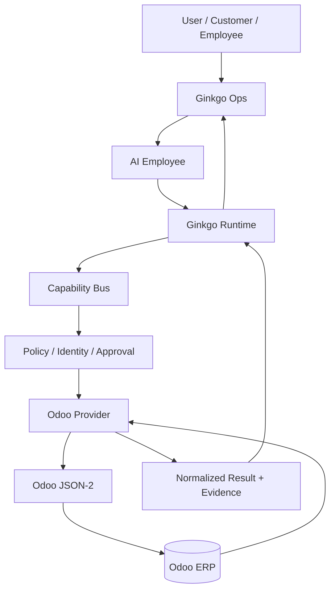

# Odoo

## TL;DR

**Decision: GO as an enterprise provider; NO-GO as a product to rebuild inside Ginkgo Ops.**

Odoo should be treated as a transactional ERP / system of record that can sit beneath Ginkgo's agentic control plane. Ginkgo Ops remains the customer/employee interaction layer, Ginkgo Runtime remains the governed execution layer, n8n remains the external automation fabric, Supabase owns Ginkgo-native state, and Odoo owns ERP business state.

The strategic opportunity is not to compete with Odoo at accounting, stock, purchasing, MRP, payroll, POS or tax. It is to expose Odoo through governed, caller-agnostic capabilities so AI Employees can operate ERP workflows safely.

```text
Odoo = business body / transactional state
Ginkgo Runtime = nervous system / policy + execution governance
AI Employees = cognitive layer
n8n = external workflow fabric
Supabase = Ginkgo state / evidence / observability
```

## Why it matters

Odoo compresses a very large amount of commodity business software into one modular platform: CRM, sales, subscriptions, invoicing/accounting, purchase, inventory, manufacturing, projects, helpdesk, HR, website/e-commerce, marketing and productivity modules.

For Ginkgo this reduces the risk of accidentally building an ERP while developing Ginkgo Ops. It also creates a credible path to an "agentic ERP" offer where Ginkgo AI Employees operate real transactional systems through policy-controlled capabilities.

## Product / edition model

Odoo has two important code/commercial layers:

- **Community**: open-source core, self-hostable, suitable when Ginkgo is prepared to own infrastructure, upgrades, backups and support.
- **Enterprise**: paid layer adding proprietary modules/features, official support and hosted deployment options.

Deployment choices have architectural consequences:

### Odoo Online

Best for mostly-standard installations. Lowest operational burden, but custom module flexibility is limited. External API access is tied to the appropriate paid plan rather than the entry plans.

### Odoo.sh

Preferred deployment for Ginkgo customers that need custom modules while avoiding full ERP infrastructure ownership. Adds managed builds, branches, CI-like environments, shell/SSH access and Odoo-specific deployment workflows.

### On-premise / self-hosted

Use only with a concrete reason: compliance, dedicated environment, special networking, heavy customization, integration constraints or economics that justify owning operations.

## Architecture and stack

Odoo 19 follows a conventional three-tier architecture:

```text
Presentation
  HTML5 / JavaScript / CSS / Owl
        ↓
Business Logic
  Python + Odoo ORM
        ↓
Persistence
  PostgreSQL
```

Business models are Python classes built on the Odoo ORM. The web client is a single-page application and modern frontend development is centered on Owl components.

This makes Odoo extensible, but extensions are not free: custom modules create upgrade, test and maintenance obligations. The Ginkgo default should therefore be **configuration first, external capability integration second, custom Odoo code only when necessary**.

## External API

Odoo 19 introduces the JSON-2 API as the strategic integration surface for external applications.

Important design consequences:

- HTTP endpoint model aligned to Odoo models/methods;
- API key authentication;
- execution inherits the permissions of the Odoo user associated with the key;
- access is governed by Odoo ACLs and record rules;
- API access must be treated as a privileged enterprise integration surface, not as a raw agent tool.

Ginkgo should never expose generic model/method execution directly to an AI Employee. The agent asks for a stable Ginkgo capability; the provider maps that capability to Odoo.

## Ginkgo provider model



### Initial capability namespace

Read-oriented P0:

```text
crm.contact.search
crm.contact.read
crm.lead.search
sales.quote.search
sales.order.read
invoice.search
invoice.read
inventory.product.search
inventory.stock.read
purchase.order.read
project.task.search
```

Controlled writes:

```text
crm.contact.create
crm.lead.create
crm.lead.update
sales.quote.create
sales.quote.send
sales.order.confirm
invoice.create
invoice.send
purchase.order.create
project.task.create
project.task.update
```

High-impact actions must support explicit policy gates and, where appropriate, human approval.

## Capability contract principles

The agent should never know Odoo internals such as model names or action methods.

Bad:

```text
POST /json/2/sale.order/action_confirm
```

Good:

```text
CapabilityRequest
  capability: sales.order.confirm
  subject: order_123
  actor: user_or_agent
  organization: org_abc
  idempotency_key: ...
  policy_context: ...
```

The provider is responsible for translating stable Ginkgo contracts to version-specific Odoo operations.

## System-of-record boundaries

### Odoo owns

```text
customers and ERP contacts when Odoo is the designated source of truth
products
quotations / sales orders
invoices and accounting state
purchase orders
inventory state
manufacturing state
ERP projects/tasks when configured as authoritative
```

### Supabase owns

```text
Ginkgo organization/workspace state
AI Employees
conversations
agent memory
capability executions
approvals
evidence
runtime configuration
Ginkgo usage and billing metadata
observability
integration bindings
```

### Rule

> Odoo owns ERP state. Supabase owns Ginkgo state.

Supabase may hold projections/caches of Odoo data for retrieval performance, search and analytics, but those projections must not become independent authorities for the same transactional truth.

## Integration with n8n

n8n is complementary, not competitive with Odoo.

Use Odoo for:

- business state;
- core transactional rules;
- master data;
- accounting/inventory/purchase/sales workflows.

Use n8n for:

- external orchestration;
- messaging;
- notifications;
- enrichment;
- cross-SaaS workflows;
- ETL;
- asynchronous integrations;
- human-facing workflow glue.

Avoid implementing critical ERP business invariants in n8n if Odoo is the authoritative system. Likewise, avoid turning Odoo Python modules into a universal external automation engine.

## Idempotency and retries

Write capabilities must carry an idempotency key generated at the Runtime boundary.

Recommended path:

```text
CapabilityRequest
  ↓
Idempotency Guard
  ↓
Policy / Approval
  ↓
Odoo Provider
  ↓
Write
  ↓
Persist external identifiers + evidence
  ↓
Normalized Result
```

Retries should be classified:

- safe transient read retry;
- safe idempotent write retry;
- uncertain write result requiring reconciliation;
- business-rule rejection;
- authorization rejection;
- provider unavailable.

Never blindly replay irreversible writes after an unknown response state.

## Observability

Each provider execution should capture at minimum:

```text
organization_id
workspace_id
capability
provider = odoo
provider_instance_id
actor
request_id
idempotency_key
started_at
completed_at
status
latency
odoo_model (internal evidence only)
odoo_record_ids
normalized_result
error_class
policy_decision
approval_id
```

Sensitive payload fields should be redacted before general logging.

## Multi-company and tenant isolation

Odoo multi-company is useful for related legal entities in the same economic group. It should not be treated as Ginkgo's default SaaS tenant-isolation mechanism for unrelated customers.

Preferred commercial topology:

```text
Ginkgo Organization
      ↓
ERP Binding
      ↓
Dedicated Odoo database / instance boundary
```

Default recommendation: **one customer environment/database boundary per independent customer**, with Odoo multi-company used inside that boundary for genuinely related companies.

## Brazil

Odoo 19 has substantial Brazil localization coverage, including Brazilian chart of accounts concepts, taxes, fiscal reports and electronic invoicing modules/integrations.

However, Brazilian tax/fiscal correctness must be treated as a deployment acceptance domain, not a checkbox.

Required validation before selling production fiscal automation:

- legal entity regime;
- state and municipality;
- NF-e / NFC-e / NFS-e requirements;
- tax rules by product/service;
- SPED outputs actually needed;
- accountant validation;
- certificate flows;
- Avalara/third-party dependency behavior where used;
- homologation and contingency behavior.

Recommended stance:

```text
CRM / Sales / Projects / Stock / Purchase      GREEN
Management finance                              GREEN
Brazil tax configuration                        YELLOW
Electronic fiscal issuance                      YELLOW until homologated
Municipal NFS-e                                  YELLOW per municipality
Legal accounting                                YELLOW + accountant sign-off
```

## Native AI direction

Odoo 19 moves beyond a side-panel chatbot toward contextual AI that can reason over records and, through configured agents/tools/server actions, execute bounded work.

Strategic significance for Ginkgo:

Odoo is validating the transition from:

```text
ERP
```

to:

```text
ERP + Agents + Tools
```

Ginkgo's differentiation should therefore not be "we also have an AI button". The differentiator is a **cross-system governed agent runtime** that can operate Odoo, messaging, payment systems, email, calendar, media systems, internal databases and other ERPs through one capability model.

## What to copy conceptually

Copy principles, not product scope:

1. small core + modular apps;
2. shared business entities instead of feature silos;
3. clear system-of-record ownership;
4. extensibility through modules/providers;
5. ecosystem and marketplace mindset;
6. contextual AI at record/workspace level;
7. configuration/low-code above a serious core;
8. explicit company/context handling;
9. permissions enforced at data/action boundaries.

## What NOT to rebuild in Ginkgo Ops

Do not build unless a narrow product reason emerges:

- general ledger accounting;
- tax engine;
- NF-e/NFS-e stack;
- inventory engine;
- MRP;
- payroll;
- procurement ERP;
- POS;
- general-purpose ERP e-commerce;
- full fiscal reporting engine.

These domains create disproportionate maintenance, compliance and correctness obligations while adding little differentiation to the Ginkgo AI control plane.

## Build vs Buy vs Reference

### Buy / integrate

Best default for SMB/mid-market customers needing broad operational ERP coverage quickly.

### Build custom Odoo modules

Only when an operation cannot be expressed cleanly through configuration, Studio, supported integrations or Ginkgo-side orchestration.

### Build competing ERP inside Ginkgo

NO-GO for the current roadmap.

## Commercial opportunity

Recommended offer category:

# Ginkgo AI Operations for Odoo

Possible packaged AI Employees:

```text
Callima / Front Desk
Sales Agent
Collections Agent
Customer Support Agent
Finance Operations Agent
Procurement Agent
Inventory Agent
Project Operations Agent
```

Example customer interaction:

```text
"Quanto temos do produto X?"
  ↓
AI Employee
  ↓
inventory.stock.read
  ↓
Runtime Policy
  ↓
Odoo Provider
  ↓
Odoo
  ↓
Normalized answer + evidence
```

High-impact example:

```text
"Compre mais 500 unidades"
  ↓
purchase.order.create
  ↓
policy = approval_required
  ↓
human approval
  ↓
Odoo Provider
  ↓
Odoo
```

This is materially more defensible than selling a generic WhatsApp chatbot.

## Risk matrix

| Risk | Level | Mitigation |
|---|---|---|
| ERP customization debt | High | configuration first; strict custom-module gate |
| Brazil fiscal edge cases | High | per-client fiscal homologation + accountant |
| Vendor/API changes | Medium | provider abstraction + contract tests |
| Permission misconfiguration | High | dedicated integration user + least privilege |
| Cross-client data leakage | Critical | dedicated customer database/instance boundary |
| Duplicate transactional writes | High | idempotency + reconciliation |
| n8n becoming business-rule authority | Medium | keep ERP invariants in Odoo |
| Dual source of truth | Critical | explicit ownership matrix |
| Third-party module quality | Medium | allowlist + upgrade tests |
| Enterprise licensing cost | Medium | TCO per customer; avoid needless seats/modules |

## 30 / 60 / 90 roadmap

### 0-30 days — Provider PoC

Goal: prove safe read/write through governed capabilities.

Implement:

```text
crm.contact.search
crm.contact.create
sales.quote.create
invoice.search
inventory.stock.read
```

Acceptance:

- dedicated Odoo test environment;
- dedicated least-privilege API user;
- normalized contracts;
- Runtime policy gate;
- idempotency on writes;
- evidence captured;
- explicit error taxonomy;
- no raw Odoo method exposed to agent prompts.

### 31-60 days — Operational workflows

Add:

```text
sales.order.confirm
invoice.create
invoice.send
purchase.order.create
project.task.create
```

Integrate:

- Callima / WhatsApp;
- approval workflow;
- n8n event handling;
- Supabase execution projection;
- retry/reconciliation queue;
- dashboards for provider health.

### 61-90 days — Productization

Validate a real customer scenario and package:

- onboarding checklist;
- ERP binding contract;
- permission templates;
- capability allowlist by AI Employee;
- pricing/TCO model;
- support boundaries;
- Brazil fiscal acceptance checklist when applicable;
- runbooks;
- upgrade compatibility suite;
- provider SLOs.

Promotion gate after 90 days:

```text
Library: VALIDATED
        ↓
Provider PoC: PASS
        ↓
Runtime integration: INTEGRATED
        ↓
Customer pilot: VALIDATED
        ↓
Production capability: PRODUCTION
```

## Final recommendation

**GO** for Odoo as the first serious ERP provider in the Ginkgo ecosystem.

**NO-GO** for importing ERP scope into Ginkgo Ops.

The strategic target is:

```text
Ginkgo AI Employees
        +
Ginkgo Runtime
        +
Odoo ERP
        +
WhatsApp / n8n / external systems
```

This lets Ginkgo own intelligence, governance, agent experience and cross-system orchestration while delegating mature transactional ERP domains to a platform designed for them.

## Sources and provenance

Primary references:

- https://www.odoo.com/
- https://www.odoo.com/pricing
- https://www.odoo.com/documentation/19.0/
- https://www.odoo.com/documentation/19.0/developer/reference/external_api.html
- https://www.odoo.com/documentation/19.0/administration/odoo_online.html
- https://www.odoo.com/documentation/19.0/administration/odoo_sh.html
- https://www.odoo.com/documentation/19.0/applications/finance/fiscal_localizations/brazil.html
- https://www.odoo.com/documentation/19.0/applications/productivity/ai.html
- https://www.odoo.com/documentation/19.0/applications/productivity/ai/agents.html
- https://github.com/odoo/odoo

## Verification notes

Verified against current Odoo 19 documentation and official product materials on 2026-09-05. Pricing, packaging, fiscal integrations and hosted-product restrictions are time-sensitive and must be reverified before client proposals or implementation decisions.
