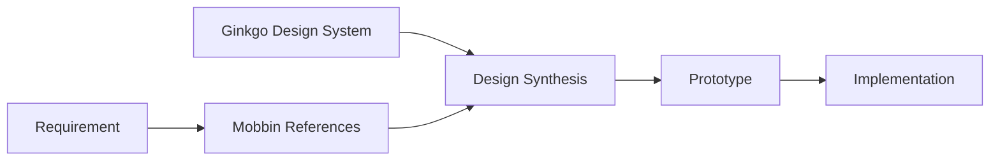

# Mobbin

## TL;DR

Mobbin is a **design-reference layer** for humans and agents. Its strategic value to Ginkgo is not copying screens; it is reducing invented UX by grounding design decisions in patterns already shipped by mature products.

Its MCP currently exposes the design library to compatible agents such as Claude Code, Cursor, Codex and other MCP clients.

**Decision:** `ADOPT AS REFERENCE / HIGH-PRIORITY AGENT CONTEXT` after access validation.

## Why it matters

AI can generate UI quickly but often produces a synthetic mixture of common patterns without understanding which interaction models actually survive in production products.

Mobbin changes the input:

```text
Requirement
   +
Ginkgo design system
   +
real shipped UX references
   ↓
agent/design reasoning
   ↓
prototype
```

Official Mobbin material describes MCP access to 600,000+ real product screens.

## Core capabilities

- search real product screens and flows;
- compare implementations of onboarding, pricing, paywalls, settings, CRM patterns and other flows;
- provide reference context directly to AI agents through MCP;
- accelerate competitive UX research;
- reduce generic AI-generated interface patterns.

## Ginkgo use cases

### Ginkgo Ops

Before implementing a new CRM capability:

```text
P0/P1 requirement
  ↓
Mobbin search: analogous shipped flows
  ↓
UX synthesis: what repeats / what differs
  ↓
Ginkgo-specific interaction contract
  ↓
Magic Patterns or Figma
  ↓
implementation
```

High-value reference searches include:

- workspace switchers;
- contact/customer profiles;
- conversation inboxes;
- agent/automation settings;
- billing and usage;
- onboarding;
- command palettes;
- activity/audit history;
- notification centers.

### Agent design context

Mobbin MCP can be attached to a design/coding agent so a request such as “design a SaaS workspace switcher” first retrieves real reference patterns.

## Architecture fit

Mobbin is **read/reference context**, not a source of product truth.



Do not make downstream runtime features depend on Mobbin availability.

## Integration surface

| Surface | Status | Notes |
|---|---|---|
| MCP | Verified | agent-facing reference access |
| Website/library | Verified | human research surface |
| Public REST API | Unknown | verify before assuming |
| Self-host | No | hosted service |

## Build vs Buy vs Reference

**Recommendation:** reference/buy.

Building an equivalent archive would require continuous capture, classification and maintenance of thousands of products. That is not a Ginkgo moat.

Ginkgo should build the **decision layer** that converts references into its own design rules.

## Security / licensing

- treat screenshots/design references as research material;
- do not clone proprietary branded assets verbatim;
- synthesize interaction patterns into the Ginkgo design system;
- do not make scraped/exported Mobbin content a permanent internal redistribution dataset without license review.

## Alternatives

- manual competitive research;
- Pageflows and similar UX libraries;
- direct inspection of live products;
- internal Ginkgo pattern library after enough products ship.

## Ginkgo destination

```text
Role: design intelligence/reference provider
Owner: Ginkgo Library
Consumers: Ginkgo Ops, product/design agents, Ginkgo Source
Promotion: MCP access in approved product-design agent profiles
```

## Verification notes

Verified from the official Mobbin MCP page on 2026-09-03: paid-plan MCP access, remote MCP server and compatibility examples including Claude Code, Cursor and Codex.

## Decision

```text
CURATED -> CONNECT MCP -> USE AS REFERENCE, NEVER AS PRODUCT SOURCE OF TRUTH
```
