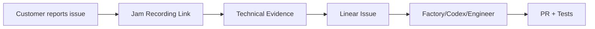

# Jam

## TL;DR

Jam turns “the app broke” into a reproducible engineering artifact by attaching the recording to available console logs, network requests, user interactions and device context. It can route that evidence into Linear, GitHub, Jira, Slack and AI-assisted debugging workflows.

For Ginkgo, Jam is best viewed as a **client-side evidence capture layer** between user/QA observation and engineering execution.

**Decision:** `HIGH-PRIORITY ADOPTION CANDIDATE FOR GINKGO OPS QA`.

## Why it matters

Most bug reports destroy context at the moment context matters most:

```text
User sees bug -> screenshot -> message -> engineer asks questions -> cannot reproduce
```

Jam changes the graph:

```text
User sees bug
   ↓
Jam recording
   + console
   + network
   + user events
   + device context
   ↓
Linear/GitHub issue
   ↓
agent or engineer investigates
```

Official Jam material also describes AI-generated title, summary and reproduction steps.

## Core capabilities

- browser screen recording and screenshot capture;
- automatic available console-log attachment;
- network-request context;
- user-event and device context;
- AI-generated bug summary/repro steps;
- Recording Links for customer-submitted issues;
- Linear/GitHub/Jira/Slack routing;
- Jam SDK for custom metadata;
- CLI surfaced by current product;
- Sentry/FullStory context integrations.

## Ginkgo use cases

### 1. Ginkgo Ops internal QA

Every visual/interaction defect should be reproducible from one artifact rather than a chat thread.

### 2. Customer support escalation



### 3. Agent debugging input

A coding agent can receive the issue plus Jam evidence instead of trying to infer the bug from prose.

### 4. Release QA

Jam can standardize evidence for failed acceptance criteria during P0/P1 review.

## Architecture fit

Jam is an **evidence producer**, not canonical observability storage.

Canonical Ginkgo engineering state remains:

- issue/task in chosen work system;
- code/diff in GitHub;
- test result;
- production telemetry in approved observability stack.

Jam links these states to high-fidelity client evidence.

## Integration surface

| Surface | Status | Notes |
|---|---|---|
| Browser capture | Verified | core surface |
| SDK | Verified | custom metadata and capture context |
| CLI | Verified at product level | validate exact automation use before adoption |
| Linear | Verified | issue creation with attached Jam context |
| GitHub | Verified | issue creation with attached Jam context |
| Sentry/FullStory | Verified | correlated error/session context |

## Security / privacy

This is the primary risk area because recordings/network logs may contain customer or tenant data.

Required controls:

- configure Auto-Blur/sensitive-element handling;
- never capture secrets/tokens intentionally;
- review whether headers/request bodies are exposed;
- establish retention policy;
- use only on approved domains/environments;
- classify customer recordings as operational evidence;
- avoid broad production use until privacy review passes.

## Build vs Buy vs Reference

**Recommendation:** buy/adopt if privacy controls pass.

Rebuilding a polished capture extension + logs + network context + issue integrations is low strategic leverage.

## Alternatives

- Sentry Session Replay: stronger telemetry/error-centric workflow;
- FullStory: broader product/session analytics;
- Loom: simpler async video but weaker debugging context;
- manual browser DevTools evidence: cheap but operationally inconsistent.

## Ginkgo destination

```text
Role: QA/support evidence capture
Owner: ginkgo-source / engineering operations
Consumers: Ginkgo Ops, client projects, coding agents
Promotion gate: privacy review + one release-cycle benchmark
```

## Verification notes

Verified from official Jam site/docs/integration pages on 2026-09-03: recording, console/network/user/device context, AI summaries, SDK, Linear/GitHub routing and agent-oriented debugging positioning.

## Decision

```text
CURATED -> PILOT IN GINKGO OPS QA -> PROMOTE IF REPRODUCTION TIME FALLS
```
