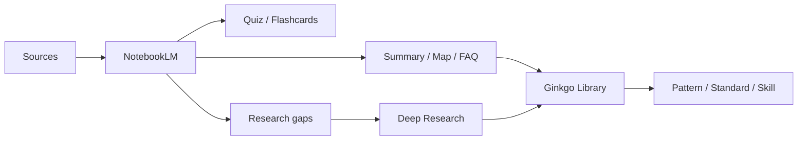

# Google AI — Agentic Use Cases for Ginkgo

> Dated capability note for integrating Google AI products into the Ginkgo Arsenal.

**Verified at:** 2026-08-17  
**Status:** adopted as external capability family; numeric quotas remain volatile.

## Current official capability family

Official Google documentation currently lists Google AI Pro benefits that include higher access across Gemini-related products, NotebookLM, Google Flow, Google Flow Music, Google AI Studio, Google Antigravity and Jules, plus Google storage benefits depending on the selected plan. Numeric quotas and availability vary by product, region and plan and must be re-verified before automation depends on them.

## Canonical uses

### 1. Research worker

**Tools:** Gemini / Deep Research / Search-integrated AI surfaces.

Use for:
- market mapping;
- competitor analysis;
- vendor and technology assessment;
- pricing/positioning research;
- literature and product research;
- pre-feature research packs.

Output contract:

```text
research-pack/
  sources
  findings
  contradictions
  assumptions
  opportunities
  risks
  recommendation
```

### 2. Notebook / learning worker

**Tool:** NotebookLM.

Use for source-grounded learning and synthesis over curated source collections.

Canonical examples:
- GINKGO COMPANY BRAIN
- N8NLAB
- AI-STACK
- LEAF
- CREATIVE-AI
- SECURITY
- certification/study notebooks

Agentic loop:



NotebookLM is a processing and learning surface, not the sole canonical store. Durable conclusions and provenance must be exported back into the Library.

### 3. Creative image worker

**Tools:** Google image-generation surfaces + local ComfyUI + cloud fallbacks.

Use for:
- product ads;
- thumbnails;
- mockups;
- background replacement;
- social creative;
- visual ideation;
- campaign variants.

Route through Pyre/Creative Router when used by products or automation.

### 4. Creative video worker

**Tool:** Google Flow.

Use for:
- vertical ads;
- B-roll;
- product videos;
- UGC-style concepts;
- storytelling scenes;
- Shorts/Reels;
- creative experimentation.

Preferred pipeline:

```text
brief -> angle -> script -> key visual -> video -> copy/CTA -> QA -> publish
```

### 5. Music / sonic worker

**Tool:** Google Flow Music.

Use for:
- background tracks;
- sonic identity;
- campaign audio;
- short-form media support;
- prototypes for jingles and branded sound.

Always record licensing/usage constraints on the generated artifact when it becomes commercial production material.

### 6. AI prototyping worker

**Tool:** Google AI Studio.

Use for:
- prompt experiments;
- structured output;
- multimodal tests;
- tool/function calling;
- model comparison;
- quick proof-of-concept before backend integration.

Promotion path:

```text
idea -> AI Studio experiment -> validated contract -> API/backend/n8n implementation
```

### 7. Coding workers

**Tools:** Jules / Google Antigravity.

Use as delegated engineering workers alongside Claude Code and Codex.

Suitable tasks:
- isolated bug fixes;
- repository exploration;
- test additions;
- refactors with explicit acceptance criteria;
- implementation from a prepared plan.

Required pattern:

```text
Planner -> Executor -> independent Reviewer
```

Do not use a coding agent as both sole implementer and sole approver for high-risk changes.

### 8. Workspace assistant

**Surfaces:** Gmail / Docs / Sheets and other supported Google applications.

Use for human-in-the-loop operations:
- thread summaries;
- task extraction;
- document drafting;
- spreadsheet analysis;
- internal planning.

These are productivity surfaces, not a substitute for backend automation or canonical application state.

### 9. Drive storage worker

Use Drive for:
- large media;
- datasets;
- PDFs and source packs;
- transcriptions;
- selected backups;
- research material;
- deliverable files.

Do not use Drive as:
- Git replacement;
- database;
- arbitrary secret manager;
- uncontrolled enterprise client data lake.

## Critical entitlement rule

```text
Google AI consumer subscription != unlimited Gemini API
```

A feature included in a Google UI does not imply that n8n, a backend, SaaS or Python/Node process can call the corresponding API at no marginal cost.

Before programmatic use, register:
- API/project;
- quota;
- billing account;
- per-request/token/media cost model;
- rate limits;
- fallback behavior.

## Knowledge-to-law use case

The highest-leverage use is not simply chatting with another model. It is building a promotion loop:

```text
clipping
 -> raw source
 -> topic notebook
 -> research/verification
 -> synthesis
 -> reusable pattern
 -> benchmark/evidence
 -> Ginkgo law or standard
 -> skill/workflow/agent/repo change
```

This turns external information into governed operational memory rather than an unstructured bookmark collection.

## Examples

### New open-source repository

```text
clipping -> Library inbox -> Researcher -> Notebook/source set
 -> alternatives/license/security -> pattern/use case
 -> experiment -> promote to ai-stack/Pyre/Agents or keep watch
```

### New marketing technique

```text
clipping -> evidence -> campaign notebook -> creative hypothesis
 -> Pyre asset -> Wave measurement -> validated playbook
```

### New engineering practice

```text
article/repo -> source set -> compare primary docs -> small benchmark
 -> architecture decision -> repo standard -> agent instruction
```

## Governance

- Verify volatile benefits against official Google documentation.
- Preserve source provenance.
- Do not version credentials/tokens.
- Keep client-sensitive knowledge inside an appropriate privacy boundary.
- Prefer Workspace/enterprise-grade controls for formal organizational data where required.
- Treat every external provider as replaceable behind a stable Ginkgo capability contract.
