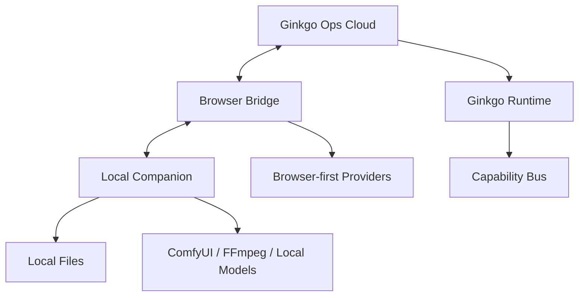
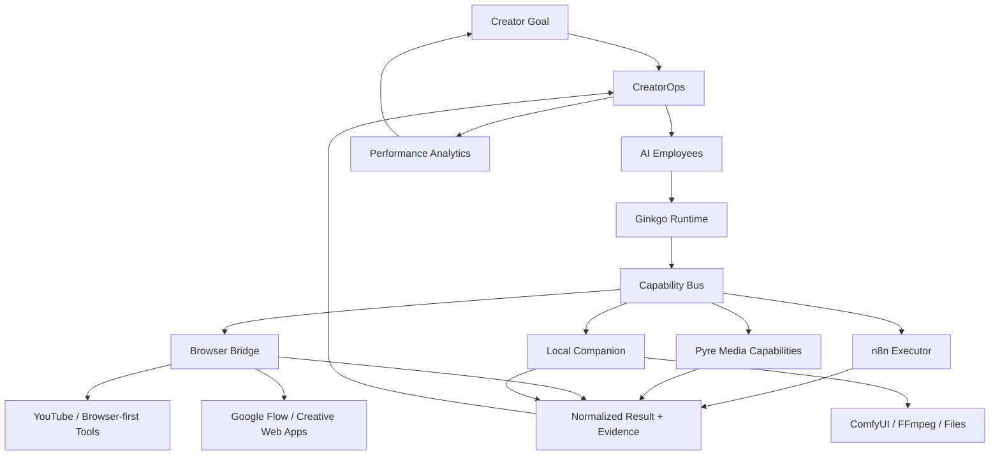

# DarkPlanner

## TL;DR

DarkPlanner is a strong product and packaging benchmark for a vertical **Creator Operations System** focused on faceless/dark content businesses.

Its strategic relevance to Ginkgo is not the individual features. Most are replaceable. The useful pattern is the composition:

```text
research -> editorial decision -> production pipeline -> browser execution -> media assets -> publication -> analysis
```

The benchmark supports a future Ginkgo direction in which CreatorOps becomes a vertical surface over existing shared infrastructure rather than another standalone backend.

**Decision:** `HIGH-VALUE REFERENCE; DO NOT CLONE; EXTRACT ARCHITECTURAL AND PRODUCT PATTERNS`.

## Why it matters

DarkPlanner demonstrates how generic AI capabilities become a product customers understand when they are wrapped around one operational job.

The user does not buy "LLM + TTS + video model + browser automation". The user buys a system for operating content channels.

For Ginkgo, that maps directly to the principle:

```text
capabilities are infrastructure
workflow is product
vertical outcome is what the customer buys
```

## Observed product shape

Public product surfaces show a combination of:

- multi-channel management;
- production planning and pipeline tracking;
- niche/content research;
- viral/reference discovery;
- prompt/reference organization;
- media utilities such as voice/audio and subtitle-related workflows;
- Chrome extension integration;
- browser-assisted Google Flow / generative media workflows;
- batch/queue-oriented creative execution;
- YouTube research overlays and channel/content inspection.

This is materially closer to an **operations system for a content factory** than to a conventional planner.

## Core benchmark patterns

### 1. CreatorOps as the product boundary

Recommended Ginkgo interpretation:

```text
CreatorOps
├── Brands
├── Channels
├── Ideas
├── References
├── Calendar
├── Production Pipeline
├── Assets
├── Intelligence
└── AI Employees
```

The vertical should consume existing shared capabilities instead of embedding its own execution engines.

### 2. Browser sidecar / extension

DarkPlanner is a useful reference for placing workflow controls directly inside third-party tools where creators already work.

Conceptual pattern:

```text
Third-party Web UI
        ↓
Browser Extension
        ↓
Queue / Project Context
        ↓
Cloud or Local Companion
```

For Ginkgo, the equivalent should be governed and capability-oriented rather than vendor-specific.

Potential future surface:

```text
Ginkgo Browser Bridge
├── browser.youtube.inspect-channel
├── browser.youtube.capture-reference
├── browser.flow.enqueue-generation
├── browser.flow.collect-generation
├── browser.instagram.capture-reference
├── browser.meta.inspect-ad
└── browser.web.capture-asset
```

These are candidate capabilities, not approved contracts.

### 3. Browser + local companion

The DarkPlanner extension publicly declares localhost access and describes integration with a desktop companion. This makes it a relevant benchmark for the hybrid pattern:



Important: the exact DarkPlanner desktop implementation technology is not verified and should not be inferred.

### 4. Content intelligence before generation

A notable product decision is placing research and reference collection before content generation.

Recommended Ginkgo loop:

```text
market/channel data
      ↓
research agent
      ↓
content hypothesis
      ↓
production
      ↓
published asset
      ↓
performance data
      ↓
next hypothesis
```

This converts a media factory from prompt automation into a closed-loop operating system.

### 5. Queue-based batch generation

Creative generation is operationally stronger when treated as jobs rather than a sequence of manual prompts.

Canonical Ginkgo direction should remain:

```text
Goal / Workflow
      ↓
AI Employee
      ↓
CapabilityRequest
      ↓
Ginkgo Runtime
      ↓
Policy
      ↓
Capability Bus
      ↓
Provider / Executor
      ↓
Normalized Result + Evidence
```

DarkPlanner validates the UX value of batching and queueing; it does not replace Ginkgo's execution architecture.

## Ginkgo use cases

### CreatorOps vertical

A future CreatorOps surface can be built over Ginkgo Ops while Runtime remains external.

```text
Ginkgo Ops / CreatorOps UI
          ↓
AI Employees
          ↓
Ginkgo Runtime
          ↓
Capability Bus
   ┌──────┼──────────────┐
   ↓      ↓              ↓
 n8n   ComfyUI       Browser Bridge
   ↓      ↓              ↓
 APIs   media         browser-first tools
```

### Pyre

Pyre can consume the benchmark for:

- channel/content planning;
- creative pipelines;
- asset registry integration;
- provider-agnostic media jobs;
- performance-driven iteration.

### Ginkgo Browser Bridge

Potentially valuable future cross-product capability for software that lacks a stable or sufficient API.

Browser automation must remain fallback/edge capability, not the default when an official API is available.

### Local execution bridge

A desktop/local companion can expose governed local capabilities such as:

- ComfyUI;
- FFmpeg;
- local models;
- filesystem operations;
- large asset transfer;
- GPU-bound jobs.

It must not become a second uncontrolled Runtime.

## What to adopt as patterns

| Pattern | Recommendation |
|---|---|
| Vertical CreatorOps positioning | adopt conceptually |
| Specialized production pipeline | adopt conceptually |
| Research before generation | adopt |
| References as first-class entities | adopt |
| Queue/batch creative jobs | adopt |
| Browser extension as contextual sidecar | experiment later |
| Local companion bridge | experiment later |
| Provider-specific logic in product UI | avoid |
| Rebuilding TTS/video providers internally | avoid |
| Parallel creator-specific backend | prohibit |

## What not to copy

Do not reproduce DarkPlanner's branding, copy, proprietary implementation, UI or product assets.

Do not create a DarkPlanner clone.

Do not create another content runtime beside Ginkgo Runtime.

Do not hardwire Google Flow, YouTube or a media provider into the CreatorOps domain model.

Do not elevate browser automation above official APIs when stable governed APIs exist.

## Ginkgo target architecture



## Architectural invariants

If Ginkgo implements these ideas later:

1. Ginkgo Runtime remains the execution/control boundary.
2. Browser Bridge is an executor/adapter surface, not an independent orchestrator.
3. Local Companion is an execution surface, not source of business truth.
4. Ginkgo Ops stores product/domain state, not provider execution logic.
5. Pyre owns reusable media capabilities.
6. Provider-specific details stay behind adapters/contracts.
7. Every agent-triggered external action must be policy-controlled and evidentiary.
8. Official APIs are preferred over DOM/browser automation when equivalent.
9. Browser automation must assume UI drift and expose failure/retry evidence.
10. No promotion into P0 merely because the benchmark is strategically attractive.

## Security / governance

Browser-extension and local-bridge architectures have privileged access surfaces.

Any Ginkgo implementation must include:

- explicit host permissions;
- least privilege;
- per-capability policy;
- secret isolation;
- no raw credential exposure to agents;
- origin allowlists;
- auditable actions;
- user/workspace tenancy boundaries;
- session/cookie handling rules;
- browser DOM drift detection;
- rate limiting and provider ToS review;
- signed/versioned local bridge protocol if a desktop companion is introduced.

## Build vs Buy vs Reference

**Current recommendation: reference.**

DarkPlanner should be treated as evidence that the CreatorOps packaging and browser-sidecar patterns have market utility.

Ginkgo should build only the reusable architectural layers that strengthen its own platform:

- CreatorOps domain surface;
- Browser Bridge contracts;
- governed local companion;
- provider-neutral content jobs;
- analytics feedback loop.

Everything else should be evaluated as buy/integrate/provider decisions.

## Promotion gates

Do not promote this benchmark directly.

Extract individual patterns only when a product roadmap requires them.

Suggested gates:

```text
CURATED BENCHMARK
   ↓
pattern selected by roadmap
   ↓
threat model + contract defined
   ↓
small isolated prototype
   ↓
validated evidence
   ↓
promotion to owning repo
```

Likely owners if promoted:

- CreatorOps domain -> Ginkgo Ops / Pyre
- browser capability contracts -> Ginkgo Runtime / Connect / Arsenal-equivalent registry
- media execution -> Pyre
- local execution bridge -> ai-stack / Runtime

## Sources and provenance

### Official

- Website: https://darkplanner.com.br/
- Instagram: https://www.instagram.com/oficialdarkplanner/
- Chrome extension: https://chromewebstore.google.com/detail/darkplanner/dkpcmhcjlidhmmnileiojcflhpclhcdn

## Verification notes

Verified on 2026-09-04 from public DarkPlanner surfaces.

Facts about specific implementation technology that are not publicly confirmed remain `unknown`. The browser/local-companion architecture is used here as a benchmark pattern based on public extension behavior and product descriptions, not as a claim about unpublished internals.

## Decision

```text
CURATED BENCHMARK
→ KEEP OUT OF CURRENT P0
→ EXTRACT CREATOROPS / BROWSER-BRIDGE / LOCAL-COMPANION PATTERNS WHEN ROADMAP REQUIRES
→ VALIDATE EACH PATTERN INDEPENDENTLY BEFORE PROMOTION
```
