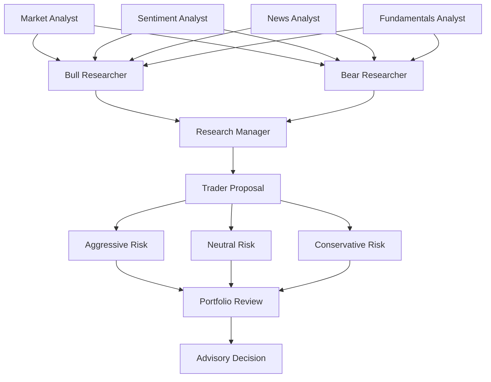
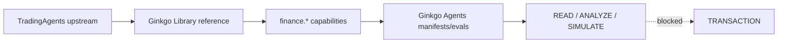

# TradingAgents — P0 Architectural Reference

## Decision

Adopt **architectural patterns**, not the upstream runtime as a trusted trading executor.

```text
RAW UPSTREAM != GINKGO CAPABILITY != TRANSACTION AUTHORITY
```

TradingAgents is a useful reference because it decomposes investment research into specialized analysts, adversarial research, a trader proposal, adversarial risk review, portfolio review, persistence and outcome reflection.

It is **not** registered as an execution authority for live brokerage, custody, transfer, order submission or position mutation.

## Upstream pattern worth reusing



The reusable pattern is:

```text
specialists
-> adversarial debate
-> synthesis
-> proposal
-> adversarial risk review
-> portfolio review
-> outcome/evidence
-> reflection
```

## Ginkgo mapping

TradingAgents concepts are decomposed into provider-agnostic `finance.*` capabilities. No caller receives the upstream graph as a master capability.

Initial allowed classes:

- `READ`
- `ANALYZE`
- `SIMULATE`

Explicitly outside this adoption:

- `TRANSACTION`
- broker order execution
- cancel/replace orders
- close positions
- transfer funds
- custody operations
- leverage changes

## Patterns promoted to Ginkgo

### P0

- specialist analyst decomposition;
- bull/bear adversarial research;
- aggressive/neutral/conservative risk perspectives;
- final portfolio review separated from trade proposal;
- fast-model vs deep-reasoning model routing;
- verified market snapshots before narrative claims;
- point-in-time / look-ahead-safe historical evaluation;
- decision -> realized outcome -> reflection loop;
- persistent checkpoint identity bound to graph shape;
- explicit data-vendor selection with no silent vendor substitution.

### P1

- FRED macro adapter candidate;
- market-expectation/prediction-market adapter candidate;
- yfinance and Alpha Vantage as research-data candidates;
- LangGraph checkpoint implementation pattern;
- Backtrader as one simulation candidate.

## Known upstream risks

- research output is probabilistic and model-dependent;
- backtests can overstate performance when data provenance or point-in-time constraints are weak;
- upstream v0.3.1 fixed a fundamentals look-ahead issue, proving temporal leakage is a material risk class;
- consumer-grade market data may be stale, incomplete or revised;
- social/news sentiment is noisy and can be manipulated;
- a BUY/SELL/HOLD recommendation is not transaction authorization.

## Evidence contract requirement

Any historical observation promoted into a simulation should carry, where applicable:

```text
event_time
available_at
observed_at
ingested_at
source_id
provider_id
instrument_id
```

A historical run may consume only evidence for which:

```text
available_at <= simulation_time
```

This is the default anti-look-ahead rule.

## Promotion boundary



Runtime adoption requires independent Ginkgo manifests, tests, evidence and promotion. Upstream popularity, benchmarks or stars do not grant lifecycle promotion.

## Alternatives / complements

- `AI4Finance-Foundation/FinRobot` — broader financial-agent platform/reference;
- Backtrader — simulation/backtest engine candidate;
- FRED — macroeconomic data candidate;
- Alpha Vantage / Yahoo Finance — market/fundamental data candidates;
- broker-specific APIs — future execution adapters, intentionally outside the current phase.

## Verdict

**P0 architectural reference.** Reuse the governance-friendly decomposition and evaluation patterns. Do not expose TradingAgents itself as a live-trading capability and do not connect its Trader/Portfolio output directly to a broker.