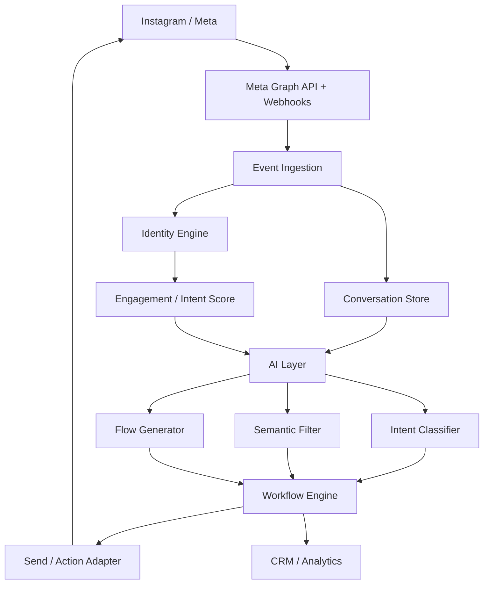
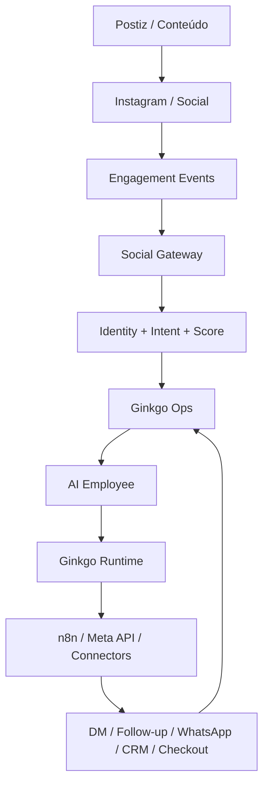
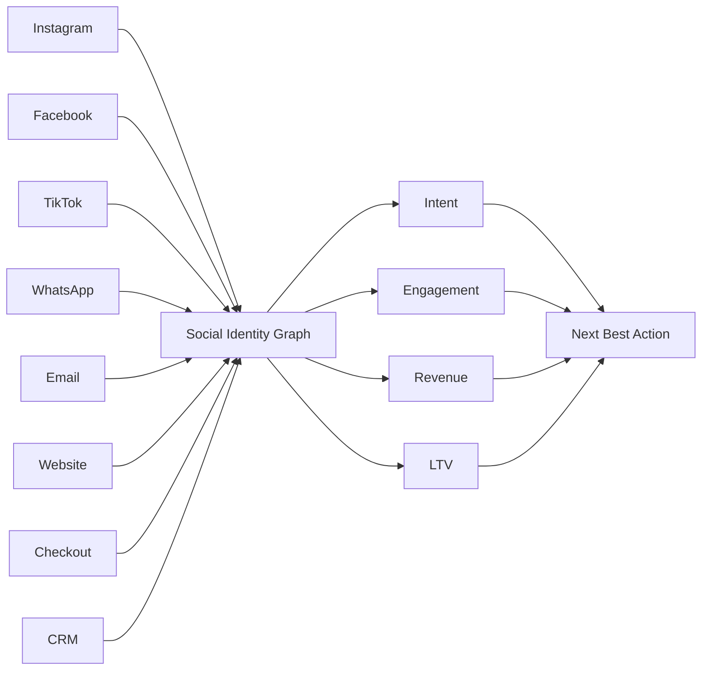

# Gaio Social — Benchmark para Social Revenue Engine

## Resumo executivo

A Gaio deve ser entendida menos como um "bot de Instagram" e mais como uma combinação de:

- automação de Instagram;
- inbox inteligente;
- mini-CRM social;
- classificação de intenção;
- ranking de seguidores;
- geração de fluxos por linguagem natural;
- ativação comercial de audiência via DM.

A tese central é transformar **engajamento social em pipeline comercial mensurável**.

```text
Instagram
  ↓
Interação
  ↓
Identidade
  ↓
Intenção
  ↓
Score
  ↓
Automação
  ↓
DM / Conversa
  ↓
Venda
```

Para a Ginkgo, o valor principal não está em copiar a interface ou criar outro ManyChat. O benchmark aponta para uma capability mais ampla: **Social Revenue Engine + Social Identity Graph** integrada ao Ginkgo Ops, Runtime, Postiz e executores externos.

---

## 1. Proposta de valor

O posicionamento comercial da Gaio gira em torno de uma ideia simples:

> Interações no Instagram são oportunidades comerciais que normalmente morrem dentro da caixa de entrada.

A plataforma busca reduzir essa perda criando automações de resposta, classificação e ativação sem exigir que o usuário pense como operador de workflow.

A abstração é importante:

```text
ManyChat tradicional
Usuário → constrói fluxo → publica

Gaio
Usuário → descreve intenção → IA gera fluxo → publica
```

O motor continua sendo um workflow engine; a diferença é que o workflow deixa de ser a interface principal.

---

## 2. Capabilities relevantes

### 2.1 Prompt → automação

O usuário descreve em linguagem natural o comportamento esperado.

Exemplo:

```text
"Quando alguém comentar GUIA neste Reel, envie o link pelo Direct."
```

Arquiteturalmente, isso sugere um fluxo semelhante a:

```text
Natural language intent
  ↓
LLM / parser
  ↓
Structured Workflow JSON
  ↓
Validator
  ↓
Workflow Engine
  ↓
Meta API
```

A implicação para a Ginkgo é direta: **DSL e engine devem existir, mas não precisam aparecer para o cliente final**.

### 2.2 Comment-to-DM

O principal loop de aquisição transforma comentário em conversa privada.

```text
Reel / Post
  ↓
Comentário com palavra-chave
  ↓
Evento Meta
  ↓
Regra / intenção
  ↓
DM
  ↓
CTA
  ↓
Conversa
  ↓
Pipeline / checkout / reunião
```

Casos de uso:

- creators;
- infoprodutos;
- afiliados;
- e-commerce;
- lançamento;
- serviços B2B/B2C;
- aquisição para WhatsApp;
- agendamento de reunião.

### 2.3 Disparo contextual

A lógica importante não é "spam para seguidores". O valor está em ativar uma audiência que acabou de gerar sinal comportamental.

```text
Conteúdo viral
  ↓
Interações recentes
  ↓
Segmentação
  ↓
Campanha DM
  ↓
Oferta
```

Isso deve ser tratado como **remarketing conversacional de alta intenção**, sempre respeitando as regras e janelas da Meta.

### 2.4 Ranking de seguidores

A plataforma transforma audiência bruta em prioridade comercial.

```text
Messages
Comments
Story interactions
Mentions
   ↓
Interaction Events
   ↓
Follower Profile
   ↓
Engagement Score
   ↓
Lead Ranking
```

A mudança de pergunta é estratégica:

```text
Antes:
"Quantos seguidores temos?"

Depois:
"Quem está demonstrando intenção comercial agora?"
```

### 2.5 Filtro e classificação semântica

Eventos podem ser classificados por significado comercial.

Exemplo conceitual:

```text
"quanto custa?"       → PURCHASE_INTENT_HIGH
"manda o link"        → PURCHASE_INTENT_HIGH
"tem tamanho M?"      → PRODUCT_INTEREST
"vocês atendem B2B?"  → B2B_LEAD
"kkkk"                → LOW_VALUE_INTERACTION
```

Pipeline provável:

```text
Event
  ↓
Classifier
  ↓
Intent
  ↓
Tags
  ↓
Score
  ↓
Queue / Action
```

### 2.6 Inbox inteligente / mini-CRM

A mensagem deixa de ser o objeto principal. O objeto principal passa a ser a pessoa.

```text
Person
├── social identity
├── username
├── messages
├── comments
├── story interactions
├── mentions
├── tags
├── interests
├── engagement score
├── purchase intent
├── last interaction
└── commercial stage
```

Esse é o ponto em que automação social começa a convergir com CRM.

---

## 3. A tese maior: Identity Layer

A direção mais estratégica é tratar identidades sociais como componentes de um mesmo perfil comercial.

```text
Instagram ─┐
Facebook  ─┤
TikTok    ─┤
WhatsApp  ─┼──► Unified Person / Company
Email     ─┤        │
Website   ─┤        ├── Intent
Checkout  ─┤        ├── Interests
CRM       ─┘        ├── Engagement Score
                    ├── Revenue
                    └── LTV
```

O objetivo deixa de ser automatizar mensagens e passa a ser construir uma **camada de identidade e intenção para social commerce**.

---

## 4. Arquitetura provável da categoria

A implementação interna da Gaio não é pública. O diagrama abaixo representa uma arquitetura de referência inferida para este tipo de produto.



Componentes essenciais:

1. event ingestion idempotente;
2. identity resolution;
3. conversation store;
4. engagement scoring;
5. intent classifier;
6. rules/workflow engine;
7. natural-language workflow compiler;
8. Meta adapter;
9. compliance/rate-limit layer;
10. CRM/attribution integration.

---

## 5. Diferencial contra ferramentas tradicionais

A vantagem principal não precisa ser quantidade de features.

Ela pode estar na redução de complexidade percebida.

```text
Ferramenta tradicional:
"Construa sua automação."

Produto AI-native:
"Diga o resultado que quer."
```

Essa é uma mudança de UX semelhante à transição:

```text
CLI → copiloto
workflow builder → intent compiler
```

A infraestrutura continua sofisticada. A sofisticação apenas migra da interface para o sistema.

---

## 6. Modelo comercial observado

A categoria favorece freemium com expansão por contatos/audiência ativa, não necessariamente por número de workflows.

Características desejáveis:

- entrada gratuita simples;
- automações suficientes para provar valor;
- upgrade conforme base/uso cresce;
- cobrança alinhada ao volume de contatos ou valor comercial;
- recursos premium para ranking, filtros, marca branca, suporte e analytics.

A lógica é eficiente porque evita cobrar pelo mecanismo e cobra pela escala do resultado.

---

## 7. O que absorver para a Ginkgo

### Não fazer

Não criar uma cópia isolada da Gaio.

Evitar:

- novo SaaS monolítico só para DM;
- outro workflow builder visual concorrendo com n8n;
- lógica de CRM duplicada fora do Ginkgo Ops;
- novo execution engine dentro do produto;
- dependência de scraping/browser quando a API oficial resolve;
- identidade social presa a um único canal.

### Fazer

Criar uma capability horizontal:

# Social Revenue Engine



Responsabilidades:

### Postiz

- calendário;
- publicação;
- distribuição;
- outbound content.

### Social Gateway

- ingestão de eventos;
- normalização;
- identidade de canal;
- compliance;
- rate limits;
- evidence.

### Ginkgo Ops

- pessoa/empresa;
- contatos;
- conversas;
- pipeline;
- histórico;
- tenancy;
- métricas comerciais.

### AI Employee

- qualificação;
- próxima melhor ação;
- resposta;
- follow-up;
- handoff humano;
- campanhas orientadas a intenção.

### Ginkgo Runtime

- policy;
- routing;
- capability execution;
- evidence;
- normalized result.

### n8n / adapters

- execução externa;
- Meta API;
- WhatsApp;
- e-mail;
- checkout;
- CRM externo;
- enriquecimento.

---

## 8. Social Identity Graph — evolução estratégica

A versão Ginkgo deve ser concebida desde o início para evoluir além de Instagram.



Pergunta operacional alvo:

> Quais pessoas estão demonstrando intenção de compra agora, em qualquer canal, e qual é a próxima melhor ação?

Esse é um problema maior e mais defensável do que simplesmente automatizar DMs.

---

## 9. Contratos conceituais recomendados

### SocialEvent

```json
{
  "event_id": "evt_x",
  "organization_id": "org_x",
  "channel": "instagram",
  "event_type": "comment.created",
  "channel_identity_id": "ig_123",
  "content_id": "media_456",
  "timestamp": "2026-09-03T00:00:00Z",
  "payload_ref": "secure://event/evt_x"
}
```

### IntentObservation

```json
{
  "person_id": "person_x",
  "intent": "purchase_interest",
  "confidence": 0.94,
  "signals": ["asked_price", "requested_link"],
  "source_event_ids": ["evt_x"],
  "observed_at": "2026-09-03T00:00:00Z"
}
```

### SocialLeadScore

```json
{
  "person_id": "person_x",
  "engagement_score": 82,
  "commercial_intent_score": 91,
  "recency_score": 97,
  "priority": "high"
}
```

### NextBestAction

```json
{
  "person_id": "person_x",
  "action": "send_offer_dm",
  "capability": "social.messaging.send",
  "requires_approval": false,
  "reason": "high_purchase_intent_recent_interaction"
}
```

Esses contratos são apenas referência de produto/arquitetura e não devem ser considerados contratos canônicos do Runtime sem promoção formal.

---

## 10. Guardrails

Qualquer implementação Ginkgo desta categoria deve manter:

- uso preferencial de APIs oficiais;
- consentimento e políticas da plataforma;
- respeito às janelas de mensagens;
- rate limiting;
- idempotência de webhooks;
- isolamento por organização;
- identidade e dados comerciais sob RLS/tenancy;
- segredos apenas por credential refs;
- evidence por execução;
- handoff humano disponível;
- prevenção de spam;
- opt-out e suppression lists quando aplicável;
- não inferir receita sem evento financeiro/checkout confirmado.

---

## 11. Roadmap sugerido

### Fase 0 — Benchmark

- [x] mapear Gaio;
- [x] identificar capabilities;
- [x] separar produto observado de arquitetura inferida;
- [x] registrar oportunidade Ginkgo.

### Fase 1 — Instagram inbound

- [ ] Meta webhook adapter;
- [ ] normalized SocialEvent;
- [ ] comment/DM/story event ingestion;
- [ ] identity mapping;
- [ ] Ginkgo Ops conversation link;
- [ ] basic intent classification.

### Fase 2 — Revenue automation

- [ ] engagement score;
- [ ] commercial intent score;
- [ ] next-best-action;
- [ ] comment-to-DM capability;
- [ ] follow-up orchestration;
- [ ] human handoff;
- [ ] attribution.

### Fase 3 — Intent compiler

- [ ] natural-language automation request;
- [ ] structured workflow schema;
- [ ] validation;
- [ ] preview;
- [ ] approval;
- [ ] execution via Runtime/n8n.

### Fase 4 — Social Identity Graph

- [ ] Instagram + WhatsApp identity linkage;
- [ ] email identity linkage;
- [ ] TikTok/Facebook adapters;
- [ ] checkout/revenue association;
- [ ] unified engagement timeline;
- [ ] LTV + propensity models.

---

## 12. Decisão de biblioteca

```yaml
adopt_now: false
status: curated
recommendation: promote-as-capability-design
promotion_targets:
  - Ginkgo Ops
  - Ginkgo Runtime
  - Ginkgo Agents
  - Ginkgo Connect / social adapters
  - Postiz integration layer
```

A Gaio é um **benchmark de produto e go-to-market**, não uma dependência técnica obrigatória.

O insight a promover é:

> conteúdo social gera eventos; eventos geram identidade e intenção; identidade + intenção devem alimentar agentes comerciais capazes de escolher e executar a próxima melhor ação.

---

## Fontes principais

- Gaio Social: https://gaio.social/
- Instagram: https://www.instagram.com/gaio.social/
- LinkedIn: https://br.linkedin.com/company/gaio-social

> Nota: detalhes internos de implementação não são públicos. Diagramas e componentes arquiteturais deste documento representam inferências e propostas da Ginkgo, não afirmações sobre o código-fonte da Gaio.
