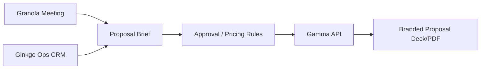

# Gamma

## TL;DR

Gamma is a hosted visual-content engine for presentations, documents, social posts and websites. Its value to Ginkgo increased materially because Gamma now exposes a production Generate API plus MCP/automation connectors, including an n8n integration path.

For Ginkgo, the best role is a **replaceable presentation/document rendering provider** behind internal proposal/report/content workflows.

**Decision:** `HIGH-PRIORITY ADOPTION CANDIDATE FOR COMMERCIAL OUTPUTS`.

## Why it matters

Many Ginkgo workflows end in an artifact a human/client must consume:

- sales proposal;
- pitch deck;
- account review;
- analytics report;
- onboarding guide;
- social carousel;
- internal briefing.

The information already exists upstream. Gamma can automate the visual packaging step.

```text
CRM / Analytics / Meeting / PRD
          ↓
normalized content brief
          ↓
Gamma adapter
          ↓
Deck / PDF / document / social artifact
```

## Core capabilities

- AI-generated presentations;
- structured visual documents;
- social media content;
- websites/pages;
- brand/theme application;
- PDF/PPTX export;
- programmatic generation via REST API;
- MCP connector for AI tools;
- automation integrations including n8n, Make and Zapier.

## Ginkgo use cases

### 1. Sales proposal factory



Gamma handles presentation, not commercial truth. Pricing, scope and customer facts must come from Ginkgo-controlled systems.

### 2. Automated client reporting

Analytics -> narrative -> approved metrics -> Gamma -> monthly/quarterly deck.

### 3. Social/content production

Pyre can use Gamma as one provider for carousel/document-style assets while retaining its own creative contract and asset registry.

### 4. Internal architecture briefings

Convert structured architecture decisions into readable stakeholder decks without forcing architects to manually format slides.

## Architecture fit

Gamma is an **output/rendering provider**.

Recommended contract:

```text
ContentArtifactRequest
  type: presentation | document | social
  brand_theme_id
  structured_content
  output_format
      ↓
Gamma Adapter
      ↓
Provider Job/Artifact
      ↓
Ginkgo Asset Registry
```

Do not store business logic inside Gamma templates/prompts if it belongs in Ginkgo systems.

## Integration surface

| Surface | Status | Notes |
|---|---|---|
| Generate API v1.0 | Verified GA | programmatic generation |
| API keys | Verified | Pro and above documented |
| MCP | Verified | connector surface for AI tools |
| n8n | Verified | official integration/automation path |
| PPTX/PDF export | Verified | artifact delivery |
| 60+ languages | Verified in API product material | useful for international output |

## API maturity note

Official Gamma documentation states Generate API v1.0 has been generally available since 2025-11-05. The older v0.2 was deprecated and scheduled to sunset in January 2026. Any integration must use current v1.0 contracts.

## Security / governance

- do not pass unrestricted CRM dumps to Gamma;
- normalize/minimize customer data before generation;
- keep API key in governed secret storage;
- persist final canonical artifact in Ginkgo-controlled storage when required;
- log provider job ID, cost/credits and template/theme version;
- human-approve commercial claims/pricing before external delivery.

## Build vs Buy vs Reference

**Recommendation:** buy/integrate.

Building a presentation rendering/layout engine is low strategic leverage. Ginkgo should own the content truth, workflow and approvals; Gamma can own layout/generation.

## Alternatives

- Canva automation/design workflows;
- Google Slides generation;
- PowerPoint/PPTX programmatic generation;
- custom HTML/PDF report rendering;
- direct generative design providers.

## Ginkgo destination

```text
Role: visual artifact provider
Owner: ginkgo-pyre for creative output; Ginkgo Ops as business consumer
Consumers: Sales, reporting, marketing, architecture communications
Promotion gate: stable branded template + API/n8n benchmark + artifact persistence
```

## Verification notes

Verified from official Gamma site/API/help/integration pages on 2026-09-03: API v1.0 GA, presentations/documents/social/web generation, MCP, n8n/Make/Zapier integrations and PDF/PPTX export.

## Decision

```text
CURATED -> PILOT PROPOSAL/REPORT GENERATION -> PROMOTE AS REPLACEABLE OUTPUT PROVIDER
```
