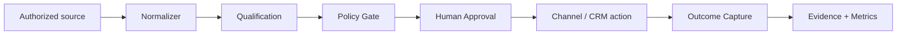

# Open Source Monetization Engine — 30-Day Execution Plan

## Objective

Convert the highest-ranked research opportunity into measurable commercial evidence without promoting unvalidated components into production architecture.

Primary target:

```text
Revenue Agent
```

Secondary target:

```text
WhatsApp Knowledge Agent
```

## Success definition

At the end of 30 days, the experiment should answer five questions with evidence:

1. Is the buyer problem real and frequent?
2. Can the workflow operate end-to-end under controlled permissions?
3. Does it produce a measurable business outcome?
4. Can Ginkgo deliver it at acceptable cost and operational effort?
5. Is the workflow repeatable enough to justify promotion into a canonical product/runtime repository?

## Week 1 — Problem and offer validation

### Deliverables

- choose one vertical;
- define one buyer role;
- define one measurable pain;
- define the baseline metric;
- complete at least 10 buyer conversations or equivalent validated discovery interactions;
- write the first offer contract;
- confirm intended deployment model before selecting upstream components.

### Recommended first vertical candidates

1. real estate;
2. clinics;
3. B2B local services.

### Offer contract

```yaml
buyer: null
problem: null
baseline_metric: null
promised_outcome: null
workflow_scope: null
excluded_actions: null
data_sources: []
channels: []
approvals: []
evidence: []
pricing_hypothesis: null
pilot_duration: null
success_threshold: null
```

### Gate W1

Proceed only if:

- pain is repeatedly confirmed;
- buyer can describe current manual workflow;
- buyer has an observable baseline;
- desired outcome is measurable;
- no critical license/platform blocker is identified.

Otherwise, change vertical or problem before building.

## Week 2 — Controlled end-to-end prototype

### Target architecture



### Minimum technical requirements

- isolated tenant/test dataset;
- no production secrets in repository;
- explicit input schema;
- idempotency key for repeatable operations;
- audit record for every material decision/action;
- human approval before irreversible or externally visible mutation during pilot;
- retry policy with bounded attempts;
- failure queue or replay mechanism;
- cost tracking per workflow execution;
- output linked to evidence.

### Prototype component posture

Components may be selected from:

- n8n or Activepieces for orchestration;
- Supabase for state/audit;
- Langflow/CrewAI for reasoning composition;
- Browser Use only for authorized browser tasks;
- Evolution API or official provider only after channel-policy review;
- custom Python/TypeScript workers for deterministic steps.

Selection is implementation-specific. No component becomes part of the public capability contract.

### Gate W2

Proceed only if one complete workflow can execute with:

```text
input
-> decision
-> approval
-> action
-> evidence
-> measurable result
```

and can be safely replayed or recovered after failure.

## Week 3 — Pilot and economic evidence

### Pilot cohort

Target:

```text
2-3 controlled pilot customers
```

or an equivalent internal simulation if external pilot authorization is not available.

### Metrics

Revenue Agent:

- leads processed;
- qualified leads;
- contactable leads with valid basis;
- approved outreach events;
- replies;
- booked meetings;
- attended meetings;
- opportunities created;
- revenue attributed where observable;
- cost per workflow;
- human minutes per workflow;
- error/recovery rate.

WhatsApp Knowledge Agent:

- conversations;
- response time;
- autonomous resolution rate;
- handoff rate;
- unsupported-answer rate;
- evidence coverage;
- customer/operator corrections;
- cost per resolved conversation.

### Economic model

```text
customer_value
= incremental_revenue
+ labor_cost_avoided
+ error_cost_avoided
+ cycle_time_value

cost_to_serve
= infrastructure
+ paid APIs
+ messaging/provider fees
+ human operations
+ support
+ amortized onboarding

contribution_margin
= price - cost_to_serve
```

Do not use model-estimated ROI as final evidence when observed business data is available.

### Gate W3

Proceed if:

- buyer outcome is positive enough to justify continued use;
- cost-to-serve is bounded;
- no unresolved safety/compliance blocker exists;
- failure handling is operationally acceptable.

Otherwise, reprice, reduce scope or redesign the workflow.

## Week 4 — Packaging and promotion decision

### Operational package

Produce:

- onboarding checklist;
- data requirements;
- channel requirements;
- permission matrix;
- support boundary;
- incident/recovery procedure;
- customer-facing scope;
- exclusion list;
- pricing model;
- ROI reporting view;
- deployment model;
- license/third-party dependency record.

### Productization test

The pilot should be reproducible using a documented sequence rather than bespoke founder intervention.

Measure:

```text
onboarding_time
configuration_time
weekly_human_ops_time
failure_rate
support_time
cost_per_customer
gross_margin
```

### Promotion outcomes

#### Promote

Use when E4/E5 evidence exists.

Possible targets:

- `Ginkgo-Core/ai-stack` for shared runtime contracts/infrastructure;
- `Ginkgo-Core/ginkgo-agents` for reusable agent/skill contracts and evals;
- `Ginkgo-Core/ginkgo-source` for validated solution composition;
- specific commercial product repository for final implementation.

#### Continue as Lab

Use when the workflow is technically viable but lacks buyer/economic evidence.

#### Watch

Use when the opportunity is strategically useful but not currently justified.

#### Reject / archive

Use when license, platform policy, economics or customer demand make the opportunity unattractive.

## P0 / P1 / P2 backlog

### P0 — commercial validation

- Revenue Agent vertical selection;
- buyer discovery;
- offer contract;
- baseline metric;
- authorized data-source strategy;
- consent/opt-out policy;
- end-to-end prototype;
- evidence schema;
- human approval gate;
- cost instrumentation;
- first pilot;
- ROI readout.

### P1 — repeatability and expansion

- WhatsApp Knowledge Agent pilot;
- reusable tenant onboarding;
- evaluation dataset;
- failure replay tooling;
- standardized audit events;
- pricing calculator;
- operational dashboard;
- vertical Content Factory acquisition module;
- Backoffice Agent process template;
- upstream license refresh process.

### P2 — platformization

- opportunity discovery/scoring assistant;
- reusable monetization scorecard UI;
- automated source/provenance refresh;
- portfolio-level economics dashboard;
- cross-product reusable business capability contracts;
- AI Engineering Factory externalization;
- automated promotion evidence checks.

## Promotion evidence packet

Every candidate proposed for promotion should include:

```yaml
candidate_id: null
library_record: null
buyer_segment: null
problem: null
baseline: null
pilot_result: null
roi_result: null
cost_to_serve: null
pricing_test: null
license_review: null
platform_policy_review: null
security_review: null
evidence_refs: []
known_failures: []
required_human_gates: []
recommended_target_repo: null
recommended_lifecycle_state: null
```

## Stop conditions

Stop or redesign the experiment when any of these occur:

- commercial use is incompatible with the intended license/deployment model;
- required data cannot be obtained on an authorized basis;
- the workflow depends on platform-policy violations;
- cost-to-serve destroys the pricing hypothesis;
- human review remains so large that automation has no material leverage;
- buyer outcome cannot be measured;
- repeat failures cannot be recovered safely;
- the offer is only differentiated by an upstream project that competitors can copy immediately.

## Final decision rule

```text
Do not promote because the demo works.
Promote when the business system works repeatedly, safely and economically.
```
