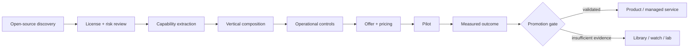
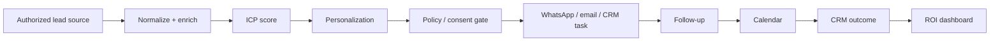
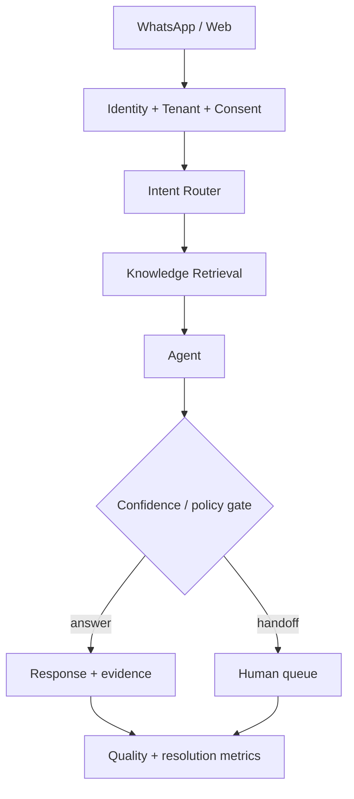
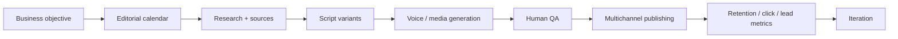
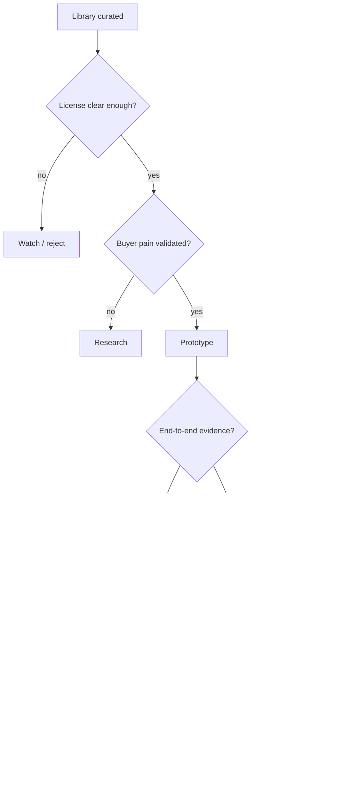

# Open Source Monetization Engine v1

## Executive thesis

The monetizable asset is not the open-source repository by itself. The defensible layer is the operational system built around it: distribution, proprietary data, process integration, observability, governance, support and measurable business outcomes.

The practical rule for Ginkgo is:

```text
OPEN_SOURCE_COMPONENT
!= PRODUCT
!= OFFER
!= BUSINESS_MODEL
```

A repository becomes commercially relevant only after it is composed into a controlled workflow that produces an outcome a buyer can measure.



## Scope

This feature defines a repeatable decision system for converting open-source AI projects into commercial opportunities without confusing technological popularity with production readiness or business viability.

It covers:

- opportunity discovery;
- license and platform-policy review;
- capability extraction;
- verticalization;
- offer design;
- pricing logic;
- pilot validation;
- operational controls;
- evidence and ROI;
- promotion into canonical Ginkgo repositories.

It does **not** authorize runtime execution, provider routing, customer outreach, scraping, messaging, payments or external mutations.

## Architectural boundary

The Library remains metadata and strategic intelligence.

```text
Ginkgo Library
  -> records what exists, why it matters and where it could fit

Ginkgo Source
  -> composes validated reusable solution patterns

Ginkgo Agents
  -> owns reusable agent / skill contracts and evaluations

ai-stack
  -> owns shared runtime architecture and infrastructure

Products / client delivery
  -> own the commercial implementation
```

No entry in this feature becomes routing-eligible or production-eligible merely because it is ranked highly.

## Source portfolio

### Strategic bases

| Project | Primary role | Commercial leverage | License posture from source research | Ginkgo posture |
|---|---|---|---|---|
| n8n | workflow orchestration | integrations, operations, managed automation | fair-code / Sustainable Use License; white-label and some hosted models require care | use internally or in consulting; audit before product embedding |
| Dify | agent workflows, RAG and AI apps | vertical agents and knowledge systems | Apache-based with additional conditions | candidate for delivery acceleration; audit multi-tenant/branding constraints |
| Langflow | visual agent pipelines | rapid prototyping and API composition | MIT | strong product-composition candidate |
| Browser Use | browser agent automation | backoffice and portal operations | MIT | candidate worker/tool behind governed adapters |
| CrewAI | multi-agent orchestration | research, sales, support, analytical workflows | MIT | candidate orchestration component, not public capability identity |
| OpenHands | software-engineering agent | MVP factory, maintenance and migration | MIT | candidate engineering executor/tooling component |
| ComfyUI | media pipelines | e-commerce creatives, ads, media production | GPL-3.0 plus model-level licensing | use with explicit derivative/distribution review |
| MoneyPrinterTurbo | automated short-form video | content modules and acquisition assets | MIT | reference implementation; not standalone differentiation |
| ShortGPT | Shorts/TikTok automation | batch content operations | MIT; external APIs | accelerator for vertical media workflows |
| Activepieces | automation platform | workflow automation and connector composition | license requires case-specific audit | evaluate as alternative orchestration layer |
| Agenta | agent evaluation workspace | prompt/agent QA and evaluation services | audit current distribution terms | evaluation-layer candidate |

## Commercial opportunity stack

The source research points to four high-value commercial directions. This feature adds a Ginkgo-specific fifth direction for software delivery.

### 1. Revenue Agent for local and B2B businesses — P0 commercial experiment

**Outcome sold:** qualified meetings, reactivated pipeline, faster follow-up and attributable revenue activity.

Candidate flow:



Potential components:

- n8n or Activepieces for orchestration;
- Supabase for data, audit and state;
- Langflow/CrewAI for agentic reasoning;
- workers for enrichment and controlled browsing;
- Evolution API or official messaging provider for WhatsApp channel integration;
- CRM connector;
- Stripe or Brazilian payment providers at product layer, when authorized;
- analytics layer for attribution.

Commercial package:

```text
setup
+ monthly managed operation
+ optional performance component tied to an agreed measurable event
```

Guardrails:

- no spam-as-a-product;
- consent and opt-out requirements;
- LGPD-aware data handling;
- channel policy compliance;
- evidence for contact origin and outreach decision;
- rate limits and human approval where required.

### 2. WhatsApp Knowledge + Service Agent — P0/P1 commercial experiment

**Outcome sold:** lower response time, increased resolution rate, reduced manual support load and better lead capture.



Defensibility comes from the customer knowledge base, integrations, accumulated evaluation data, workflow state and operational history—not from the chat UI alone.

### 3. Backoffice Process Agents — P1

**Outcome sold:** fewer manual hours, lower error rate, shorter cycle time and auditable execution.

Candidate processes:

- order checking;
- portal operations;
- CRM updates;
- proposal preparation;
- ticket triage;
- document intake;
- reconciliation support;
- recurring operational reporting.

Mandatory controls:

```text
queue
+ idempotency
+ permission boundary
+ human approval for irreversible actions
+ evidence capture
+ replay / recovery
+ cost limits
+ observability
```

A browser agent without audit and recovery is a demo. A browser agent inside these controls can become a productized operation.

### 4. Vertical Content Factory — P1

**Outcome sold:** consistent branded distribution tied to acquisition or commerce metrics.

MoneyPrinterTurbo and ShortGPT are treated as pattern sources and accelerators. The offer must be verticalized.



Possible verticals:

- real estate;
- local retail;
- education;
- professional services;
- franchises;
- e-commerce;
- B2B founders.

The differentiator is the loop `content -> distribution -> lead -> attribution`, not raw video generation volume.

### 5. AI Engineering Factory — P1/P2

**Outcome sold:** faster delivery of scoped software changes with human-reviewed evidence.

Potential foundations:

- OpenHands;
- coding agents;
- browser QA;
- CI;
- repository intelligence;
- test generation;
- migration assistants.

This direction should be positioned as an engineering service or controlled internal factory before becoming an autonomous product.

## Opportunity scoring model

The following scoring system is a **Ginkgo synthesis** derived from the source research, not a source-provided benchmark.

Each opportunity receives 0–5 on seven factors.

| Factor | Weight | Question |
|---|---:|---|
| Revenue proximity | 25% | Does the workflow connect directly to revenue, cost reduction or throughput? |
| Speed to pilot | 20% | Can a credible end-to-end pilot be assembled quickly? |
| Recurring value | 15% | Does usage naturally recur each week/month? |
| Defensibility | 15% | Do data, integration and operational history create switching cost? |
| Margin potential | 10% | Can delivery scale without proportional labor growth? |
| Ginkgo stack leverage | 10% | Can existing orchestration, WhatsApp, CRM, RAG and analytics capabilities be reused? |
| License confidence | 5% | Is commercial use straightforward enough for the intended deployment model? |

Weighted score:

```text
score = Σ(factor_rating / 5 * factor_weight)
```

Initial strategic ranking:

| Opportunity | Score / 100 | Priority | Rationale |
|---|---:|---|---|
| Revenue Agent | 92 | P0 commercial experiment | closest to measurable revenue and reuses core Ginkgo integrations |
| WhatsApp Knowledge Agent | 89 | P0/P1 | recurring operational value with high data/integration defensibility |
| Backoffice Process Agents | 86 | P1 | strong cost/time ROI; requires tighter governance and process mapping |
| Vertical Content Factory | 80 | P1 | fast to launch but more competitive; defensibility depends on attribution/data loop |
| AI Engineering Factory | 76 | P1/P2 | high strategic leverage but harder to package for repeatable external delivery |

These scores are decision aids and must be replaced by observed pilot evidence as soon as real data exists.

## Offer design contract

Every monetization candidate should be expressed as:

```yaml
buyer: <specific role/company type>
problem: <measurable operational pain>
outcome: <measurable result>
workflow: <controlled process>
inputs: <authorized data sources>
controls: <approvals, permissions, audit, limits>
evidence: <what proves the result>
pricing_unit: <setup/monthly/usage/outcome>
unit_economics: <cost-to-serve and margin assumptions>
license_constraints: <relevant upstream terms>
platform_constraints: <channel/API/data terms>
pilot_gate: <minimum evidence to continue>
promotion_target: <repo/product if validated>
```

If the opportunity cannot fill these fields, it is not ready to leave research.

## License and policy gate

GitHub availability does not equal unrestricted SaaS rights.

Before promotion, classify deployment intent:

| Deployment model | Required posture |
|---|---|
| Internal consulting tool | review repository license and vendor terms |
| Dedicated client installation | validate redistribution, notices and support obligations |
| Multi-tenant SaaS | perform explicit commercial-license analysis |
| White-label frontend | verify branding and redistribution rights; never assume |
| Modified redistribution | review copyleft/disclosure obligations and dependencies |
| Platform data collection | verify authorization, terms, privacy and opt-out requirements |

Additional review is required for models, datasets, voices, fonts, images and third-party APIs even when the orchestration repository itself is permissively licensed.

## Build-vs-adopt rule

Use upstream projects as replaceable components behind Ginkgo-owned contracts.

```text
PUBLIC BUSINESS CAPABILITY
    -> Ginkgo contract
    -> adapter / worker / orchestration implementation
    -> third-party project or provider
```

Never make a public business capability synonymous with one repository.

Example:

```text
GOOD
business.lead.qualify
  -> internal skill/adapter
  -> replaceable implementation

BAD
business.lead.qualify
  -> crewai.qualify
```

This preserves provider and tool replaceability.

## Candidate capability families for later promotion

These names are **discovery metadata only**. They are not active runtime contracts.

```text
business.opportunity.discover
business.opportunity.score
business.offer.compose
business.unit_economics.evaluate
business.license_risk.assess
business.pilot.plan
business.roi.measure

revenue.lead.normalize
revenue.lead.enrich
revenue.lead.qualify
revenue.outreach.prepare
revenue.followup.plan
revenue.meeting.attribute

operations.task.prepare
operations.task.execute_guarded
operations.evidence.capture
operations.process.measure

content.plan
content.research
content.compose
content.qa
content.distribute
content.performance.measure
```

Promotion requires canonical contract review in the target runtime repository.

## Evidence model

A monetization candidate must accumulate evidence across five layers:

```text
E0 — source evidence
E1 — technical feasibility
E2 — controlled end-to-end pilot
E3 — buyer evidence
E4 — economic evidence
E5 — repeatability evidence
```

Definitions:

- **E0:** repository, license, documentation and source provenance recorded;
- **E1:** critical workflow can run in an isolated test environment;
- **E2:** complete workflow with logs, failure handling and human gates;
- **E3:** real buyer confirms the problem and willingness to adopt/pay;
- **E4:** measured value exceeds cost-to-serve with acceptable margin;
- **E5:** onboarding and operation are repeatable across multiple customers.

No candidate should be labeled production-ready before E4/E5.

## Promotion gates



Minimum promotion checklist:

- [ ] canonical source recorded;
- [ ] upstream license reviewed for intended deployment model;
- [ ] third-party API/platform terms identified;
- [ ] buyer and measurable pain defined;
- [ ] end-to-end workflow demonstrated;
- [ ] audit/evidence path exists;
- [ ] permissions and irreversible actions gated;
- [ ] cost-to-serve measured or bounded;
- [ ] pricing hypothesis tested;
- [ ] ROI metric defined;
- [ ] fallback semantics documented;
- [ ] target repository and owner identified.

## Anti-patterns

Avoid:

- cloning a viral repository and treating popularity as a business model;
- faceless-content volume without distribution or attribution advantage;
- uncontrolled browser agents;
- scraping without an authorized basis;
- WhatsApp spam as an acquisition strategy;
- multi-tenant resale without license analysis;
- upstream-specific names in public business capability contracts;
- automations with no evidence, recovery or human escalation;
- “AI savings” claims without a baseline and measurable delta.

## Strategic recommendation

The first commercial validation target should be the **Revenue Agent**, followed closely by the **WhatsApp Knowledge Agent**.

They sit at the intersection of:

```text
existing Ginkgo integration leverage
× recurring customer pain
× measurable outcome
× proprietary operational data
× expansion potential
```

MoneyPrinterTurbo-style media automation should be attached as an acquisition/remarketing module, not positioned as the entire product.

## Provenance

Primary input: user-supplied technical research report, `Open source de IA com potencial de monetização`, dated 2026-08-20.

Referenced upstreams from that research include:

- https://github.com/n8n-io/n8n
- https://github.com/langgenius/dify
- https://github.com/langflow-ai/langflow
- https://github.com/browser-use/browser-use
- https://github.com/crewAIInc/crewAI
- https://github.com/OpenHands/OpenHands
- https://github.com/Comfy-Org/ComfyUI
- https://github.com/harry0703/MoneyPrinterTurbo
- https://github.com/RayVentura/ShortGPT
- https://github.com/activepieces/activepieces
- https://github.com/Agenta-AI/agenta
- https://github.com/asiifdev/business-leads-ai-automation
- https://github.com/brightdata/ai-lead-generator

This Library feature preserves the source thesis while adding Ginkgo-specific scoring, promotion gates, capability candidates and commercial packaging guidance.
