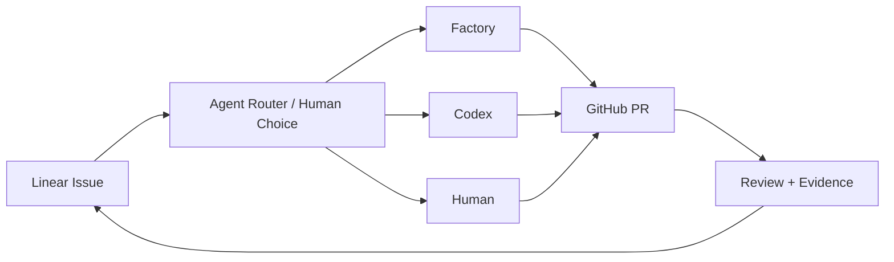

# Linear

## TL;DR

Linear can serve as Ginkgo's **execution ledger for product/engineering work**: scoped issues, projects, cycles and agent-visible work items, while GitHub remains source of truth for code.

The strategic fit improved because Linear now exposes GraphQL API, TypeScript SDK, webhooks, remote MCP and a Developer Preview in which agents can behave similarly to workspace users: receive assignments, be mentioned and collaborate through issues/comments/projects.

**Decision:** `CRITICAL PILOT CANDIDATE FOR ENGINEERING WORK CONTROL PLANE`.

## Why it matters

Ginkgo already works in slices, acceptance criteria, PASS/BLOCKED gates and repository evidence. Linear can turn that methodology into a machine-readable work graph.

```text
Roadmap decision
   ↓
Linear project/issue
   ↓
agent or human assignee
   ↓
GitHub implementation
   ↓
Jam/test evidence
   ↓
review
   ↓
issue completion
```

This is materially better than using chat history as the task database.

## Core capabilities

- issues and sub-work tracking;
- projects/roadmaps/cycles;
- triage and insights on higher plans;
- GraphQL API;
- OAuth/API-key auth;
- TypeScript SDK;
- webhooks;
- remote MCP server for compatible agents;
- native agent-development model in Developer Preview;
- integrations with GitHub and support/customer systems.

## Ginkgo use cases

### 1. Ginkgo Ops P0/P1 execution

Each slice becomes a bounded issue or project with:

- objective;
- baseline;
- affected areas;
- invariants;
- tenancy/RLS requirements;
- acceptance criteria;
- tests;
- prohibited actions;
- promotion criteria.

### 2. Agent dispatch



Agent identity must not weaken review requirements.

### 3. Bug intake

Jam can create a Linear issue carrying reproduction context. The issue becomes the durable task; Jam remains evidence.

### 4. Cross-repo roadmap

Use projects to represent business/product outcomes and issues to represent bounded repo work, avoiding giant “build Ginkgo Ops” tasks.

## Architecture fit

Linear is a **work coordination system**, not Ginkgo Runtime.

Do not route customer/business actions through Linear unless explicitly modeled as human/engineering work. Ginkgo Runtime continues to execute product capabilities; Linear coordinates building and operating those capabilities.

## Integration surface

| Surface | Status | Notes |
|---|---|---|
| GraphQL API | Verified | query/mutation surface |
| TypeScript SDK | Verified | strongly typed integration |
| Webhooks | Verified | event-driven synchronization |
| MCP | Verified | find/create/update issues, projects, comments and evolving functionality |
| Agent APIs | Developer Preview | native agent participation model; contract may change |

## Plan note

Official Business pricing verified on 2026-09-03 at USD 16/user/month billed yearly. Business includes features such as unlimited teams, private teams/guests, Triage Intelligence, Loops, Code Intelligence and Insights.

Third-party “12 month” offers around one month of official seat price should be treated as entitlement risk, not normal procurement.

## Security / governance

- least privilege for integrations and agents;
- workspace admin ownership must remain Ginkgo-controlled;
- GitHub branch protection remains authoritative for code;
- do not store secrets in issues;
- sensitive client data should be linked/referenced, not dumped into general work items;
- agent-created issues/comments require provenance.

## Build vs Buy vs Reference

**Recommendation:** buy/pilot rather than build a project tracker.

Ginkgo Ops itself may contain customer-facing task/workflow features, but internal engineering work management is not the same problem and should not be recreated prematurely.

## Alternatives

- GitHub Issues/Projects: lower tool count and strong code adjacency;
- Jira: deeper enterprise configurability, heavier operation;
- Notion: flexible docs/tasks but weaker execution primitives for agent-native engineering;
- custom Ginkgo Ops internal module: only justified if product requirements converge later.

## Ginkgo destination

```text
Role: engineering/product work control plane
Owner: ginkgo-connect + engineering operations
Consumers: product architects, coding agents, QA, GitHub
Promotion gate: prove one full slice lifecycle Linear -> agent/human -> PR -> evidence -> close
```

## Verification notes

Verified from official Linear pricing/developer/MCP/agent documentation on 2026-09-03. Agent APIs are explicitly Developer Preview and must not be treated as stable production contracts yet.

## Decision

```text
CURATED -> PILOT ON GINKGO OPS -> PROMOTE IF IT BECOMES THE SINGLE EXECUTION LEDGER WITHOUT DUPLICATING GITHUB
```
