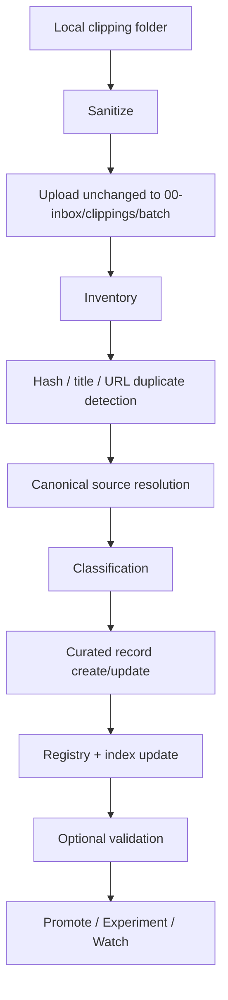

# Ingestion Guide

## Goal

Turn messy clippings, saved Markdown files, URLs and repository notes into a clean, deduplicated, AI-readable library.

## Input rule

New material enters **raw first**. Do not manually sort it into final categories before triage unless the category is obvious and a canonical record already exists.

Recommended upload destination:

```text
00-inbox/clippings/<batch-name>/
```

Example:

```text
00-inbox/clippings/2026-08-local-vault/
```

## Accepted source types

Preferred:

```text
.md
.txt
.json
.yaml / .yml
.csv
```

Allowed when useful:

```text
.pdf
.png / jpg / webp
.mp4
.html
```

For binary/heavy media, prefer a metadata Markdown record + stable external/storage reference instead of bloating Git when the original file is not essential.

## Pre-upload sanitation

Before committing a local vault batch, remove or quarantine:

- `.env` and variants;
- tokens/API keys;
- credentials/password files;
- browser/session/cookie exports;
- private SSH keys;
- database dumps;
- personal documents unrelated to library research;
- client-sensitive data;
- generated cache folders;
- `.obsidian/workspace*` and machine-specific Obsidian state;
- node_modules/build artifacts.

Useful Obsidian Markdown notes can be uploaded. Obsidian application state normally should not.

## Batch workflow



## Why raw input is preserved

Raw source keeps:

- discovery context;
- original claims;
- historical snapshots;
- audit trail;
- details that may be omitted during synthesis.

But raw files are **not** authoritative conclusions.

## Deduplication keys

Use in order:

1. canonical URL;
2. GitHub `owner/repo`;
3. normalized product/project name;
4. exact content hash;
5. near-duplicate title;
6. semantic overlap.

Multiple sources about the same technology update one canonical curated file.

## Canonical source resolution

If a clipping is about a GitHub repository:

```text
clipping -> identify owner/repo -> official README/docs/releases -> curated record
```

If a clipping is about a commercial platform:

```text
clipping -> official site/docs/API/pricing -> curated record
```

If there is no primary source, clearly mark that limitation.

## Curated filename

Convert long clipping titles into stable canonical IDs.

Bad:

```text
SamurAIGPTawesome-hermes-agent A curated list of skills....md
```

Good:

```text
10-agents/frameworks/awesome-hermes-agent.md
```

Raw file can keep the original title inside the batch folder.

## Batch manifest

Every large upload batch should include:

```text
00-inbox/clippings/<batch>/MANIFEST.md
```

Minimum content:

```yaml
batch_id: 2026-08-local-vault
source: local-obsidian-vault
uploaded_at: 2026-08-17
sanitized: true
approx_files: 120
notes: "Export of saved technology clippings"
```

## Curator output

After processing a batch, create/update:

```text
00-inbox/clippings/<batch>/PROCESSING_REPORT.md
```

Recommended metrics:

```text
files_received
exact_duplicates
semantic_duplicates
canonical_projects_identified
curated_records_created
curated_records_updated
watch_items
promotion_candidates
rejected_or_archived
security_findings
```

## Large batch strategy

Do not process hundreds of files in one giant model context.

Recommended chunking:

```text
inventory whole batch
  ↓
group by likely entity/topic
  ↓
process 10–30 related files at a time
  ↓
update canonical records incrementally
```

The registry is the memory between batches.

## Source preservation vs copyright

For private internal research, preserve your own notes and clippings as appropriate, but avoid turning the repository into a redistribution mirror of copyrighted books, paid courses, proprietary documents or entire third-party sites.

Prefer:

- your notes/summaries;
- metadata;
- short necessary excerpts;
- canonical links;
- architectural synthesis.

## Final criterion

Ingestion is successful when a future agent can answer the useful question from the curated layer and only needs the raw clipping to verify provenance or inspect details.
