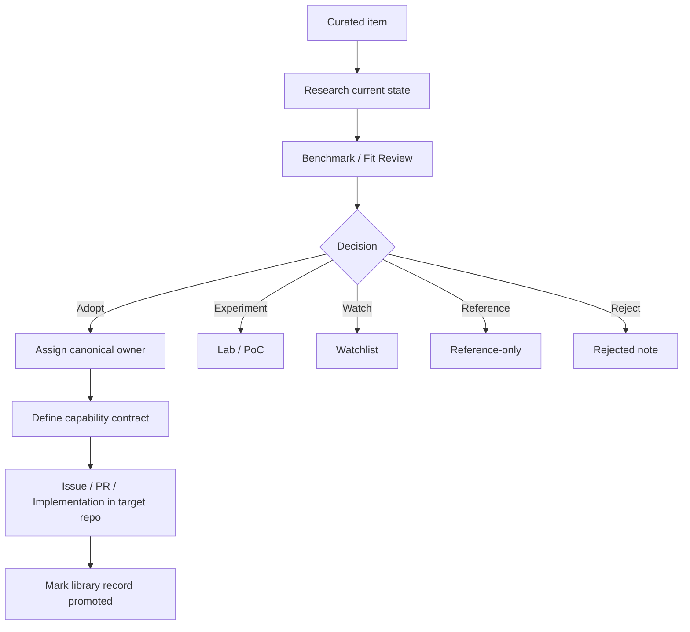

# Promotion Policy

Promotion means a library item becomes an implementation candidate or an adopted capability in another canonical Ginkgo repository.

## Promotion gate

Before `validated` or `promoted`, confirm:

- current authoritative source checked;
- license/terms understood;
- security and data exposure reviewed;
- maintenance activity assessed;
- integration surface known;
- operational burden estimated;
- expected cost profile estimated;
- fallback/removal path defined;
- target owner/repository identified;
- stable internal capability contract defined where appropriate;
- benchmark, PoC or other acceptance evidence exists for high-impact adoption.

## Decision classes

```text
ADOPT NOW  -> useful, current, target owner exists, risk understood
EXPERIMENT -> promising but needs benchmark/PoC
WATCH      -> potentially useful later, no current implementation need
REFERENCE  -> architecture/code inspiration, not intended as dependency
REJECT     -> poor fit, unsafe, legally incompatible or redundant
ARCHIVE    -> historically useful but obsolete
```

## Promotion flow



## Provider neutrality

When adopting hosted AI/model/media providers, prefer a Ginkgo-owned interface around the provider.

Bad:

```text
product -> vendor-specific SDK everywhere
```

Preferred:

```text
product -> internal capability contract -> provider adapter
```

## Production evidence

Evidence may include:

- automated tests;
- benchmark results;
- cost/latency measurements;
- security review;
- successful sandbox integration;
- real controlled customer/use-case evidence;
- upstream maintenance/release evidence.

Popularity alone is not evidence of fit.

## Promotion record

When promoting, update the library record with:

```yaml
status: promoted
canonical_owner: ginkgo-pyre
promotion_target: Ginkgo-Seeds/ginkgo-pyre
```

And add the issue/PR/implementation reference under provenance or a dedicated promotion section.

The library record remains after promotion as the technology intelligence source of truth.
