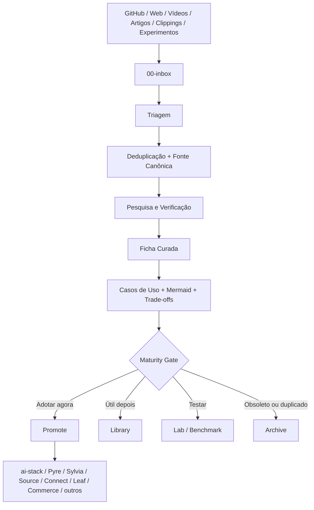
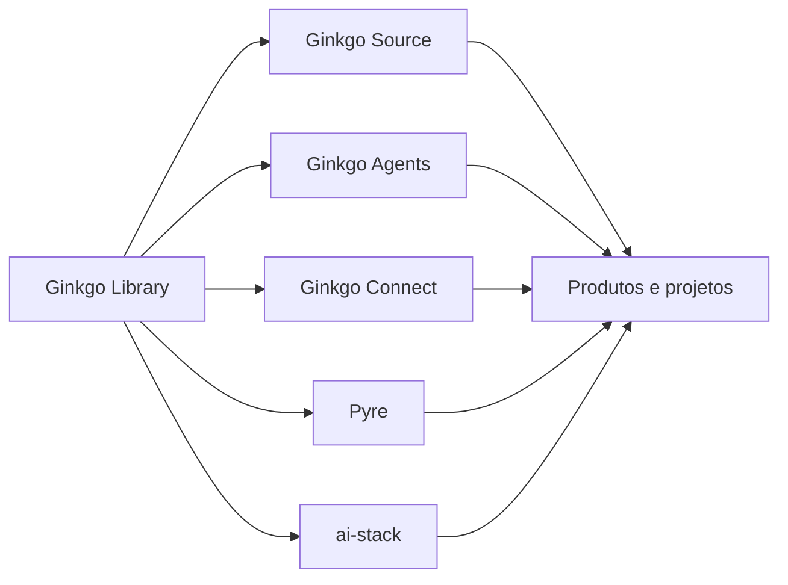

# Ginkgo Library

> **Biblioteca canônica de inteligência tecnológica da Ginkgo AI Systems.**
>
> Um repositório neutro para tecnologias, projetos open source, skills, agentes, padrões arquiteturais, clippings, pesquisas e referências que podem ser úteis agora ou no futuro.

## Princípio central

```text
RAW != CURATED != ADOPTED
```

Salvar uma ferramenta não significa adotá-la. A biblioteca existe para transformar descoberta em conhecimento operacional reutilizável.



## O que esta biblioteca é

- memória tecnológica versionada;
- catálogo de capacidades e ferramentas;
- índice de projetos open source relevantes;
- base de pesquisa para agentes de IA;
- camada neutra entre descoberta e produção;
- fonte de contexto para arquitetura, build-vs-buy e seleção de providers;
- histórico de por que uma tecnologia foi considerada, adotada ou descartada.

## O que esta biblioteca não é

- runtime de produção;
- monorepo de todos os projetos open source encontrados;
- depósito de links sem contexto;
- substituto de `ai-stack`, `ginkgo-source`, `ginkgo-agents` ou produtos;
- lugar para secrets, `.env`, credenciais ou dados pessoais.

## Lifecycle

```text
inbox
  ↓
raw
  ↓
triaged
  ↓
curated
  ↓
validated
  ↓
promoted
  ↓
deprecated / archived
```

Estados canônicos:

| Status | Significado |
|---|---|
| `inbox` | material recém-ingestado, ainda não analisado |
| `raw` | conteúdo bruto preservado com provenance |
| `triaged` | categoria, fonte e duplicatas identificadas |
| `curated` | ficha refinada com entendimento e casos de uso |
| `validated` | pesquisa atual e/ou benchmark suficiente para recomendação |
| `promoted` | capacidade levada para um repo/produto canônico |
| `watch` | útil, mas ainda não vale adoção |
| `deprecated` | perdeu relevância ou foi substituída |
| `archived` | preservado apenas por histórico |

## Estrutura

```text
.
├── README.md
├── AGENTS.md
├── CLAUDE.md
├── CONTRIBUTING.md
├── LIBRARY_SCHEMA.md
├── TAXONOMY.md
├── PROMOTION_POLICY.md
├── LICENSE_POLICY.md
├── INGESTION_GUIDE.md
├── AI_ACCESS.md
│
├── 00-inbox/
├── 10-agents/
├── 20-automation/
├── 30-models-routing/
├── 40-media/
├── 50-data-knowledge/
├── 60-app-platform/
├── 70-design/
├── 80-infrastructure/
├── 90-business-use-cases/
│
├── architectures/
├── indexes/
├── registry/
├── templates/
└── archive/
```

## Categorias principais

| Código | Área | Exemplos |
|---|---|---|
| `10` | Agents | Hermes, Claude Code, OpenCode, agent frameworks, memory, evals |
| `20` | Automation | n8n, browser automation, workflow engines, integrations |
| `30` | Models & Routing | LiteLLM, gateways, inference, local models, model routers |
| `40` | Media | imagem, vídeo, voz, avatars, ComfyUI, Higgsfield |
| `50` | Data & Knowledge | RAG, vector DB, knowledge graph, scraping, ingestion |
| `60` | App & Platform | CRM, SaaS patterns, auth, payments, frontend/backend |
| `70` | Design | design systems, motion, Three.js, GSAP, Lottie, visual QA |
| `80` | Infrastructure | Docker, observability, queues, storage, deployment, security |
| `90` | Business Use Cases | social factory, commerce, real estate, sales, workforce, verticals |

## Como uma ficha deve responder

Ao abrir qualquer item curado, uma pessoa ou agente deve descobrir rapidamente:

1. **O que é?**
2. **Por que foi salvo?**
3. **Quais capacidades entrega?**
4. **Quais casos de uso Ginkgo possui?**
5. **Como se encaixa arquiteturalmente?**
6. **É open source? Pode self-host? Tem API/MCP/CLI?**
7. **Quais riscos, custos e limitações existem?**
8. **Quais alternativas competem com ele?**
9. **Qual o status atual: adopt, experiment, watch ou archive?**
10. **Para qual repo/produto deve ser promovido se adotado?**

## Padrão de ficha

```yaml
id: higgsfield
name: Higgsfield
kind: platform
category: media.video
status: curated
maturity: production-candidate
priority: high
open_source: false
self_hostable: false
api: partial
mcp: true
canonical_owner: ginkgo-pyre
tags: [video, ugc, ads, mcp, multimodal]
source_verified_at: 2026-08-17
```

Depois do frontmatter, a ficha usa Markdown humano + Mermaid.

## Regra de open source

A biblioteca normalmente guarda **metadados, análise, provenance e links canônicos**, não clones inteiros.

Fork/cópia somente quando houver uma razão explícita:

- modificar o upstream;
- preservar uma versão crítica;
- self-hosting controlado;
- upstream instável ou em risco;
- patches próprios relevantes.

## Relação com os outros repos



- **Ginkgo Library:** o que existe e o que sabemos.
- **Ginkgo Source:** como compor soluções com peças validadas.
- **Ginkgo Agents:** agentes/skills reutilizáveis e evals.
- **Ginkgo Connect:** conectores e contexto externo governado.
- **ai-stack:** infraestrutura e runtime compartilhado.
- **Produtos:** implementação comercial final.

## Quick access para IA

Agentes devem começar por:

1. `AI_ACCESS.md`
2. `registry/library.yaml`
3. `indexes/`
4. a ficha individual relevante
5. `architectures/` quando a pergunta for sistêmica

Evite varrer todos os arquivos brutos por padrão.

## Segurança

Nunca versionar:

- `.env`;
- tokens;
- API keys;
- senhas;
- cookies/sessions;
- dados pessoais sensíveis;
- dumps de banco;
- arquivos privados de clientes sem autorização explícita.

Clippings devem passar por sanitização antes do commit.

---

**Ginkgo Library** — descobrir uma vez, entender direito, reutilizar muitas vezes.
