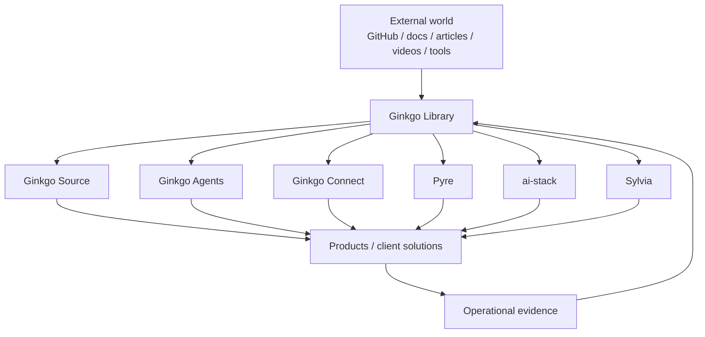
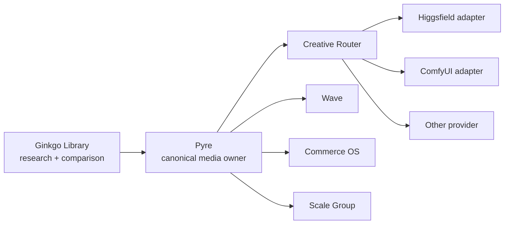
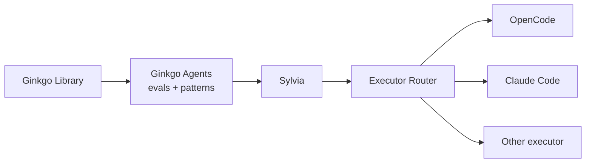

# Ginkgo Technology Intelligence Ecosystem

## Role separation



## Mental model

```text
Library = memory of what exists and what we know
Source = architect/composer of solutions
Agents = reusable cognitive capabilities
Connect = governed external context
Pyre = creative/media engine
ai-stack = shared runtime/workshop
Sylvia = orchestrator
Products = business implementations
```

## Promotion direction

The library should not become a runtime dependency of products. It produces knowledge and promotion decisions.

```text
research record
   ↓
validated capability
   ↓
issue / PR / implementation in canonical owner repo
   ↓
product consumes stable owner contract
```

## Feedback direction

Operational evidence can update library knowledge:

```text
provider cost
benchmark
failure rate
conversion impact
maintenance burden
security issue
upstream abandonment
```

This keeps the library alive rather than a frozen bookmarks folder.

## Example — media provider



The library documents Higgsfield. Pyre integrates it. Consumers do not each implement it independently.

## Example — coding executor



Again: research and architecture remain separable from runtime implementation.
