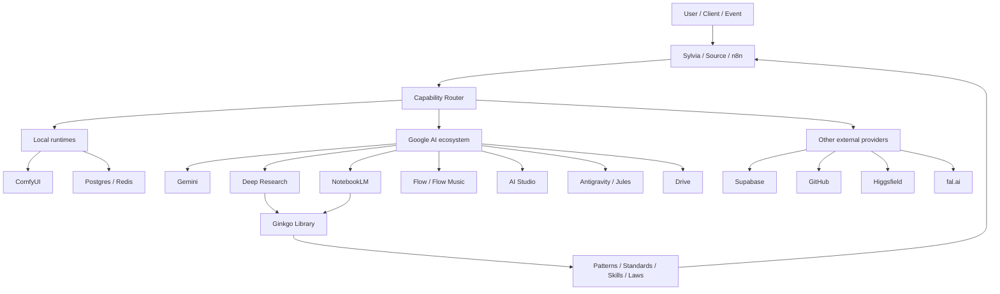

# Ginkgo Arsenal

> Canonical capability map for local runtimes, external providers and agentic tooling used by Ginkgo AI Systems.

## Principle

The Arsenal is **not a subscription list**. It is a governed registry of capabilities that Sylvia, Source, n8n and product runtimes can route to.

```text
capability -> policy -> provider -> artifact -> evidence
```

A product must depend on a **capability contract**, not directly on a vendor whenever practical.

## Canonical architecture



## Habitats

| Habitat | Canonical role |
|---|---|
| GitHub | source code, versioned engineering docs, PR history |
| Ginkgo Library | technology intelligence, clippings, research, patterns, standards |
| Google Drive | large files, media, datasets, documents and selected backups |
| NotebookLM | source-grounded learning and synthesis over curated source sets |
| Supabase/Postgres | operational application state |
| VPS / ai-stack | execution |
| Gemini / model providers | intelligence |
| Pyre / Creative Router | creative provider abstraction |

## Routing policy

1. Identify the capability required.
2. Determine constraints: privacy, latency, quality, reproducibility, cost, context size, GPU/CPU availability.
3. Select provider from `registry/capabilities.yaml`.
4. Record provider/model/version/cost when the output becomes an operational artifact.
5. Fall back without changing the caller contract.

## Local vs external

Use local runtimes when:
- reproducibility matters;
- inputs should remain local;
- repeated marginal cost should be low;
- a deterministic workflow can be pinned and tested.

Use external providers when:
- quality or capability exceeds local hardware;
- context size is the main constraint;
- research/search integration is valuable;
- the workload is bursty;
- audiovisual generation would be inefficient locally.

## Google AI as an external capability cluster

Google AI is modeled as one provider family with multiple distinct capabilities:

- Gemini: reasoning, multimodal analysis, long-context work.
- Deep Research: research packs and current external evidence.
- NotebookLM: source-grounded learning and knowledge synthesis.
- Flow: cloud audiovisual generation.
- Flow Music: music and sonic assets.
- AI Studio: prompt/model/tool-calling prototyping.
- Antigravity / Jules: delegated development work.
- Drive: file and media storage.
- Gmail / Docs / Sheets: human productivity surfaces.

**Rule:** consumer-plan benefits and programmatic API entitlements are separate. Never infer that a paid UI subscription grants free or unlimited backend/API calls.

## Agentic workers

### Researcher
Input: question, market, technology or decision.
Output: `research-pack` with sources, findings, uncertainty, alternatives and recommendation.

### Librarian
Input: clippings, papers, docs, transcripts, repository docs.
Output: notebook, synthesis, glossary, relationship map, FAQ, study material.

### Creative worker
Input: commercial brief.
Output: routed image/video/audio asset plus provenance and cost metadata.

### Engineer
Input: scoped repository task.
Output: branch/diff/tests/evidence, produced by Claude Code, Codex, Jules, Antigravity or another validated executor.

### Router
Input: desired outcome + constraints.
Output: capability selection + provider decision; does not perform complex specialist execution itself.

## Cost and entitlement contract

Every provider registry entry should distinguish:

```yaml
access:
  ui:
    included: true
  api:
    included: false
    billing: external
```

Numeric quotas are volatile. They belong in observed entitlement records or dated provider notes, not hard-coded business logic.

## Definition of done for a new Arsenal capability

A capability is `adopted` only when:
- owner and purpose are clear;
- access mode is known;
- cost/billing boundary is documented;
- privacy/security implications are reviewed;
- caller contract is defined;
- fallback or failure behavior is known;
- at least one real use case exists;
- evidence or a benchmark supports adoption.
