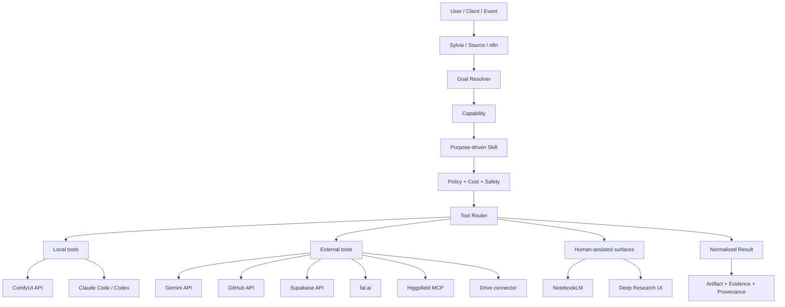
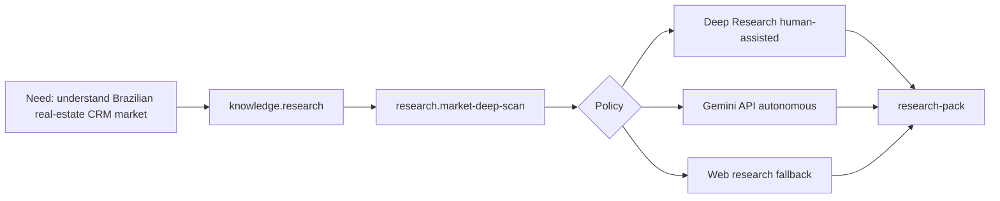
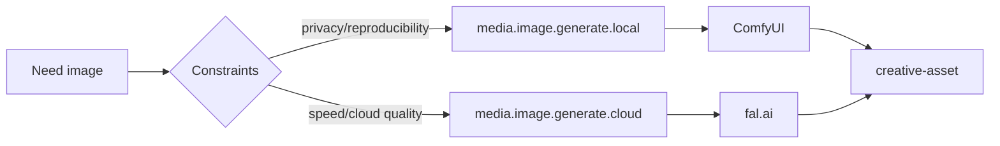

# Ginkgo Arsenal

> Canonical executable map of agent-usable capabilities, skills, tools, endpoints and policies across local runtimes and external providers.

## Principle

The Arsenal is **not a subscription list** and is not a vendor directory.

It is a governed map that lets an agent resolve:

```text
agent goal
  -> capability
  -> purpose-driven skill
  -> policy
  -> tool / adapter
  -> API | MCP | CLI | connector | human-assisted surface
  -> endpoint
  -> credential reference
  -> execution
  -> normalized result
```

A product or agent should depend on a **skill/capability contract**, not directly on a vendor whenever practical.

## Canonical architecture



## Registry layers

| Registry | Question answered |
|---|---|
| `providers.yaml` | Who provides the capability? |
| `capabilities.yaml` | What can the system accomplish? |
| `skills.yaml` | What purposeful action can an agent execute? |
| `tools.yaml` | What concrete execution surface exists? |
| `endpoints.yaml` | Where/how is it invoked? |
| `policies.yaml` | When is it allowed and how should it be routed? |
| `fallbacks.yaml` | What is the safe alternative if the preferred implementation fails? |

## Naming rule

Skills are named by **purpose**, never by brand.

Bad:

```text
skill-gemini
skill-supabase
skill-github
```

Good:

```text
research.market-deep-scan
knowledge.ingest-source-set
code.repo.inspect
code.issue.create
storage.file.archive
database.query.read
media.image.generate.local
media.product-ad.fast
```

Providers remain implementation details below those skills.

## Execution modes

Every tool must truthfully declare one of:

- `autonomous` — callable by an agent without a human interaction step;
- `supervised` — executable by an agent while a human remains in the control loop;
- `connector` — executed through a governed connected application/tool;
- `human_assisted` — a human must operate or approve the product surface.

A web-only product must never be presented to Sylvia as an autonomous API.

## Habitats

| Habitat | Canonical role |
|---|---|
| GitHub | source code, versioned engineering docs, PR history |
| Ginkgo Library | Arsenal definitions, technology intelligence, clippings, research, patterns, standards |
| Ginkgo Agents | skill implementations, contracts and evals |
| Ginkgo Connect | governed adapters/connectors and external context boundaries |
| Google Drive | large files, media, datasets, documents and selected backups |
| NotebookLM | source-grounded learning and synthesis over curated source sets |
| Supabase/Postgres | operational application state |
| VPS / ai-stack | execution |
| Gemini / model providers | intelligence |
| Pyre / Creative Router | creative provider abstraction |

## Ownership boundary

```text
Library  -> what exists and the canonical Arsenal map
Agents   -> how a reusable skill is implemented and evaluated
Connect  -> how external systems are connected safely
ai-stack -> what runs locally
Sylvia   -> when to choose a skill
n8n      -> workflow execution/orchestration
Source   -> composition of validated capabilities into solutions
```

## Routing policy

1. Resolve the desired outcome, not the vendor.
2. Select the capability.
3. Select a purpose-driven skill.
4. Evaluate constraints: privacy, latency, quality, reproducibility, cost, quota and availability.
5. Select a concrete tool from `registry/tools.yaml` under `registry/policies.yaml`.
6. Resolve the endpoint/adapter without leaking provider details into the caller.
7. Execute and normalize the result.
8. Record provider/model/version/cost when the result becomes an operational artifact.
9. Apply a declared fallback only if the output contract remains safe and intelligible.

## Example: research



The caller asks for the skill result, not for Gemini specifically.

## Example: creative routing



## Google AI as an external capability cluster

Google AI is modeled as one provider family with distinct surfaces:

- Gemini API: autonomous reasoning/multimodal execution when API billing is configured.
- Deep Research: currently represented as a human-assisted research surface unless a supported autonomous integration is available.
- NotebookLM: human-assisted/source-grounded learning and synthesis unless a supported autonomous integration is available.
- Flow / Flow Music: creative surfaces; automation status must be represented truthfully.
- AI Studio: prototyping surface, not automatically a production API entitlement.
- Antigravity / Jules: delegated development surfaces when validated and connected.
- Drive: governed file storage through connector/API access.

**Rule:** consumer-plan benefits and programmatic API entitlements are separate. Never infer that a paid UI subscription grants free or unlimited backend/API calls.

## Cost and entitlement contract

Every tool/provider entry should distinguish access boundaries, for example:

```yaml
access:
  ui:
    included: true
  api:
    included: false
    billing: external
```

Numeric quotas are volatile. They belong in dated observed-entitlement records, not hard-coded product logic.

## Clipping -> Arsenal promotion

```text
clipping
  -> raw source
  -> source set / notebook
  -> research + verification
  -> synthesis
  -> pattern candidate
  -> benchmark / repeated evidence
  -> law / standard / playbook
  -> reproducible action?
       yes -> skill candidate -> eval -> Arsenal
       no  -> durable knowledge only
```

Not every clipping becomes a skill. A skill exists only when an action is reproducible, purposeful, permissioned and has a clear result contract.

## Definition of done for an Arsenal skill

A skill is adopted only when:
- purpose is explicit;
- capability is clear;
- inputs and outputs are defined;
- permissions are explicit;
- execution mode is truthful;
- at least one real tool implementation exists;
- access/auth boundary is known without storing secrets;
- cost/billing implications are understood;
- fallback/failure behavior is defined;
- at least one real use case exists;
- evidence or an eval supports adoption.
