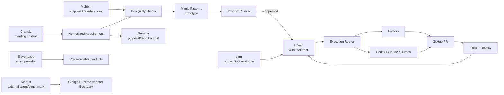
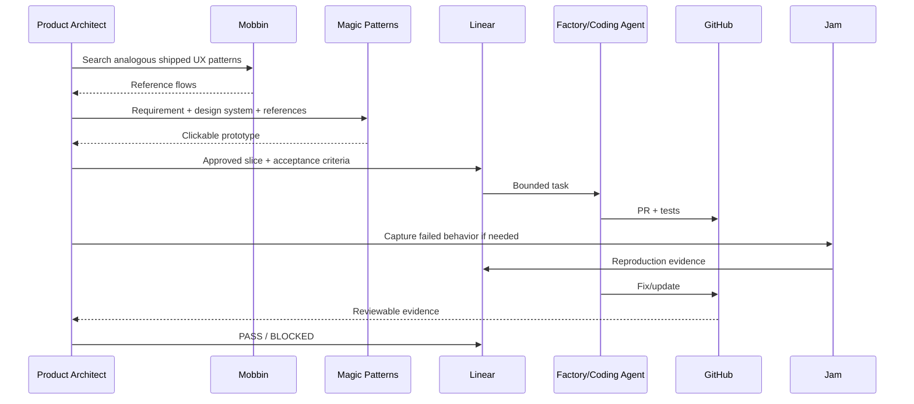

# Agent-Native Product Delivery Loop

## Purpose

This architecture note connects the curated external tools added on 2026-09-03 into a **provider-aware product delivery loop** without turning any SaaS vendor into Ginkgo's source of truth.

The goal is speed with boundaries:

```text
conversation / requirement
        ↓
context + reference
        ↓
prototype
        ↓
work contract
        ↓
execution
        ↓
evidence
        ↓
review
        ↓
commercial/artifact output
```

## Recommended graph



## Tool roles

| Tool | Canonical role | Must NOT become |
|---|---|---|
| Granola | meeting/context source | CRM/source of truth |
| Mobbin | UX reference provider | design system or copied UI source |
| Magic Patterns | design-time prototype generator | runtime dependency |
| Linear | work/execution ledger | code source of truth or business runtime |
| Factory | bounded software executor | product architect or Ginkgo Runtime |
| Jam | client/QA evidence producer | canonical telemetry store |
| Manus | benchmark + optional external agent executor | AI Employee identity/control plane |
| Gamma | visual artifact/rendering provider | pricing/CRM/business truth |
| ElevenLabs | voice/audio provider | canonical voice identity store |
| Higgsfield | video/creative provider through Pyre | product-specific hard dependency |

## Three control planes

### 1. Product truth

Owned by Ginkgo:

- product requirements;
- architecture invariants;
- tenancy/RLS rules;
- design system;
- CRM/business records;
- AI Employee identities;
- provider-neutral capability contracts.

### 2. Work truth

Recommended split:

```text
Linear -> what work is approved/assigned/status
GitHub -> what code actually exists
Tests/Evidence -> whether the change is acceptable
```

No chat conversation alone counts as completion evidence.

### 3. Provider bindings

External providers are referenced through replaceable bindings:

```yaml
provider_binding:
  provider: elevenlabs | gamma | manus | factory | higgsfield
  external_id: provider-specific-id
  capability: normalized-ginkgo-capability
  status: active
  provenance: ...
```

Ginkgo identities and business entities must survive provider replacement.

## Recommended adoption waves

### Wave A — immediate benchmark

1. Factory
2. Linear
3. Jam
4. Mobbin
5. Magic Patterns

Target metric: lower time from approved slice -> accepted PR without increasing review failures.

### Wave B — operating context

6. Granola
7. Gamma

Target metric: lower time from meeting -> structured CRM/action/proposal output.

### Wave C — provider integrations

8. ElevenLabs
9. Manus
10. Higgsfield (already curated)

Target metric: prove provider-neutral adapters, cost observability and fallback paths.

## Ginkgo Ops example



## Hard invariants

1. External SaaS does not become canonical identity storage.
2. Provider-specific IDs stay behind bindings/adapters.
3. Ginkgo Runtime remains independent from Factory and Manus internals.
4. GitHub remains source of truth for code.
5. Production credentials never live in prompts, issues or library records.
6. Client-sensitive meeting, recording, voice and network data require explicit governance.
7. No tool is promoted from `curated` to `validated/promoted` solely because a discounted subscription exists.
8. Every adoption must have a measurable success criterion and an exit/fallback path.

## Procurement rule

Third-party annual access sold far below official subscription pricing is suitable only for **sandbox evaluation** until ownership, renewal, revocation, terms and access mechanism are verified.

For production-critical services, use Ginkgo-owned billing/account/admin control through official or contractually trusted channels.

## Benchmark scorecard

| Dimension | Measure |
|---|---|
| Speed | cycle time from request to accepted output |
| Quality | acceptance/test pass rate |
| Review burden | human corrections per task |
| Scope discipline | unauthorized changes |
| Cost | cost per accepted artifact/task |
| Reliability | successful runs / total runs |
| Portability | ability to replace provider |
| Security | minimum permissions/data exposure |
| Evidence | reproducibility and audit quality |

## Decision

```text
Adopt the LOOP, not the vendors.
Vendors are replaceable modules; Ginkgo contracts, identities, evidence and product truth are the durable layer.
```
