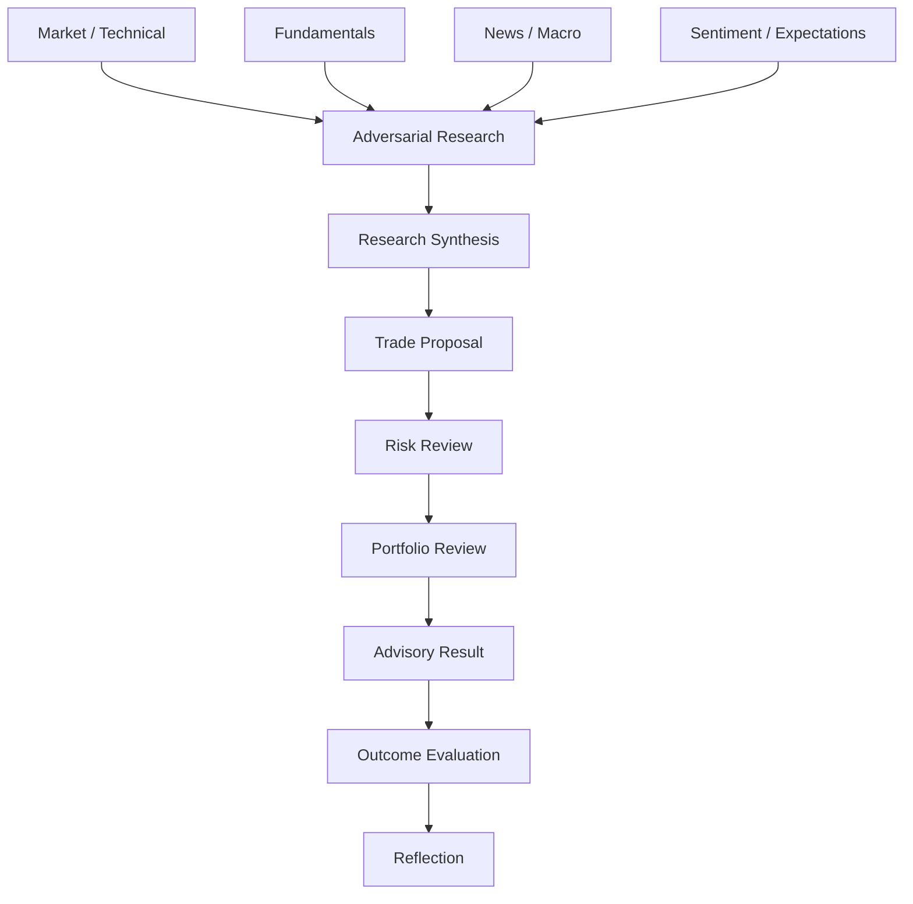
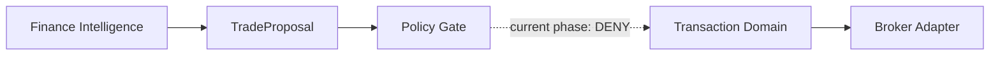

# Finance Intelligence Domain — P0 Architecture

## Status

- Scope: architecture, discovery metadata, contracts and promotion requirements.
- Runtime implementation: not included.
- Live financial transactions: blocked.
- Canonical core contracts: `Ginkgo-Core/ai-stack` P0.

## Boundary

```text
Caller
-> CapabilityRequest v1
-> Capability Bus
-> Finance Domain Router
-> eligible skill/version
-> adapter when applicable
-> provider when applicable
-> CapabilityResult v1
```

Operational execution remains separate:

```text
TaskOps
-> Executor Router
-> Human | n8n | Hermes | OpenClaw | Sylvia
```

Taxonomy invariant:

```text
CAPABILITY != SKILL != BINDING != TOOL != ADAPTER != PROVIDER != EXECUTOR
```

## Initial capability family

### READ

```text
finance.instrument.resolve
finance.market.snapshot
finance.company.fundamentals.read
finance.news.collect
finance.sentiment.collect
finance.macro.read
finance.market.expectations.read
```

### ANALYZE

```text
finance.market.technical.analyze
finance.company.fundamentals.analyze
finance.news.analyze
finance.sentiment.analyze
finance.research.debate
finance.research.synthesize
finance.trade.propose
finance.risk.evaluate
finance.portfolio.review
finance.performance.evaluate
finance.decision.reflect
```

### SIMULATE

```text
finance.backtest.simulate
```

### TRANSACTION — reserved and blocked

The following namespace is reserved for a future separately governed transaction domain and is not routing-eligible in this phase:

```text
finance.order.submit
finance.order.cancel
finance.position.close
finance.funds.transfer
```

A recommendation, signal, portfolio review or simulation result grants no transaction authority.

## Reference decision graph



## TradeProposal contract intent

A proposal is analysis, not execution. Minimum semantic fields:

```yaml
instrument: required
action: BUY | HOLD | SELL | REDUCE | INCREASE
confidence: 0..1
time_horizon: required
thesis: required
bull_case: required
bear_case: required
risk_score: 0..1
suggested_position_pct: optional
stop_conditions: []
evidence: []
generated_at: required
execution_allowed: false
```

`execution_allowed` is always `false` in this domain phase.

## Data-time contract

Financial analysis must distinguish when something happened from when it was knowable.

Required temporal fields where applicable:

```text
event_time     = when the underlying event occurred
available_at   = earliest time the evidence was legitimately available
observed_at    = time the source was observed by the system
ingested_at    = time the evidence entered Ginkgo
```

Historical simulation rule:

```text
available_at <= simulation_time
```

Any evidence violating the rule is excluded and flagged as temporal leakage.

## Deterministic guardrails

The following are policy-owned and must not be delegated to an LLM:

- allowed action class;
- allowed asset universe;
- maximum position percentage;
- maximum notional exposure;
- maximum leverage;
- maximum daily loss / drawdown stop;
- allowed market hours;
- data freshness thresholds;
- transaction enablement state;
- Approval requirements;
- External Gate requirements;
- broker/account eligibility;
- kill-switch state.

## Model routing

The finance domain may use multiple models internally, but callers never select provider/model as execution authority.

Recommended pattern:

```text
cheap/fast models
-> extraction, summarization, normalization, first-pass analysis

deep reasoning models
-> adversarial synthesis, risk arbitration, portfolio review
```

All promoted artifacts should record model/provider/version/cost metadata in Evidence when an LLM materially contributed.

## Evidence and learning loop

```text
Decision
-> expected outcome
-> realized outcome
-> benchmark-relative outcome
-> forecast error
-> reflection
-> future context
```

Evaluation should record at minimum:

- raw return;
- benchmark-relative return/alpha;
- holding period;
- max adverse excursion when available;
- max favorable excursion when available;
- decision/model/version;
- source/evidence set;
- token/API cost;
- market regime tags when available.

## Simulation metrics

Candidate metrics:

```text
CAGR
Sharpe
Sortino
Max Drawdown
Calmar
Win Rate
Profit Factor
Expected Value
Turnover
Volatility
Alpha
Beta
Information Ratio
LLM/API cost per unit of alpha
```

Backtest metrics are evaluation evidence, not proof of future profitability.

## Transaction freeze



Current rule:

```text
READ / ANALYZE / SIMULATE = discoverable P0 family
TRANSACTION = fail closed
```

No human Approval can manufacture a missing routing-eligible transaction binding. Approval is necessary for future transaction capabilities where policy requires it, but it is not sufficient without an eligible implementation, account policy, risk limits and evidence.

## Promotion gates

Before any `finance.*` implementation becomes `VALIDATED` or above:

1. provider-agnostic input/output contract;
2. deterministic permission classification;
3. explicit data provenance;
4. temporal leakage tests;
5. stale-data tests;
6. normalized provider errors/retries;
7. model/provider/version evidence when applicable;
8. reproducible offline fixtures;
9. benchmark/eval pack;
10. reviewer approval.

Before any future `TRANSACTION` capability becomes routing-eligible, additionally require:

1. separate transaction-domain ADR;
2. broker adapter contract;
3. account/identity binding;
4. deterministic risk engine;
5. human/business Approval policy;
6. idempotency keys;
7. order/position reconciliation;
8. partial-fill handling;
9. kill switch;
10. immutable execution Evidence;
11. paper-trading validation;
12. bounded live canary with explicit approval.

## P0 non-goals

- no broker credentials;
- no exchange API keys;
- no live order routing;
- no fund transfer;
- no leverage mutation;
- no auto-copy trading;
- no claim of profitable strategy;
- no lifecycle promotion based solely on upstream benchmarks.