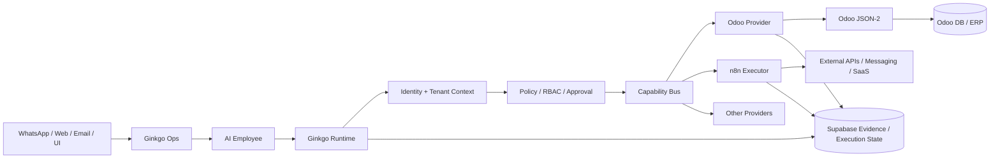
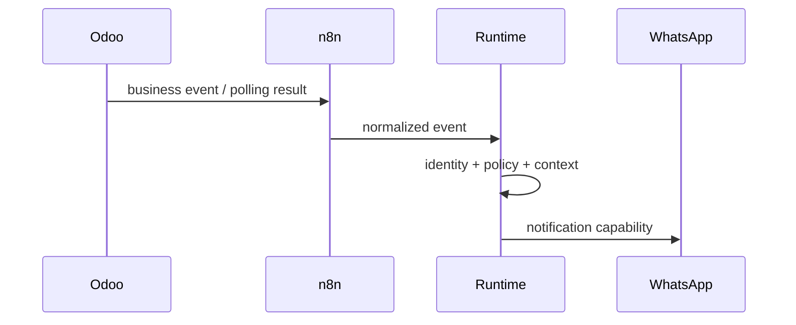

# Odoo Enterprise Intelligence Layer

Status: proposed reference architecture  
Date: 2026-09-05  
Owner: Ginkgo Runtime / Connect boundary  
Research record: `60-app-platform/erp/odoo.md`

## Objective

Define how Odoo participates in the Ginkgo ecosystem without turning Ginkgo Ops into an ERP and without exposing raw ERP operations directly to AI Employees.

## Architectural decision

```text
Ginkgo Ops = interaction and operational experience
Ginkgo Runtime = governed decision/execution control plane
Ginkgo Arsenal/Connect = capability/provider contracts
Odoo = ERP system of record
n8n = asynchronous/external automation fabric
Supabase = Ginkgo-native state, evidence and projections
```

## Reference topology



## Provider invariant

AI Employees and callers MUST NOT receive direct Odoo model/method credentials or generic execution access.

Callers use stable Ginkgo capabilities. The provider owns mapping to Odoo-specific models, methods, IDs and version behavior.

```text
Caller
  ↓
sales.order.confirm
  ↓
Capability Bus
  ↓
Policy
  ↓
OdooProvider
  ↓
Odoo version-specific operation
```

## Initial contract set

### Reads

```text
crm.contact.search
crm.contact.read
crm.lead.search
sales.quote.search
sales.order.read
invoice.search
invoice.read
inventory.product.search
inventory.stock.read
purchase.order.read
project.task.search
```

### Writes

```text
crm.contact.create
crm.lead.create
crm.lead.update
sales.quote.create
sales.quote.send
sales.order.confirm
invoice.create
invoice.send
purchase.order.create
project.task.create
project.task.update
```

## Risk classes

### READ

No mutation. Generally auto-executable when actor and tenant context permit access.

### LOW_WRITE

Creates or updates non-financial/non-irreversible business records. May be auto-approved for scoped AI Employees.

Examples:

```text
crm.contact.create
crm.lead.update
project.task.create
```

### BUSINESS_COMMIT

Changes commercial state and may trigger downstream consequences.

Examples:

```text
sales.order.confirm
sales.quote.send
```

Default: explicit policy gate; optional approval depending on organization policy.

### FINANCIAL_WRITE

Creates/sends financial documents or obligations.

Examples:

```text
invoice.create
invoice.send
purchase.order.create
```

Default: approval required until organization-specific policy explicitly allows bounded autonomy.

## Capability request envelope

Recommended normalized request shape:

```json
{
  "request_id": "req_...",
  "organization_id": "org_...",
  "workspace_id": "ws_...",
  "actor": {
    "type": "human|agent|system",
    "id": "..."
  },
  "capability": "inventory.stock.read",
  "input": {},
  "idempotency_key": "...",
  "policy_context": {},
  "requested_at": "..."
}
```

The provider may enrich internally with:

```text
provider_instance_id
odoo_database
odoo_company_id
odoo_user_id
odoo_model
method
field allowlist
record IDs
```

Those details are implementation evidence, not caller API.

## Normalized result

```json
{
  "request_id": "req_...",
  "capability": "inventory.stock.read",
  "provider": "odoo",
  "status": "succeeded|failed|blocked|uncertain",
  "result": {},
  "provider_refs": [],
  "evidence": {},
  "completed_at": "..."
}
```

## Source-of-truth rules

### Odoo authoritative domains

```text
ERP contacts when designated primary
products
sales documents
invoices/accounting
purchase orders
inventory
manufacturing
ERP project state when configured primary
```

### Ginkgo authoritative domains

```text
organization/workspace
AI Employees
conversations
capability registry
policy configuration
execution records
approvals
agent memory
provider bindings
Ginkgo usage/billing
observability
```

### Projection rule

Odoo data MAY be projected into Supabase for search, analytics, context building or performance.

Projection records MUST carry:

```text
source = odoo
source_instance_id
source_record_id
source_updated_at
projected_at
sync_status
```

Projected data must not silently become a second writable source of truth.

## Tenant topology

Default recommendation for unrelated customers:

```text
Ginkgo org A -> Odoo binding A -> Odoo database A
Ginkgo org B -> Odoo binding B -> Odoo database B
```

Odoo multi-company should be used primarily for related companies within the same customer/economic group.

Avoid one shared Odoo database for unrelated Ginkgo customers unless a separate, formally reviewed SaaS isolation design proves equivalent isolation.

## Identity and credentials

Each Odoo customer binding SHOULD have:

- dedicated integration user;
- least-privilege groups/ACLs;
- API key isolated per environment;
- key rotation policy;
- explicit company scope;
- environment distinction (`dev`, `staging`, `production`);
- secret stored outside repository/docs;
- revocation runbook.

No AI prompt receives raw credentials.

## Idempotency

Every mutating capability MUST provide an idempotency key.

Recommended key derivation:

```text
organization
+ capability
+ caller operation ID
+ stable business subject
```

Provider layer stores:

```text
idempotency_key
request_hash
status
provider_refs
result_hash
first_attempt_at
last_attempt_at
```

If the provider response is lost after Odoo may have committed the write, mark execution `uncertain` and reconcile before retrying.

## Reconciliation

For uncertain writes:

```text
1. Do not blind retry.
2. Search Odoo using deterministic business/reference keys.
3. Confirm whether intended state already exists.
4. If yes, normalize as success with reconciled evidence.
5. If no, retry only when policy allows.
6. If ambiguous, escalate to human review.
```

## Async events and n8n

Use n8n for asynchronous workflow orchestration outside ERP boundaries.

Example:



n8n SHOULD NOT become the canonical authority for ERP rules such as stock valuation, invoice lifecycle or fiscal status.

## Event envelope

Recommended event shape:

```json
{
  "event_id": "evt_...",
  "organization_id": "org_...",
  "provider": "odoo",
  "provider_instance_id": "odoo_...",
  "event_type": "sales.order.confirmed",
  "subject": {
    "type": "sales.order",
    "provider_id": "..."
  },
  "occurred_at": "...",
  "observed_at": "...",
  "payload": {},
  "dedupe_key": "..."
}
```

Consumers must deduplicate on `event_id`/`dedupe_key`.

## Error taxonomy

Normalize Odoo errors into stable Ginkgo classes:

```text
AUTHENTICATION_FAILED
AUTHORIZATION_DENIED
TENANT_SCOPE_VIOLATION
VALIDATION_FAILED
BUSINESS_RULE_REJECTED
NOT_FOUND
CONFLICT
RATE_LIMITED
PROVIDER_UNAVAILABLE
TIMEOUT
TRANSIENT_PROVIDER_ERROR
UNKNOWN_PROVIDER_ERROR
UNCERTAIN_WRITE_STATE
```

Do not leak raw stack traces or sensitive Odoo payloads to customers/agents.

## Observability

Minimum execution telemetry:

```text
request_id
organization_id
workspace_id
capability
provider
provider_instance_id
actor_id
actor_type
policy_decision
approval_id
idempotency_key
attempt
status
latency_ms
error_class
provider_refs
started_at
completed_at
```

Metrics:

```text
success rate by capability
p50/p95/p99 latency
provider availability
authorization failures
business-rule failures
uncertain writes
reconciliation outcomes
approval wait time
retry rate
sync lag
```

## Security gates

Before production:

- provider credentials separated by customer/environment;
- no wildcard model execution surface;
- field allowlists for sensitive operations;
- record/company scope tested;
- write actions classified by risk;
- approval policy implemented;
- PII redaction in logs;
- provider-call audit trail;
- deterministic tenant binding resolution;
- contract tests against supported Odoo version;
- fail-closed behavior for unresolved tenant/company context.

## Brazil-specific production gate

For customers using Odoo as fiscal/accounting authority, production promotion additionally requires:

- accountant validation;
- legal entity/tax regime mapping;
- state/municipality validation;
- NF-e/NFC-e/NFS-e scenario tests as applicable;
- certificate and contingency procedures;
- real homologation evidence;
- documented ownership for tax rule changes;
- upgrade regression checklist.

Ginkgo provider readiness does not imply Brazilian fiscal readiness.

## 30-day PoC slice

Implement only:

```text
crm.contact.search
crm.contact.create
sales.quote.create
invoice.search
inventory.stock.read
```

Required proof:

- real Odoo test tenant;
- dedicated integration user;
- JSON-2 request/response adapter;
- capability contracts;
- Runtime policy decision;
- normalized result;
- evidence persisted;
- idempotency for writes;
- forced failure tests;
- cross-company negative tests.

## Promotion criteria

Promote from Library into Runtime/Connect implementation only if:

```text
[ ] API behavior verified on target Odoo release
[ ] tenant/company binding deterministic
[ ] read contracts pass
[ ] write idempotency passes
[ ] auth/ACL negative tests pass
[ ] uncertain-write reconciliation passes
[ ] evidence/observability complete
[ ] no raw generic Odoo method exposed to agents
[ ] failure modes mapped to stable error taxonomy
[ ] operational owner assigned
```

## Non-goals

This architecture does NOT authorize:

- rebuilding Odoo domains inside Ginkgo Ops;
- embedding general accounting/MRP/fiscal logic into Runtime;
- giving agents generic Odoo administrator access;
- using Supabase as an uncontrolled replica of ERP truth;
- moving all Odoo business rules to n8n;
- declaring Brazilian fiscal production-ready based only on successful API calls.
