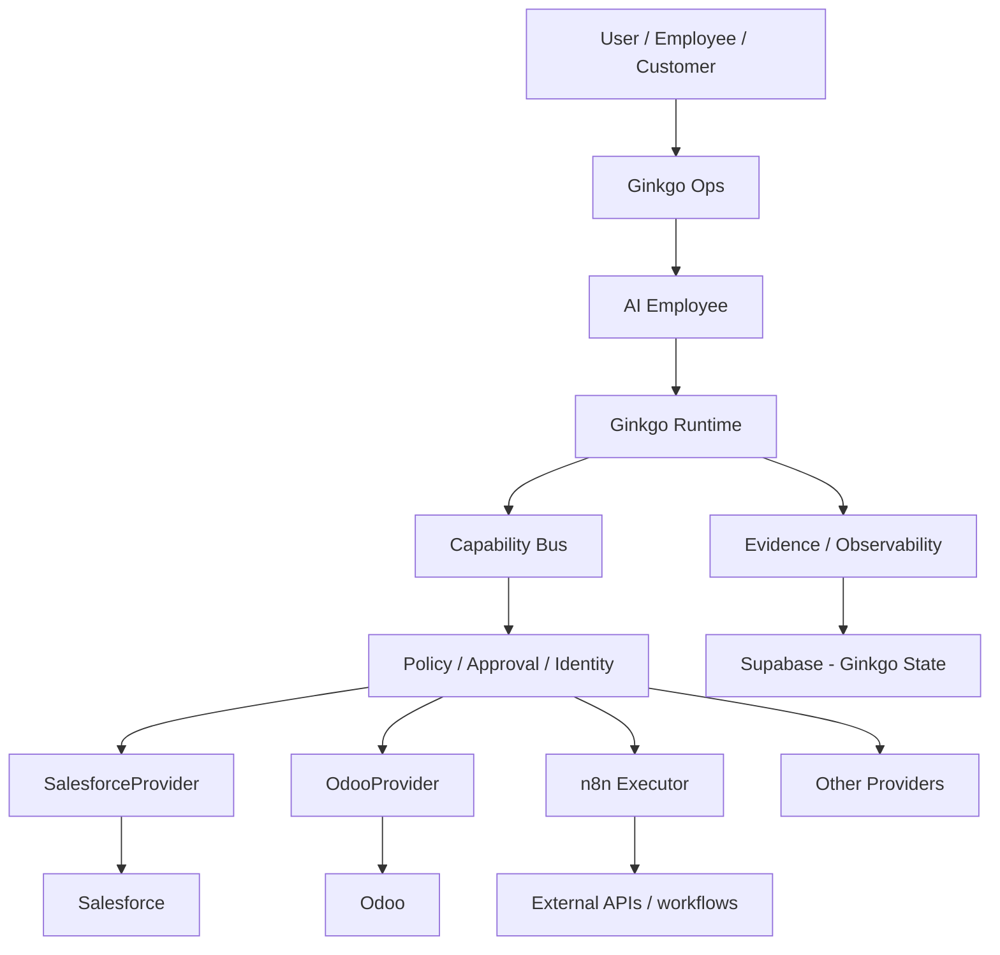

# Salesforce vs Odoo — Enterprise Provider Strategy for Ginkgo

## Executive decision

Salesforce and Odoo should not be treated as mutually exclusive platform choices inside Ginkgo.

They occupy different enterprise roles:

```text
Salesforce = front-office / customer system of record
Odoo       = back-office / ERP system of record
Ginkgo     = governed cross-system intelligence and execution layer
```

Canonical recommendation:

- **Odoo**: preferred greenfield ERP for SMB / lower-midmarket deployments where Ginkgo can shape the stack.
- **Salesforce**: Tier-1 enterprise CRM provider for companies that already operate on Salesforce or require advanced sales/service/customer-data capabilities.
- **Ginkgo Runtime**: remains the control plane above both.
- **Ginkgo Ops**: remains the human/AI workspace and conversation layer.
- **n8n**: remains an automation executor/fabric, not the system of record.
- **Supabase**: owns Ginkgo application state, evidence, agent state and projections; not duplicated ERP/CRM truth.

## Comparison matrix

| Dimension | Salesforce | Odoo | Ginkgo implication |
|---|---|---|---|
| Core identity | Enterprise CRM/customer platform | Modular ERP + CRM | Treat as different provider classes |
| CRM | Excellent | Good | Salesforce for complex enterprise CRM |
| Sales pipeline | Excellent | Strong | Abstract through Ginkgo capabilities |
| Service/customer support | Excellent | Good | Salesforce preferred at enterprise scale |
| Customer data/CDP | Excellent | Limited/moderate | Salesforce strategic for customer context |
| Marketing | Excellent ecosystem | Good integrated suite | Preserve provider-neutral marketing capabilities |
| Accounting | Not core ERP strength | Strong | Odoo owns accounting where authoritative |
| Inventory | Not core ERP strength | Strong | Odoo preferred |
| Purchasing | Not core ERP strength | Strong | Odoo preferred |
| Manufacturing/MRP | Not core ERP strength | Strong | Odoo preferred |
| Self-host | No normal self-host model | Yes | Odoo more controllable operationally |
| Open-source core | No | Community core available | Odoo lower lock-in at core level |
| Enterprise ecosystem | Extremely strong | Strong | Salesforce required for enterprise reach |
| SMB economics | Expensive relative to Odoo | Strong | Odoo preferred greenfield SMB stack |
| Native AI direction | Agentforce / Data 360 | AI Agents / Topics / Tools | Both validate Ginkgo's agent+tool thesis |
| Best Ginkgo role | Customer-facing SoR provider | ERP SoR provider | Both behind Capability Bus |

## Architectural model



## Source-of-truth boundaries

### Salesforce can own

```text
account
contact
lead
opportunity
pipeline
forecast
case
customer profile
customer journey
sales activity
service activity
```

### Odoo can own

```text
product
quote/order
inventory
purchase
invoice
accounts receivable/payable
accounting
manufacturing
ERP project state
```

### Ginkgo owns

```text
organization/workspace
AI employee configuration
conversation
capability request
policy decision
approval
provider binding
execution result
evidence
agent memory
cross-system orchestration
usage/observability
```

### n8n owns no canonical business truth

n8n executes workflows. It can transform, route and invoke, but should not become the authoritative source for customer, ERP, invoice, inventory or opportunity state.

## Provider-neutral capabilities

The central design requirement is that AI Employees consume business capabilities instead of vendor APIs.

Examples:

```text
crm.account.search
crm.contact.search
crm.lead.create
crm.opportunity.update

sales.quote.create
sales.order.confirm
sales.pipeline.read
sales.forecast.read

service.case.create

inventory.stock.read
purchase.order.create
invoice.search
```

Resolver examples:

```text
Client A:
crm.opportunity.update -> SalesforceProvider
inventory.stock.read   -> SAPProvider

Client B:
crm.contact.search     -> OdooProvider
sales.quote.create     -> OdooProvider
inventory.stock.read   -> OdooProvider

Client C:
crm.contact.search     -> GinkgoNativeProvider
```

This preserves AI Employee portability.

## Ginkgo commercial segmentation

### Ginkgo SMB Stack

Target: roughly 5–250 employees, especially greenfield or fragmented operations.

```text
Ginkgo Ops
+ Odoo
+ n8n
+ WhatsApp
+ Supabase
+ AI Employees
```

Primary value:

- replace spreadsheets and fragmented SaaS;
- provide ERP + CRM baseline;
- automate repetitive operations;
- deploy AI Employees over operational data;
- lower TCO compared with enterprise CRM + separate ERP stacks.

### Ginkgo Enterprise Intelligence

Target: midmarket/enterprise with established systems.

```text
Ginkgo Runtime
+ AI Employees
+ Salesforce
+ SAP / Oracle / Odoo / other ERP
+ MuleSoft / n8n / existing integration layer
+ data platforms
```

Primary value:

- do not force migrations;
- govern agent actions across systems;
- unify capabilities;
- provide approval, evidence and observability;
- make AI Employees work across system boundaries.

## Salesforce vs Odoo selection rules

### Prefer Odoo when

- client is greenfield or replacing fragmented tooling;
- ERP scope is central;
- accounting/inventory/purchasing/manufacturing matter;
- budget sensitivity is high;
- self-hosting/custom modules are important;
- Ginkgo controls the operating stack.

### Prefer Salesforce when

- Salesforce already exists as strategic CRM;
- sales/service operations are complex;
- large pipeline teams require enterprise CRM tooling;
- customer data unification is central;
- customer service and omnichannel are strategic;
- the client is enterprise and migration risk is unacceptable.

### Use both when

A common enterprise pattern is valid:

```text
Salesforce -> customer / sales / service truth
Odoo       -> orders / inventory / finance / ERP truth
Ginkgo     -> cross-system intelligence and action governance
```

In this model, synchronization must be explicit and bounded. Avoid declaring the same field/domain authoritative in both systems.

## Agent architecture comparison

### Salesforce direction

Conceptual pattern:

```text
Agentforce
  -> customer context / Data 360
  -> actions
  -> Salesforce business objects
```

### Odoo direction

Conceptual pattern:

```text
AI Agent
  -> Topics
  -> Tools
  -> Odoo models
```

### Ginkgo differentiation

```text
AI Employee
  -> Capability Request
  -> Policy
  -> Provider Resolver
  -> any governed enterprise system
```

The AI Employee belongs to the organization, not one SaaS ecosystem.

## Risk model

| Risk | Salesforce | Odoo | Ginkgo control |
|---|---:|---:|---|
| Vendor lock-in | High | Medium | Capability abstraction |
| API/package drift | Medium/high | Medium | Provider contract + version tests |
| Excess privileges | High impact | High impact | Least privilege + policy gates |
| Duplicate writes | Medium | Medium | Idempotency + correlation IDs |
| Cross-system inconsistency | High when both used | High when both used | SoR matrix + reconciliation |
| Cost overrun | High | Medium | FinOps / usage policy |
| Upgrade customization breakage | Medium | High for custom Odoo modules | Version compatibility gates |
| Agent unsafe action | High impact | High impact | approval classes + evidence |

## Tiered enterprise provider roadmap

### Tier 1

```text
Odoo
Salesforce
SAP
```

Reason:

- Odoo covers modern modular ERP/SMB-midmarket;
- Salesforce covers enterprise CRM/customer operations;
- SAP covers enterprise ERP and large legacy estates.

### Tier 2

```text
HubSpot
Microsoft Dynamics 365
TOTVS
Omie
Oracle
```

Promotion depends on commercial demand and verified integration quality.

## Provider lifecycle

Each provider follows Ginkgo lifecycle:

```text
FEATURE
  -> PROTOTYPE
  -> VALIDATED
  -> INTEGRATED
  -> PRODUCTION
```

### Salesforce promotion gates

Prototype should begin read-heavy:

```text
crm.account.search
crm.contact.search
crm.opportunity.search
sales.pipeline.read
service.case.search
```

Then low/medium-risk writes:

```text
crm.lead.create
crm.opportunity.create
service.case.create
```

High-impact actions only after policy/evidence tests.

### Odoo promotion gates

Initial reference PoC:

```text
crm.contact.search
crm.contact.create
sales.quote.create
invoice.search
inventory.stock.read
```

Then transactional actions with approval/idempotency guarantees.

## Strategic non-goals

Do not:

- build a Salesforce replacement inside Ginkgo Ops;
- build a complete ERP inside Ginkgo Ops;
- expose raw Salesforce/Odoo APIs directly to AI Employees;
- make n8n the canonical business state layer;
- mirror all Salesforce or Odoo data into Supabase without purpose;
- let each provider invent incompatible capability names;
- make one unrestricted integration identity responsible for all actions;
- assume multi-company equals strong SaaS tenant isolation.

## Final architecture thesis

```text
Ginkgo does not need to become Salesforce.
Ginkgo does not need to become Odoo.
Ginkgo should make Salesforce, Odoo, SAP and future systems safely operable by AI Employees through one governed capability layer.
```

This is the preferred enterprise direction for Ginkgo Runtime and Ginkgo Connect.