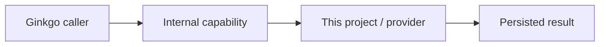

# Example Project

## TL;DR

Explain in 2–5 lines what it is and the decision-relevant takeaway.

## Why it matters

Why did Ginkgo save this? What problem might it solve better, cheaper or faster?

## Core capabilities

- Capability A
- Capability B
- Capability C

## Ginkgo use cases

### Use case 1

Describe a concrete use inside the ecosystem.

### Use case 2

Describe another realistic use.

## Architecture



Explain the boundary and ownership. Avoid vendor coupling where possible.

## Integration surface

| Surface | Available | Notes |
|---|---|---|
| API | unknown | |
| MCP | unknown | |
| CLI | unknown | |
| SDK | unknown | |
| Webhook | unknown | |
| Docker | unknown | |

## Build vs Buy vs Reference

Choose and explain:

- `build`
- `buy/use hosted`
- `self-host`
- `reference-only`
- `hybrid`

## Operational profile

Document:

- deployment requirements;
- CPU/GPU/RAM where material;
- expected maintenance;
- latency/throughput constraints;
- storage requirements;
- observability needs.

## Cost profile

Record current known pricing/usage model if verified. If it changes frequently, store the verification date and avoid hard-coding assumptions into downstream architecture.

## Security / privacy / licensing

Cover:

- what data leaves Ginkgo;
- secret requirements;
- permissions;
- licensing;
- supply-chain risks;
- sensitive-data concerns.

## Alternatives

| Alternative | Better when | Worse when |
|---|---|---|
| Alternative A | | |
| Alternative B | | |

## Ginkgo destination

```text
Canonical owner:
Promotion target:
Downstream consumers:
```

State clearly whether the technology itself should be integrated or only the underlying pattern reused.

## Sources and provenance

### Canonical sources

- Official repository/docs

### Discovery sources

- Clipping path / article / video that led to discovery

## Verification notes

Record what was actually verified and what remains unknown.

## Decision

```text
ADOPT NOW | EXPERIMENT | WATCH | REFERENCE | REJECT | ARCHIVE
```

Reason:
